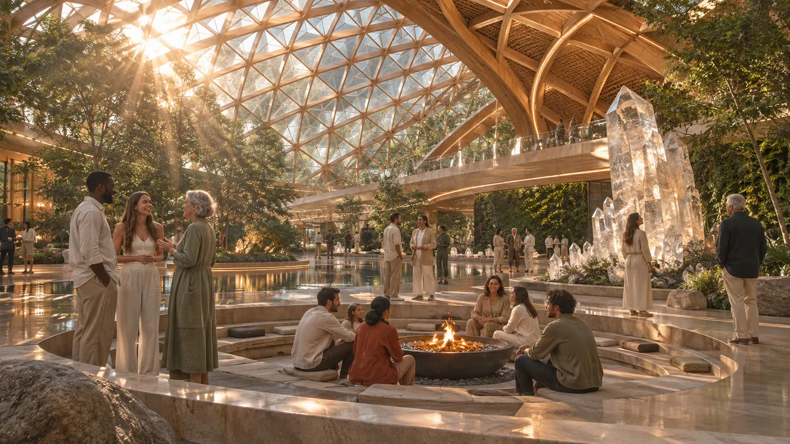
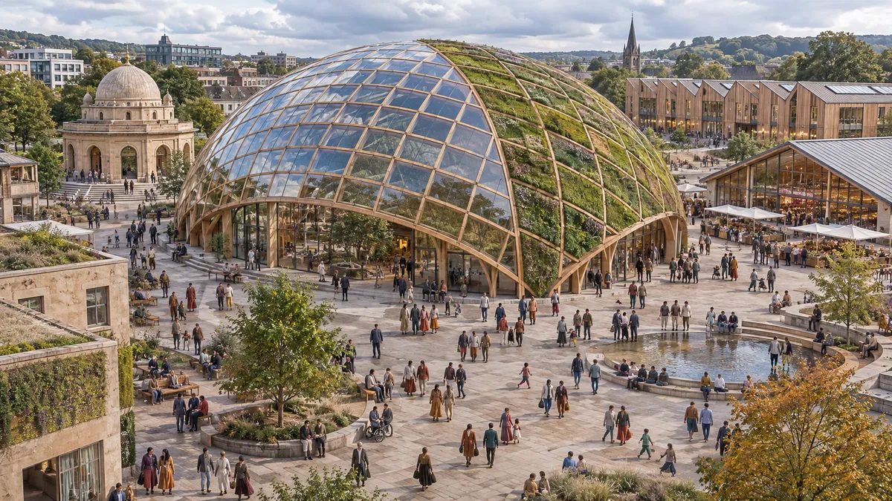
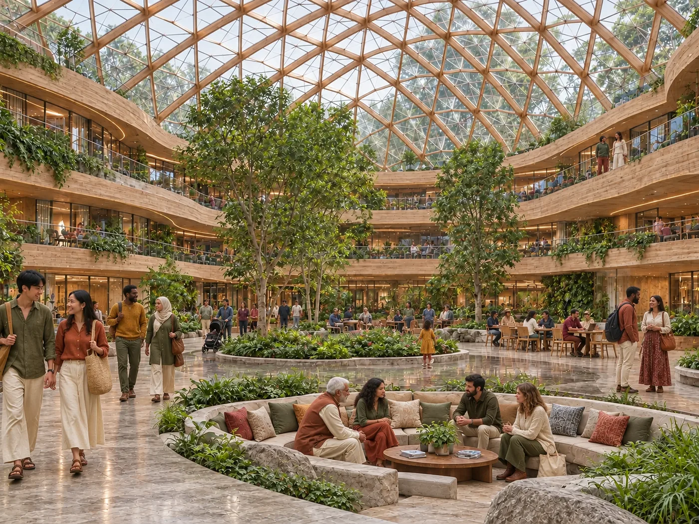
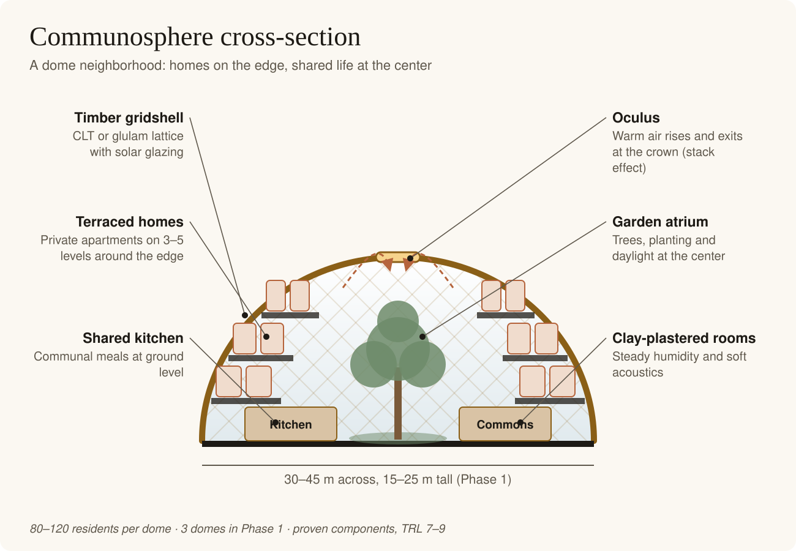
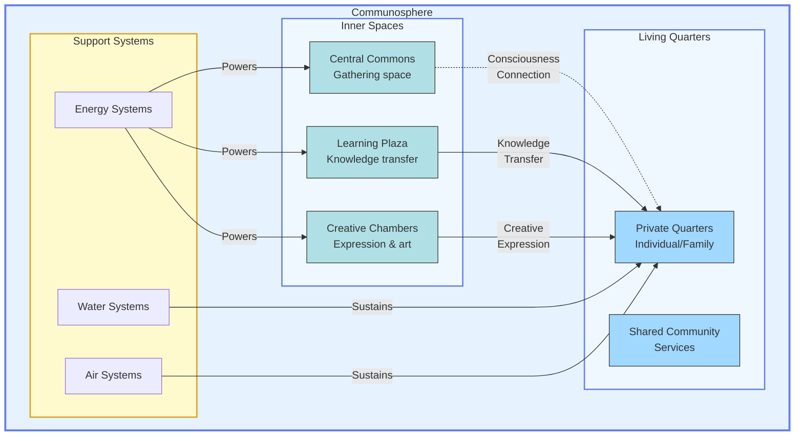

# Communospheres

*Shared timber domes where a community of about a hundred people lives, eats and gathers*

<figure>

<figcaption>Communosphere, 40 m</figcaption>
</figure>

<figure>

<figcaption>District communosphere, 80 m</figcaption>
</figure>

## Overview

A communosphere is a large shared dome with private homes inside or around it and common spaces at its heart. The source describes communospheres as spheres that hold a resonant frequency and keep their inhabitants consciously connected; on Earth we build the social and architectural idea and treat any wider effect as a research question.

**Origin**: The idea comes from the project's visionary source, which describes communospheres in Delphin, a city said to exist on another world. We treat that account as inspiration, not fact; it is kept on [The Archetype](/docs/concepts/the-archetype).

:::info Scale Clarification
**In the source** (visionary reference): spheres 600–1,200 ft across, each housing 10,000 people.

**Light City Scale** (Earth Implementation): Phase 1 domes are 30–45 m (100–150 ft) across and house 80–120 residents each, using proven technologies (timber gridshells, CLT, clay interiors, BIPV). See [Beyond the Box](/docs/design/organic-forms-and-materials) for forms and materials.
:::

### Visual Reference

How a Phase 1 communosphere could look: a timber gridshell dome with terraced homes around a garden atrium.

The original visionary images that inspired the idea are collected in [Architecture → Vision references](/docs/design/architecture#vision-references).

---

## Core Concept

A communosphere is:
- **Physical**: A large timber gridshell dome
- **Social**: A complete community living environment
- **Sensory**: A calm space shaped by light, acoustics and plants
- **Research**: A place to study, with consent, how shared space affects wellbeing

It is architecture first, and a living laboratory second.

## Key Characteristics

*Phase 1 cross-section: a 30–45 m timber gridshell, 15–25 m tall, with homes on 3–5 terraced levels, a garden atrium, shared kitchen and commons, clay-plastered rooms and a crown oculus for natural ventilation.*

### Physical Structure

**Shape**: Spherical (dome visible from exterior)

#### In the source (visionary reference)

The source describes mega-spheres 600–1,200 ft across, each a self-contained city of 10,000 people. We use the image only as a proportional guide; see [The Archetype](/docs/concepts/the-archetype).

#### Terrestrial prototype (Earth implementation)

**Phase 1 (built in Stage 5, Dec 2028 – Nov 2031)**: 3 geodesic domes
- **Size**: 30-45 m diameter (100-150 ft)
- **Height**: 3-5 levels, 15-25 m tall
- **Capacity**: 80-120 residents per dome
- **Total Phase 1**: 240-360 residents (target: 200)
- **Structure**: CLT (cross-laminated timber) + steel nodes, or tensegrity geodesic
- **Glazing**: BIPV (building-integrated photovoltaics) + insulated panels

**Phase 2 (mid-2030s, after Phase 1 proves out)**: 6-12 domes expansion
- **Size**: 45-60 m diameter (150-200 ft)
- **Capacity**: 120-200 residents per dome
- **Total in domes**: 720-2,400 residents (Village total 1,500-3,000 including ring housing)
- **Clustered**: Outer ring arrangement, connected by covered walkways

**Phase 3 (Long-term vision)**: 12+ domes
- **Size**: 60-90 m diameter (200-300 ft)
- **Capacity**: 200-400 residents per dome
- **Total in domes**: 2,400-4,800+ residents (Town total 8,000+ including ring housing)

**Construction** (Terrestrial):
- "Hooked in" to the ground—firmly anchored with deep foundations
- CLT (cross-laminated timber) or steel frame with geodesic geometry
- BIPV glazing + insulated panels (R-30+ walls, R-50+ roof)
- Designed to maintain acoustic resonance and biophilic environment

**Location**: Positioned around the city's outer ring(s)

### Energetic Function

**What the source describes**: the spire holds a base frequency, each communosphere maintains it, and inhabitants stay "consciously connected" through it.

**What we design and test** (research hypothesis, TRL 1-3):
1. Domes are tuned acoustically for calm, clear sound
2. Shared spaces are designed for gathering and quiet
3. Any effect on felt connection or wellbeing is studied with consent and protocols
4. **Note**: This is about acoustics and experience, NOT electrical power
5. **Physical power**: Provided by the microgrid (solar PV + batteries)

**Field Effects** (experiential hypotheses, not established science):
- Coherent acoustic and spatial environment
- Subjective sense of connection (to be studied with consent and protocols)
- Supports focus and shared learning (measurable where possible)
- No claim of “instant” knowledge transfer without evidence

### Social Structure

**Community Scale**: Complete self-sufficient communities

**Population**: 
- Phase 1: 80–120 people per dome
- Large enough for diversity and culture
- Small enough for genuine community
- Close to the size at which people can still know each other well

**Living Arrangement**:
- Multiple families/individuals per sphere
- Shared community spaces
- Private living quarters
- Integrated amenities and services

#### Communosphere Structure Diagram

---

### Shared Learning

**What the source describes**: in Delphin, "whatever they learn in some elevated knowledge form gets transferred to all of the spheres. So they all know the same thing."

**What we build**: ordinary ways to share knowledge well: open documentation, learning circles, mentoring and shared meals.

**Light City Research Approach**:
We treat "field-mediated learning" as a **testable hypothesis**:
- **Measurement**: Learning speed, retention, transfer, group coherence
- **Method**: Preregistered protocols, sham controls, third-party observers
- **Ethics**: IRB approval, informed consent, right to withdraw
- **Outcome**: Enhanced learning environments (not "instant download")
- **Status**: TRL 1-2 (early research, no claims of proven efficacy)

See [Energy Systems](/docs/concepts/energy-systems) for detailed research protocols.

## Applications to Light City

### Design Implications

**Layout**:
- Position communospheres in outer ring(s)
- Connect to the central spire along the radial paths
- Arrange in geometric pattern (circle, 12 positions, etc.)
- Pathways connecting to central area

**Number** (Phased Approach):
- **Phase 1**: 3 domes (200 residents target, 150-300 range)
- **Phase 2**: 6-12 domes (720-2,400 residents in domes; Village 1,500 target)
- **Phase 3**: 12+ domes (2,400-4,800+ residents in domes; Town 8,000+)
- **In the source**: 12 mega-spheres for 60,000–120,000 people, used only as inspiration

**Architecture**:
- Geodesic dome or sphere structure
- Timber, glass and local stone; an occasional natural quartz point placed as an accent, never as structure
- Semi-transparent to allow light
- Beautiful, inspiring design

### Energetic System

**Frequency Generation**:
- Central spire generates base frequency
- Distributed through geometric grid
- Each communosphere acts as receiver/amplifier
- Creates unified field across entire city

**Maintenance**:
- Passive system once established
- Self-regulating through geometry and materials
- Consciousness of inhabitants strengthens field
- Regular ceremonies/intentions to reinforce

### Social Organization

**Community Structure**:
- Each sphere develops its own culture within unity
- Self-governance at sphere level
- Connection to city-wide governance
- Balance of autonomy and unity

**Interaction**:
- Daily life primarily within sphere
- Journey to center for ceremonies, work, learning
- Inter-sphere connection and visiting
- Maintained awareness of whole while living in part

### Practical Considerations

**Services Within Sphere**:
- Food preparation and dining
- Basic healthcare
- Recreation and gathering spaces
- Creative studios
- Small-scale gardens
- Childcare and education

**Services Requiring Central Access**:
- Advanced learning centers
- Major ceremonies and gatherings
- Specialized healing temples
- Large-scale production
- Administration and coordination

## Comparison to Other Models

### vs. Traditional Neighborhoods
- **Traditional**: Geographic proximity, limited connection
- **Communosphere**: Energetic connection, conscious unity

### vs. Intentional Communities
- **Intentional**: Shared values, some connection
- **Communosphere**: Shared consciousness field, deep connection

### vs. Apartment Buildings
- **Apartments**: Isolated units in shared structure
- **Communosphere**: Connected beings in unified field

## Technical Specifications

### Size Calculations

**For 10,000 People**:
- Assume 400-600 sq ft per person average
- Total: 4-6 million sq ft
- Multi-level structure: 5-10 levels
- Per level: 500,000-1,200,000 sq ft
- Diameter (rough): 800-1,200 feet
- Height: 400-600 feet

**Variation by Population**:
- 5,000 people: ~600-900 ft diameter
- 7,500 people: ~700-1,000 ft diameter
- 10,000 people: ~800-1,200 ft diameter

### Materials Research Needed

**Properties Required**:
- Structural strength for large sphere
- Resonance-maintaining characteristics
- Light transmission/refraction
- Energetic coherence
- Durability and longevity
- Beauty and inspiration

**Candidate Materials**:
- Crystal (quartz, others)
- Advanced glass/ceramics
- Crystalline metals
- Biomaterials
- Composite structures
- Frequency-tuned materials

## Construction Approach

### Physical Construction

**Method 1: Geodesic Dome Principles**
- Triangulated structure for strength
- Modular construction
- Scalable to large sizes
- Proven technology (Buckminster Fuller)

**Method 2: Advanced Materials**
- Self-assembling materials
- Crystalline growth processes
- Consciousness-directed construction
- Hybrid biological-technological

**Method 3: Staged Construction**
- Begin with foundation and frame
- Build floor by floor
- Install systems progressively
- Activate energetically when complete

### Energetic Activation

**Process**:
1. Complete physical structure
2. Install crystal/resonance technology
3. Connect to central spire grid
4. Ceremony to activate field
5. Gradual population as field stabilizes
6. Conscious intention strengthens over time

## Living Experience

### Daily Life in a Communosphere

**Morning**:
- Wake in resonant field—natural alignment
- Shared breakfast with neighbors
- Check in with collective awareness
- Choose day's activities

**Daytime**:
- Work or create within sphere or journey to center
- Learning happens spontaneously through field
- Collaboration flows naturally from connection
- Children learn through play and presence

**Evening**:
- Community gathering or quiet reflection
- Share meals and experiences
- Ceremony or celebration
- Rest in coherent field

### Personal Space vs. Collective

**Balance**:
- Private living quarters for individuals/families
- Shared common areas for community
- Both honor personal needs and collective connection
- Conscious choice of engagement level

## Challenges and Considerations

### Potential Issues

1. **Privacy**: How much is possible/desirable in unified field?
2. **Individuality**: Maintaining unique expression within unity
3. **Scale**: Finding optimal size for connection and autonomy
4. **Technology**: Developing resonance-maintaining systems
5. **Materials**: Sourcing or creating appropriate materials
6. **Cost**: Significant investment for each sphere

### Solutions to Explore

1. **Privacy**: Different field intensity zones within sphere
2. **Individuality**: unity includes diversity
3. **Scale**: Test with smaller prototypes, scale up
4. **Technology**: Research crystal energy, sacred geometry
5. **Materials**: Phased approach—start simple, upgrade
6. **Cost**: Community investment, phased construction

## Research Priorities

### Immediate (Stage 1-2)
- [ ] Design initial communosphere concept
- [ ] Determine appropriate scale for Light City
- [ ] Research resonance and frequency technologies
- [ ] Study geodesic dome construction
- [ ] Explore material options

### Near-term (Stage 3-4)
- [ ] Create detailed architectural plans
- [ ] Develop resonance system specifications
- [ ] Design interior layouts
- [ ] Plan community structure within spheres
- [ ] Prototype small-scale resonance chamber

### Long-term (Stage 5-6)
- [ ] Construct first communosphere
- [ ] Test and refine resonance systems
- [ ] Establish first community
- [ ] Document living experience
- [ ] Build additional spheres

## Connection to Other Concepts

### Related Documents
- [Architecture](/docs/design/architecture) - Overall city design
- [Sacred Geometry](/docs/concepts/sacred-geometry) - Sphere significance
- [Energy Systems](/docs/concepts/energy-systems) - Resonance technology
- [Core Concepts](/docs/concepts/core-concepts) - Shared values
- [The Archetype](/docs/concepts/the-archetype) - The visionary source

### Integration Points
- Communospheres are key component of Light City layout
- They put shared living and care into built form
- They demonstrate sacred geometry (sphere, perfect form)
- They integrate spiritual and practical

## Inspiration and Evidence

The communosphere idea comes from the project's visionary source, which describes it as already built in Delphin ([The Archetype](/docs/concepts/the-archetype)). We do not treat that as evidence. What we can point to on Earth:

1. **Shared domes work as buildings**: timber gridshells and geodesic domes stand around the world ([Beyond the Box](/docs/design/organic-forms-and-materials)).
2. **Shared living works at this scale**: co-housing and ecovillages of 100–500 people, such as Findhorn and Sieben Linden, have lasted for decades ([Bibliography](/docs/research/bibliography)).
3. **The rest is research**: any effect of shared space on wellbeing or connection is measured with consent ([Open Questions](/docs/research/open-questions)).

---

**Status**: Scale-clarified, investor-ready framework  
**Version**: 2.0 (Scale Separation)  
**Last reviewed**: November 2026  
**Last Reviewed**: November 14, 2025  
**Priority**: High - Core architectural component  
**Next Steps**: Integrate into architecture.md, develop detailed designs

**Related Documents**: 
- [Architecture](/docs/design/architecture) - Physical implementation and specifications
- [Energy Systems](/docs/concepts/energy-systems) - Resonance technology and research protocols
- [Development Stages](/docs/project/development-stages) - Timeline and phasing
- [Technology Catalog](/docs/technical/technology-catalog) - Proven technologies (CLT, geodesic, BIPV)

