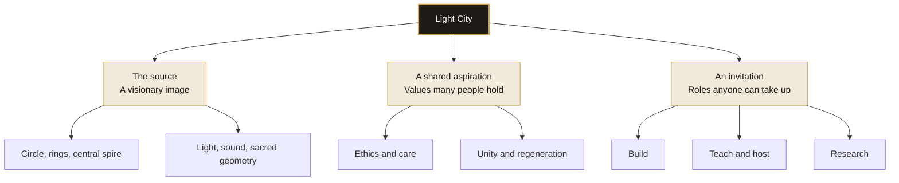

# Core Concepts

This document outlines the foundational concepts and principles of the Light City project.

:::info Scope & Framing
This page translates the project's visionary source into plain design intent. Where it refers to the source, it says so; the full account is on [The Archetype](/docs/concepts/the-archetype). **All physical infrastructure on Earth follows standard engineering, permitting, and safety practices.** For implementation details, see [Architecture](/docs/design/architecture), [Energy Systems](/docs/concepts/energy-systems), and [Development Stages](/docs/project/development-stages).
:::

## Vision

:::tip How to Read This Page
This is a **conceptual primer**. Read anything attributed to "the source" as **design intent**, not a claim of fact; take implementation details from the **Architecture**, **Development Stages**, and **Energy Systems** pages. Where claims could be controversial, we tag them as **hypotheses** and defer to peer-reviewed evidence.
:::

:::note Light City in one breath
A 200-resident pilot hamlet of three timber-and-glass domes around a 90 m crystal spire of solar glass, built in Stage 5 (Dec 2028 – Nov 2031) for about $45M, then growing into a 1,500-person village and an 8,000+ person town. Every number lives on [At a Glance](/docs/at-a-glance). How people journey from today's life into this future is described in [The Transition](/docs/concepts/the-transition).
:::

The original visions that sparked this project are shown once, in [Architecture → Vision references](/docs/design/architecture#vision-references).

---

## What is Light City?

Light City is three things at once. Each is useful on its own, and none asks you to adopt a belief.

### 1. The source: a visionary image

The source describes Light City as an "etheric blueprint", a pattern sensed in meditation and vision: white-gold crystalline buildings, a soft harmonic tone, a circular plan with a central spire. We use that image as a **design brief**, not as a claim about reality. The circle, rings, radial paths, spire and the care for light and sound all carry into the Earth design. The full account, including the off-world city of Delphin, is on [The Archetype](/docs/concepts/the-archetype).

### 2. A shared aspiration

Light City is also a picture of how people could live together:

- **Ethics**: decisions made for the common good, in the open.
- **Compassion**: care and empathy as everyday practice.
- **Unity**: a sense that people, land and other living things are connected.

It is not a utopia (literally "no place"). It is a choice a group of people can make, test and improve.

### 3. An invitation

Many people feel drawn to help build something like this. There are many ways in:

- **Building**: structures, energy, water, food and the institutions that run them.
- **Teaching and hosting**: retreats, workshops, hospitality, care.
- **Research**: measuring what works, including honest tests of the bolder ideas.

> *"To build it on Terra, begin building it in hearts. Structures follow spirit."*, from the source

## Core Principles

### 1. Spirit Before Structure

**Principle**: Values and community come before buildings.

Before we build, a founding group lives by the principles together: retreats, a residency pilot and shared decisions. If the community does not work at small scale, no amount of construction will fix it.

**Application**: The project began with documentation, values and governance, not construction. Building starts only when the stage gates are passed (see [Development Stages](/docs/project/development-stages#stage-gate-checklist)). Spiritual practice is always optional.

### 2. Listen to the Land

**Principle**: The plan adapts to the place, not the other way round.

The source speaks of a pattern held in "Gaia's memory". On Earth we translate that as listening: to the land's water, soil, climate and wildlife, and to the people and cultures already there.

**Application**: Site selection starts with water, risk and community conversations before any purchase (see [Site Locations](/docs/project/site-locations)). The final plan follows the land's contours and aims to leave more habitat than it found.

### 3. Collective Co-Creation

**Principle**: Light City grows through collaboration, not one person's control.

This is not one person's vision imposed on others, but:
- A shared aspiration that many hold
- Co-created through collaboration and contribution
- Governed with transparent, consent-based decisions
- Open to diverse traditions and expressions within shared principles

**Application**: This project welcomes contributions, variations and dissent. Governance moves from founder-led to community-led as the project grows (see [Governance](/docs/project/governance)).

### 4. Whole-Person Design

**Principle**: Design for body, mind, relationships and meaning, not only shelter.

A good place to live works on several levels:
- **Physical**: healthy materials, daylight, clean air and water
- **Sensory**: light, sound, geometry and nature that feel good to be in
- **Mental**: learning, documentation and clear plans
- **Social**: shared meals, councils and celebrations
- **Meaning**: room for reflection and, for those who want it, spiritual practice

**Application**: Each level has its own pages: [Beyond the Box](/docs/design/organic-forms-and-materials), [Light on the Land](/docs/design/light-on-the-land), [Governance](/docs/project/governance) and [Open Questions](/docs/research/open-questions).

### 5. Regenerative Living

**Principle**: Leave people and land better off than we found them.

This means:
- Decisions made for the common good rather than narrow interest
- Sharing and sufficiency rather than scarcity thinking
- Collaboration rather than competition
- Service rather than exploitation
- Regeneration rather than extraction

**Application**: Practice these principles now, in current life and in the founding circle. The ecological targets are published and measured (see [Energy Systems](/docs/concepts/energy-systems)).

## The Architecture of Light

### What the source describes

**Materials**: crystalline, semi-transparent, white-gold structures that refract light into rainbows.

**Layout**:
- **Circular design** with concentric rings
- **Central spire** described as a hub between Earth and cosmos and an axis mundi
- **Radial pathways** connecting center to edge
- **Sacred geometry** underlying the whole design

**Atmosphere**: the city "hums" with harmonic resonance, and light and sound work together.

### What we build

- **Materials**: timber, glass, clay and local stone, with warm, shielded light at night ([Beyond the Box](/docs/design/organic-forms-and-materials), [Light on the Land](/docs/design/light-on-the-land)).
- **Layout**: the same circle, five rings and 12 radial paths around a 90–240 m crystal spire ([Architecture → Circular form](/docs/design/architecture#circular-form)).
- **Atmosphere**: acoustics, daylight and gardens designed for calm. Any effect on wellbeing is a research question, measured with consent ([Open Questions](/docs/research/open-questions)).

> **Terminology:** where older pages say "energetic", they mean **experiential** (light, sound, a sense of connection), not electrical. **Electrical power** comes from a renewable **microgrid** (solar, batteries, renewable backup); see [Energy Systems](/docs/concepts/energy-systems).

### Purpose

The source describes the city as a meeting point between worlds (see [The Archetype](/docs/concepts/the-archetype#a-meeting-point-between-worlds)). On Earth its purpose is:

- A place to live well with a small footprint
- A healing, retreat and learning center
- A demonstration that regenerative communities can be financed and governed in the open
- A model others can copy or adapt to existing towns ([Urban Retrofit Guide](/docs/technical/urban-retrofit-guide))

## Key Questions

### Is Light City guaranteed?

**No.** It is a plan with stage gates, not a certainty. It happens only if enough people commit their skills, time and money, and if each stage proves itself before the next.

> **Your contribution** (skills, stewardship, research, resources) is what turns the vision into buildable plans. This is an invitation, not a guarantee.

### How do we build it?

**Three kinds of work, in parallel:**

1. **Community work**: forming a founding circle that can live and decide together.
2. **Design and documentation**: plans, numbers and research, published openly.
3. **Construction**: when the community, the site and the funding are ready.

The common failure is rushing to construction before the first two are in place.

### Where does it exist?

- **Today**: in this documentation, the 3D model and the founding circle.
- **Next**: on a site still to be chosen (see [Site Locations](/docs/project/site-locations)).
- **As an idea**: in any community that adopts the principles, including existing towns.

The source also describes the city as existing in a non-physical realm and on another world. That account is on [The Archetype](/docs/concepts/the-archetype); nothing in the plan depends on it.

### Who is it for?

**Anyone who:**
- Wants to live more lightly and more connected
- Is drawn to the vision, or simply to the design and the community
- Wants to help prove a better way of building and living
- Values both practical skill and inner life

You do not need to share any spiritual belief. See [Living Here, Honestly](/trust).

## Relation to Other Ideas

Light City draws on and connects to:

- **Sacred architecture**: temples and gathering places designed to lift the spirit
- **Intentional communities and ecovillages**: Findhorn, Sieben Linden, Auroville, Twin Oaks and others, plus visionary city projects such as The Venus Project and Arcosanti ([Similar Movements](/docs/research/similar-movements))
- **Biophilic and regenerative design**: buildings that work with nature
- **Contemplative traditions**: practices of attention, compassion and service, offered with credit and respect
- **Spiritual movements** such as "New Earth" and "ascension", which some contributors draw on; see [The Archetype](/docs/concepts/the-archetype#new-earth-5d-and-ascension)

## Living Questions

These questions guide ongoing exploration:

1. What specific principles should govern Light City?
2. What would daily life look like in Light City?
3. How do we prepare ourselves to live well together?
4. What technologies (ancient and modern) support the vision?
5. How do we handle governance, resources, and decisions?
6. What role does Light City play in humanity's larger story?
7. How do different cultural traditions inform the vision?

---

## Next Steps

To deepen your understanding:

1. Read [Philosophy](/docs/concepts/philosophy) for deeper conceptual exploration, and [The Archetype](/docs/concepts/the-archetype) for the visionary source
2. Explore [Architecture](/docs/design/architecture) for physical/energetic design
3. Review [Purpose and Mission](/docs/concepts/purpose-and-mission) for project goals
4. Study [Sacred Geometry](/docs/concepts/sacred-geometry) for underlying patterns

### Next Actions by Role

**If you're a builder/engineer:**
- Jump to [Development Stages](/docs/project/development-stages) to see gates, TRLs, and budgets
- Review [Technology Catalog](/docs/technical/technology-catalog) for proven technologies
- Check [Architecture](/docs/design/architecture) for specifications and phasing

**If you're a researcher/experience curator:**
- See [Energy Systems](/docs/concepts/energy-systems) for metrology, ethics, and consent UI
- Explore measurement protocols and research hygiene standards
- Review IRB requirements and human-subject research frameworks

**If you're an architect/designer:**
- Study [Architecture](/docs/design/architecture) for scale, heights, and typologies
- Review [Sacred Geometry](/docs/concepts/sacred-geometry) for design principles
- Check [Visual Language](/docs/design/visual-language) for design tokens

**If you're interested in urban retrofits:**
- See [Urban Retrofit Guide](/docs/technical/urban-retrofit-guide) for applying Light City principles to existing cities
- Review policy interventions, district strategies, and building-level upgrades

---

**Last reviewed**: November 16, 2026  
**Owner**: Core Team  
**Related**: [Architecture](/docs/design/architecture), [Energy Systems](/docs/concepts/energy-systems), [Development Stages](/docs/project/development-stages)

---

**[Edit this page on GitHub](https://github.com/szemkoff/light-city-project/edit/main/website/docs/concepts/core-concepts.md)** | **[Project updates](/blog)**  
**Related Documents**: [Philosophy](/docs/concepts/philosophy), [Architecture](/docs/design/architecture), [Development Stages](/docs/project/development-stages)

