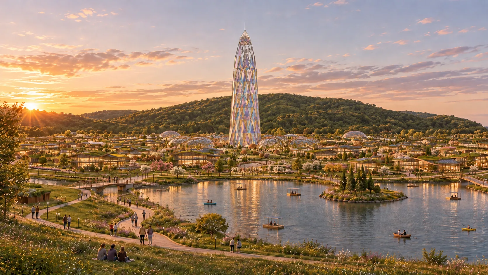
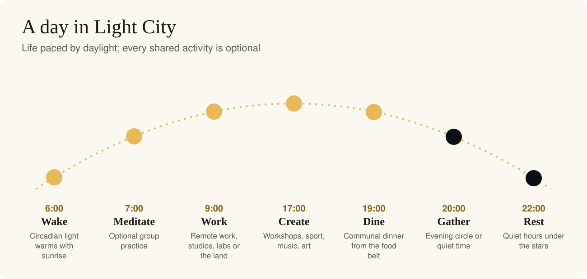

# Purpose and Mission

*Light City as we plan to build it: a 200-person hamlet of timber domes, gardens and a solar spire.*

## Project Purpose

The Light City project exists to:

### 1. Anchor the Vision
Translate the project's visionary source (the "etheric blueprint" it describes; see [The Archetype](/docs/concepts/the-archetype)) into documented, shareable plans that anyone can read and test.

### 2. Create a Blueprint
Develop documentation that can guide the whole project: its values, design, technology, finance and community life.

### 3. Inspire and Catalyze
Spark the imagination of people who want to help build better ways of living.

### 4. Build Community
Connect those who hold similar visions and facilitate collaborative co-creation.

### 5. Demonstrate Principles
Live the values and practices Light City stands for while we document them, starting with the founding circle.

### 6. Bridge Vision and Practice
Create tangible connections between:
- Inspiration and practical action
- Individual calling and collective work
- An idea on paper and a place people can live

## From purpose to practice

These purposes unfold as five movements: **Awakening, Gathering, Founding, Flourishing, Radiating**. Each is tied to a project stage and to measurable outcomes. See [The Transition](/docs/concepts/the-transition).

## Mission Statement

**To document, develop and build Light City as a living example of a regenerative, caring and open community, showing that it can be designed, financed and governed in the open.**

## Specific Goals

### Short-Term (Q4 2025 - Q2 2027: Stages 1-2)

**Timeline**: October 2025 - June 2027 (Stage 1 extended; Stage 2 Jan-Jun 2027)  
**Current Status**: Finishing Stage 1 (as of Nov 16, 2026)

1. **Complete Foundational Documentation**
   - Core concepts fully articulated
   - Philosophical framework established
   - Architectural vision documented

2. **Establish Visual Identity**
   - Concept art created
   - Architectural sketches developed
   - Symbolic system defined

3. **Create Project Infrastructure**
   - Clear organization established
   - Tools and workflows defined
   - Standards and guidelines set

### Medium-Term (Q3 2027 - Q4 2028: Stages 3-4)

**Timeline**: July 2027 - November 2028 (17 months)

1. **Build Digital Presence**
   - Website or digital platform launched
   - Documentation publicly accessible
   - Interactive experiences created

2. **Grow Community**
   - Connect with resonant individuals
   - Establish collaborative spaces
   - Facilitate co-creation

3. **Expand the Vision**
   - Deepen documentation based on collective input
   - Develop specific aspects in detail
   - Create educational materials

### Long-Term (Dec 2028 – 2032+: Stages 5-6)

**Timeline**: December 2028 - 2032+ (3+ years)  
**Stage 5**: Physical build (18-36 months)  
**Stage 6**: Operations and evolution (ongoing)

1. **Physical Build**
   - Choose and secure a site
   - Create pilot projects or installations
   - Establish physical community spaces

2. **Become Living System**
   - Self-sustaining operations
   - Continuous evolution
   - Replication and scaling

3. **Serve Larger Movement**
   - Inspire other Light City initiatives
   - Support similar projects and urban retrofits
   - Share learnings and frameworks

The six-stage roadmap diagram, from vision to a thriving city, is in [Development Stages](/docs/project/development-stages).

*A typical 24-hour cycle in Light City - flowing with natural rhythms, balancing solitude and community.*

## Who This Serves

### Primary Beneficiaries

1. **Visionaries and Builders**
   - Those who want to create new ways of living
   - People seeking practical frameworks for big ideas
   - Individuals ready to take part in building a community

2. **Seekers and Students**
   - Those exploring contemplative practice and community
   - People interested in sacred architecture
   - Anyone drawn to the Light City concept

3. **Future Humanity**
   - Coming generations who will inherit our work
   - Communities that adapt what we learn
   - The land and its living systems, which we aim to restore

### Indirect Beneficiaries

1. **The Wider Movement**
   - Adding a well-documented example to the regenerative movement
   - Sharing open data, including what fails
   - Showing that spiritual inspiration and engineering rigor can work together

2. **Other Projects**
   - Providing frameworks others can adapt
   - Inspiring parallel initiatives
   - Contributing to broader movement

## Success Metrics

### Qualitative Measures

- **Resonance**: Does the vision ring true and inspire?
- **Clarity**: Is the vision clearly articulated and accessible?
- **Embodiment**: Are we living the principles we document?
- **Impact**: Are people activated and inspired by the work?
- **Evolution**: Is the vision deepening and expanding organically?

### Quantitative Measures (Later Stages)

- Documentation completeness
- Community size and engagement
- Digital reach and impact
- Physical implementations
- Resources and sustainability

## Principles of Operation

### How We Work

1. **Inspired, then tested**: Welcome inspiration, then check it against evidence
2. **Quality-Focused**: Depth over speed, excellence over quantity
3. **Inclusive**: Welcome diverse contributions and perspectives
4. **Transparent**: Open documentation and decision-making
5. **Sustainable**: Build for long-term viability
6. **Evolutionary**: Adapt and grow with emerging understanding

### What We Avoid

1. **Ego-Driven**: Not about personal glory or control
2. **Dogmatic**: Not claiming exclusive truth
3. **Rushed**: Not building before each stage gate is passed
4. **Exploitative**: Not extracting from community or Earth
5. **Rigid**: Not clinging to fixed forms
6. **Disconnected**: Not losing sight of why we started

## Relationship to Other Movements

Light City is:

- **Complementary** to other ecovillages, co-housing and regenerative projects
- **Part of** a wider movement toward low-impact, connected living
- **Unique** in its specific vision and expression
- **Open** to learning from others, including spiritual and secular traditions

It is not:
- **Exclusive** or claiming to be "the only way"
- **Competitive** with other visions
- **Isolated** from larger movements

## Timeline Philosophy

We prefer:
- **Readiness** over urgency: each stage starts only when the last one passes its gate
- **Honest dates** over hopeful ones: when a stage runs late, the timeline is updated in public
- **Quality** over speed

The dated plan is in [Development Stages](/docs/project/development-stages).

## Call to Action

This project invites you to:

1. **Read** the plan and question it
2. **Find** your role: building, hosting, research, funding or simply following along
3. **Contribute** your skills and time
4. **Practice** the principles in your own life
5. **Co-create** the first community with us

---

## Alignment Check

Use these questions to ensure ongoing alignment:

- Does this work serve the project's purpose?
- Am I acting with care for everyone affected?
- Is this the best we can do with what we know?
- Does this honor all beings?
- Am I building in hearts as well as structures?

---

**Version**: 2.0 (Timeline Aligned)  
**Last reviewed**: November 2026  
**Last Reviewed**: November 14, 2025  
**Related**: [Core Concepts](core-concepts.md), [Philosophy](philosophy.md), [Development Stages](../project/development-stages.md)

