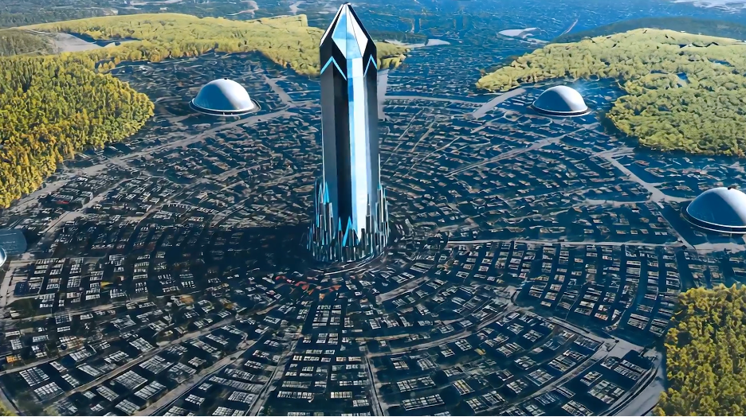

# The Archetype: Where the Idea Came From

:::caution Inspiration, not a claim of fact
This page describes the visionary source of Light City in its own terms. It is shared for transparency and as design inspiration. It is **not** a claim that any of it is literally true, and nothing in the business case, the engineering or the research depends on it. You do not need to accept any of it to live, work or invest in Light City.
:::

Light City began as a vision. Its founder and others describe receiving it through meditation, inspired imagery and channeled (mediumistic) sources. We keep that material here, in one place, so that every other page can speak plainly about what we will build and what we will test.

The rest of the library uses a simple voice for this material: **"the source describes…"**. When you read that phrase elsewhere, this page is where the full account lives.

## What the source describes

### An "etheric blueprint"

The source describes Light City as a pattern that already exists in a non-physical, "higher-dimensional" realm, sometimes called Earth's memory, "Gaia's memory" or the Akashic field. In this account the city is remembered and anchored rather than invented, and many people who sense it share the same core images:

- white-gold, semi-transparent crystalline architecture that refracts light;
- a soft harmonic tone, like layered singing bowls;
- a circular plan with a central spire as a hub between Earth and cosmos;
- radial paths and concentric rings built on sacred geometry.

**How we use it:** as a design brief. The circle, rings, radial paths, central spire and the quality of light and sound are all in the Earth design. "Crystal" becomes timber, glass and clay; "harmonic tone" becomes acoustics. See [Architecture](/docs/design/architecture) and [Light on the Land](/docs/design/light-on-the-land).

### Delphin, a city on another world

Contact accounts describe **Delphin** as a crystal city that already exists on a planet the source calls "Israel", in another star system. In these accounts:

- a **40,000-foot (about 12 km) crystal spire** generates power and a "consciousness frequency";
- twelve **communospheres**, spheres 600–1,200 ft across, each house about 10,000 people (60,000–120,000 in all);
- a **knowledge-transfer system** shares what one person learns with everyone: "whatever they learn in some elevated knowledge form gets transferred to all of the spheres";
- all inhabitants share a **unified field of consciousness**.

The source presents Delphin as proof that the Light City pattern is real and already built elsewhere. We do not. There is no evidence for Delphin, and we treat it as a mythic or visionary image.

**How we use it:** the communosphere idea (people living around a shared dome) and the spire-and-spheres plan come from here. The Earth versions are a 90–240 m crystal spire of glass and steel built in sections and 30–90 m timber gridshell domes. See [Communospheres](/docs/concepts/communospheres).

*Delphin, as imagined from the contact accounts. Visionary archetype art, not a real place or a design.*

### A meeting point between worlds

The source describes the city's purpose as a **convergence point** between awakened humanity, "higher consciousness", visiting benevolent extraterrestrial civilizations, Earth's "crystalline grid" and cosmic energies. It speaks of an "embassy for consciousness exchange" and an "anchor point for new Earth frequencies".

**How we use it:** the Earth version is a place for learning, retreats, healing practices and hospitality, open to visitors from anywhere. Claims about extraterrestrial contact play no part in the plan.

### New Earth, 5D and ascension

The source places Light City within a wider spiritual story: a "New Earth" timeline, "5D consciousness" (unity and heart-centered living), personal and collective "ascension", and humanity's place in a "galactic family".

**How we use it:** we keep the values in that story (unity, compassion, service, regeneration) and leave the cosmology to each person. Spiritual practice in Light City is always optional; see [Living Here, Honestly](/trust).

## How the archetype is translated

| The source describes | What we build or do on Earth | Where |
|---|---|---|
| A crystal city of white-gold light | Timber, glass and clay buildings with warm, shielded light | [Architecture](/docs/design/architecture), [Light on the Land](/docs/design/light-on-the-land) |
| A 40,000 ft crystal spire that makes power | A 90–240 m crystal of solar glass on a steel diagrid, with a wind crown and an enclosed observatory; its power is a supplement, not the city's supply | [The central spire](/docs/design/architecture#the-central-spire) |
| Communospheres 600–1,200 ft across for 10,000 people | Timber gridshell domes 30–90 m across; a Phase 1 dome is shared by 80–120 residents | [Communospheres](/docs/concepts/communospheres) |
| A unified consciousness field and knowledge transfer | Shared meals, councils, open documentation, and optional, consent-based research on group practice | [Governance](/docs/project/governance), [Open Questions](/docs/research/open-questions) |
| An etheric blueprint remembered from Earth's memory | A plan shaped by the chosen land: its water, soil, climate and the people who already live there | [Site Locations](/docs/project/site-locations) |
| A convergence point with other civilizations | A retreat and learning center open to visitors | [Development Stages](/docs/project/development-stages) |

## Claims we test, not assume

Some ideas from the source can be turned into testable questions, for example whether group practice inside a dome changes physiological synchrony. These are listed with honest readiness levels (TRL 1–3) in [Open Questions](/docs/research/open-questions#d-frontier-questions-study-openly-never-depend-on) and [Technology Horizon](/docs/technical/technology-horizon). They are studied openly, with consent, and never carry the business case.

## Why keep this page at all

Because hiding where an idea came from is worse than stating it plainly. People who are moved by the vision can read it in full here. People who are not can skip it and lose nothing: everything that matters for living in, building or funding Light City is on the other pages.

---

**Last reviewed**: November 16, 2026
**Related**: [Philosophy](/docs/concepts/philosophy), [Core Concepts](/docs/concepts/core-concepts), [Architecture → Vision references](/docs/design/architecture#vision-references)
