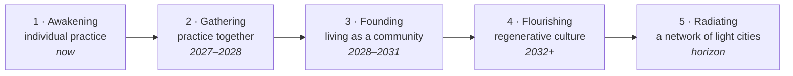

# The Transition

**From today's world to the Light City future, one livable step at a time.**

Most utopias fail because they ask people to make a leap: drop everything, move somewhere unproven and become a different person overnight. Light City takes the opposite approach. The future is reached through a **sequence of small, voluntary, reversible steps**. Each one is worthwhile on its own terms, whether or not the next one happens.

This chapter connects the inner journey (how people grow in awareness, connection and purpose) with the outer journey (the buildings, technology and governance that support it). Each step is mapped onto the [development stages](/docs/project/development-stages).

:::info How we hold the vision
The long-term vision of Light City comes from a visionary source (see [The Archetype](/docs/concepts/the-archetype)). We treat that vision as a **direction, not a prediction**. The steps below rely only on what is achievable now. Wherever a step depends on an unproven idea, we call it a hypothesis and describe how we will test it.
:::

## The five movements

| Movement | Inner shift | Outer form | Project stage | When |
|---|---|---|---|---|
| **1. Awakening** | From distraction to attention | Personal practice, the library, online circles | S1–S3 | Now – 2027 |
| **2. Gathering** | From "me" to "we" | Retreats, residency pilots, a founding circle | S4 | 2027 – 2028 |
| **3. Founding** | From ideals to shared daily life | Pilot Hamlet construction and first residents | S5 | 2028 – 2031 |
| **4. Flourishing** | From survival to contribution | Living Phase 1, education, open research | S6 | 2032+ |
| **5. Radiating** | From one place to a pattern | Village, Town, replication, urban retrofits | Phase 2–3 | 2035+ |

---

## 1. Awakening — attention as the first technology

**Inner shift.** Every transition begins with a person who notices their own mind. The first "technology" of Light City is not a building. It is the daily habit of attention: meditation, breathwork, time in nature, honest reflection.

**Why this is realistic.** The evidence for contemplative practice is modest but solid. Recent meta-analyses of randomized trials find that mindfulness-based programs produce small-to-moderate reductions in depression, anxiety and stress, with eight-to-twelve-week programs performing best ([PMC systematic review, 2026](https://pmc.ncbi.nlm.nih.gov/articles/PMC12984879/); [PubMed meta-analysis of university students](https://pubmed.ncbi.nlm.nih.gov/38146476/)). Mind-body movement such as yoga, tai chi and qigong shows similar or larger effects ([PMC, 2026](https://pmc.ncbi.nlm.nih.gov/articles/PMC12786122/)). That is enough to justify a practice culture. It is not a miracle cure, and we never present it as one.

**Outer form (now).**
- This open library and website, so the vision is free to explore.
- A simple practice path: daily sitting, weekly nature time, monthly reflection with others.
- Online circles and a mailing list for people drawn to the project.

**Enabling technology.** Heart-rate variability (HRV) biofeedback has the strongest evidence among consumer wellness tools. Wearable EEG headsets are improving, but the evidence for them is still emerging ([Wearable Wellness Guide](https://wearablewellnessguide.com/wearable-stress-tracking/stress-trackers)). We recommend devices as optional mirrors, never as scorecards. Researchers have warned that meditation wearables can end up rewarding proxy signals instead of real change ([arXiv, 2026](https://arxiv.org/abs/2605.28223)).

**What we measure.** Participation and self-reported wellbeing, using validated scales such as WHO-5 and the Perceived Stress Scale.

---

## 2. Gathering — practicing together

**Inner shift.** From private growth to shared growth. People discover that coherence, which we use to mean a felt sense of attunement, trust and shared purpose, grows fastest in a group that meets regularly.

**Why this is realistic.** Research on intentional communities shows that about half collapse within two years. The survivors share a **common vision** and a working way to resolve conflict, usually some form of consensus ([Metcalf, Rachel Carson Center](https://rachelcarsoncenter.ub.uni-muenchen.de/perspectives/issue/download/178/24)). Studies of present-day communities find that decision-making structure predicts success more than any other factor ([Academia.edu study of living ICs](https://www.academia.edu/120266752/Measuring_Success_in_Intentional_Communities_A_Critical_Evaluation_of_Commitment_and_Longevity_Theories)). Trial membership periods and adapting the organization after challenges also predict long-term survival ([Durability of Collective Action](https://www.academia.edu/66624398/The_Durability_of_Collective_Action_When_do_Intentional_Communities_Survive_Challenges)). So in this movement we rehearse governance before we pour concrete.

**Outer form (Stage 4, Dec 2027 – Nov 2028).**
- Seasonal retreats at rented venues to test programs, food, rhythms and facilitation.
- [Contribution-based residency](/docs/project/contribution-based-residency) pilots in 2027–2028.
- A **founding circle** of 150+ committed future residents (the Stage 4 gate).
- The [governance](/docs/project/governance) model practiced for real: sociocracy-style circles, 80% consent and clear conflict pathways.

**Enabling technology.** Digital-twin previews of the site and domes built in Stage 3 (Digital), so people can "walk" the future before it exists. Collaborative decision tools. Community-owned data.

**What we measure.** Retention across retreats, conflict resolution time, trust and belonging scores, and whether people still want to live together after a hard season.

---

## 3. Founding — from ideals to daily life

**Inner shift.** From talking about a shared life to living one, with all the friction that brings. This is where most communities lose their founding spirit. Research on long-lived communities notes that the hardest years come after the pioneering phase, when organization has to grow without smothering the community's spirit ([Camphill research](https://research.camphill.edu/wp-content/uploads/2019/12/Plant-Developmental-Dilemmas.pdf)).

**Outer form (Stage 5, Dec 2028 – Nov 2031).**
- Pilot Hamlet construction: 3 communosphere domes, the first 90 m of the crystal spire, temple and plaza, studios, and a solar microgrid. Figures are on [At a Glance](/docs/at-a-glance).
- Founding residents join in waves as buildings open. They help shape interiors, gardens and rituals.
- Land held in a trust or community land structure. Communities whose land is held by charitable trusts have proved more durable ([Waikato comparative study](https://researchcommons.waikato.ac.nz/server/api/core/bitstreams/fbfac45f-c75e-4963-9c6d-c83c38bd3ff9/content)).

**Enabling technology.** Proven: mass timber, solar plus batteries, heat pumps and water recycling. Scaling: perovskite-tandem solar glazing, sodium-ion storage, AI building controls and robotic prefabrication. See [Technology Horizon](/docs/technical/technology-horizon).

**What we measure.** Building performance against the design, energy self-supply, resident wellbeing over time and cost per resident against budget.

---

## 4. Flourishing — a regenerative culture

**Inner shift.** From securing the basics to offering gifts. With housing, food and energy shared, people spend more of their life energy on creativity, care, learning and service. This is the heart of the Light City vision: a culture where consciousness and contribution grow together.

**Outer form (Stage 6, 2032+).**
- Daily and seasonal rhythms: morning practice, shared meals, festivals aligned with the solar year.
- A learning village: schooling, apprenticeships, open courses and visiting researchers.
- **Open research** into the frontier questions in the [research agenda](/docs/research/open-questions). Examples: does living in this environment measurably change wellbeing, social trust or physiological coherence? Studies are preregistered, results are published whether positive or null, and we work with independent universities.
- Revenue from retreats, licensing and consulting funds the next phase.

**What we measure.** Long-term wellbeing and health, intergenerational retention, ecological regeneration (soil carbon, biodiversity) and research output.

---

## 5. Radiating — from one place to a pattern

**Inner shift.** From "our city" to "a way of living anyone can adopt." The source describes the archetype as planetary: a network of light cities. On Earth, that becomes **replication and retrofit**.

**Outer form (Phase 2–3, 2035+).**
- The Village (1,500–3,000 residents), then the Town (8,000+).
- Open-source design kits that other groups can adapt to their climate and culture.
- The [Urban Retrofit Guide](/docs/technical/urban-retrofit-guide), which brings Light City patterns (green roofs, microgrids, community spaces, practice centers) into existing towns.
- Frontier technologies adopted only after they are proven elsewhere.

---

## Principles that keep the transition humane

1. **Voluntary at every step.** No one is pressured to move on to the next movement. Leaving is always respected.
2. **Each step stands alone.** The library, a practice circle and a retreat are all worthwhile even if a city is never built.
3. **Evidence before promises.** Claims about health or consciousness follow the research, never the reverse.
4. **No single guru.** Inspiration comes from many sources, and authority sits with transparent governance.
5. **Reversible and adaptive.** Every stage has a gate. If a gate is not met, we pause, learn and adjust. We do not force the timeline.
6. **Beauty and care.** Sacred geometry, light and nature are design commitments because they make daily life better, whether or not any deeper hypothesis is confirmed.

## Where to go next

- The numbers behind each movement: [Light City at a Glance](/docs/at-a-glance)
- The technologies, from proven to frontier: [Technology Horizon](/docs/technical/technology-horizon)
- The detailed project plan: [Development Stages](/docs/project/development-stages)
- The questions we are testing: [Open Questions](/docs/research/open-questions)
