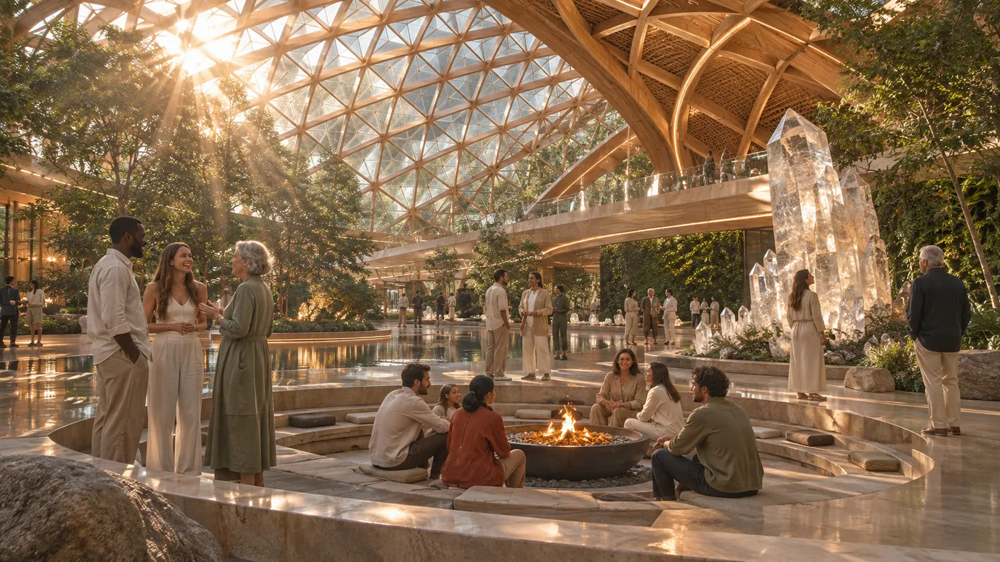
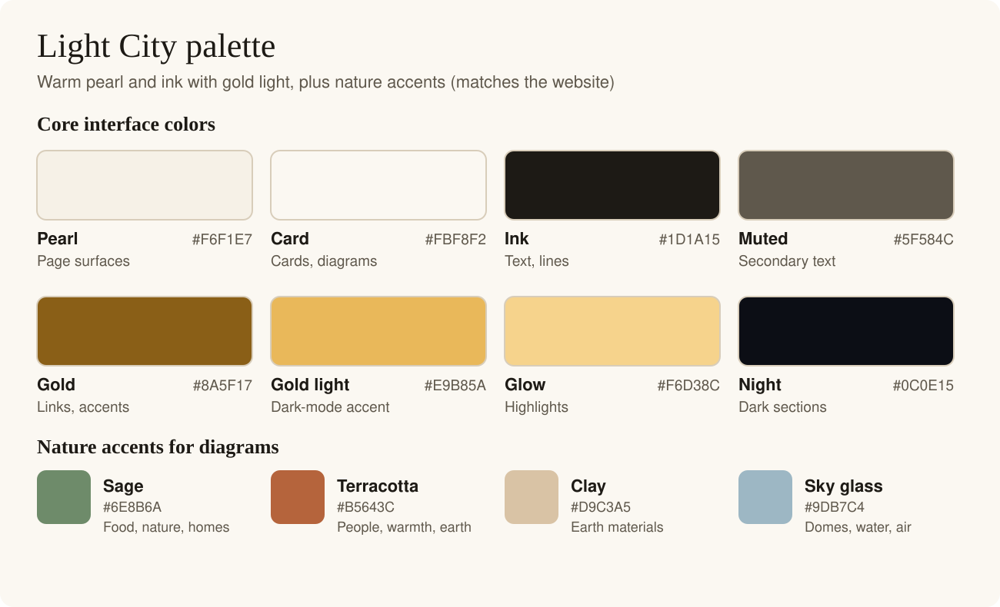

# Color and Light

*Palette and lighting rules for the website, diagrams, photos and the built city*

*Modern Organic light: warm integrated LED, daylight through glass, clay and timber surfaces, and a place for fire.*

## Palette

*The palette matches the website. Diagrams use the same colors, so documents, site and print look like one family.*

### Core interface colors

| Name | Hex | Use |
|---|---|---|
| Pearl | `#F6F1E7` | Page surfaces, diagram backgrounds |
| Card | `#FBF8F2` | Cards, panels |
| Ink | `#1D1A15` | Text, lines |
| Muted | `#5F584C` | Secondary text, captions |
| Gold | `#8A5F17` | Links, accents, structure lines in diagrams |
| Gold light | `#E9B85A` | Accent on dark backgrounds |
| Glow | `#F6D38C` | Highlights, "current" markers |
| Night | `#0C0E15` | Dark sections, night scenes |

### Nature accents (diagrams and illustrations)

| Name | Hex | Use |
|---|---|---|
| Sage | `#6E8B6A` | Food, nature, homes |
| Terracotta | `#B5643C` | People, warmth, earth, reference lines |
| Clay | `#D9C3A5` | Earth materials, plaster |
| Sky glass | `#9DB7C4` | Domes, glazing, water, air |

Use light tints (about 15–30% opacity) of the nature accents for panel fills. Keep text on tints in Ink.

## Lighting principles

- **Daylight first.** Domes and studios are planned for daylight through glazing and an oculus; artificial light fills in.
- **Warm and circadian.** Evening light is warm (2,200–3,000 K) and dimmable; daytime light can be cooler. Integrated LED lines sit in timber ribs and coves, not bare fixtures.
- **Fire stays.** Fire bowls, hearths and sculptural fire features are part of shared spaces, indoors and out, with proper ventilation.
- **Crystal as accent.** Quartz and glass catch and split light in small doses: a centerpiece, a window, a lamp. Never a whole wall of crystal.
- **Crystals are placed, not scattered.** Show natural quartz as one, two or three vertical points, set with intention into the ground on a stone or earth base, or on a simple pedestal or stand. No clusters shooting in every direction and no glowing, game-style crystals.
- **Dark skies.** Exterior light points down, is shielded and is warm, so stars stay visible.
- **Spire light.** The spire crown can carry programmable light for gatherings; it stays off or low on ordinary nights.

## Usage guidance

- Text is Ink or Muted on Pearl or Card. On Night, use `#F3EEE4` text and Gold light accents.
- Gold marks links, structure lines and the most important item in a diagram. Use it sparingly.
- Terracotta is for people, warmth and reference lines (for example the Mjøstårnet height line).
- Check contrast: body text needs at least 4.5:1, large titles 3:1.

---

**Last reviewed**: November 2026  
**Related**: [Visual Language](/docs/design/visual-language), [Beyond the Box](/docs/design/organic-forms-and-materials), [Sacred Geometry](/docs/concepts/sacred-geometry)
