# How the City Grows: One Plan for Every Phase

Light City grows in three phases: a hamlet of about 200 people, a village of about 1,500 and a town of 8,000 or more ([At a Glance](/docs/at-a-glance)). This page sets out what each phase needs and where it goes, so the systems grow together instead of arriving as separate projects. The [3D model](pathname:///model/index.html?phase=1&view=yard) follows it.

> **Our rule: every phase is a complete place to live. Each one has its own water, sewage, food, care, learning and play, sized for its own people and built close to them. Later phases add to what is there; they do not replace it.**

---

## Why the systems grow with the town

A hamlet of 200 cannot wait for a town-sized water works a kilometre away, and it should not pay for one. Water and sewage pipes are expensive per metre, so a small place keeps its works short and close. Utilities now build this way on purpose: modular plants start small and add identical units as homes are built. Young's Cove in Nova Scotia built its treatment plant in four stages, from 125 to 500 homes ([newterra](https://www.newterra.com/case-study/waterfront-community-wastewater-treatment/)). A Texas district added 200,000-gallon-a-day modules as each section of the development opened ([Seven Seas Water Group](https://sevenseaswater.com/wp-content/uploads/2026/04/SSWG_Case_Study_Modular-Design-Ft-Bend-18Mar26.pdf)). This "build as you grow" approach also allows treated water to be reused on site ([Fluence](https://www.fluencecorp.com/phased-municipal-water-infrastructure/)).

The same thinking applies to everything else. A school, a clinic or a sports field opens when there are enough people to use it. Until then, a smaller version does the job in a shared building.

The loops connect. Rain from the domes fills cisterns, and the water serves toilets and gardens. Used water goes to the reed beds, and the cleaned water irrigates the orchards. Food waste goes to compost and, from Phase 2, to a biogas digester whose gas cooks in the shared kitchens. In feng shui terms the works sit where the land puts them: water stored behind and above to the north, sewage treated downhill in front, and the town's quiet front kept open ([Planning principles](/docs/design/planning-principles#feng-shui-reading-the-land)).

---

## Phase by phase

<figure>

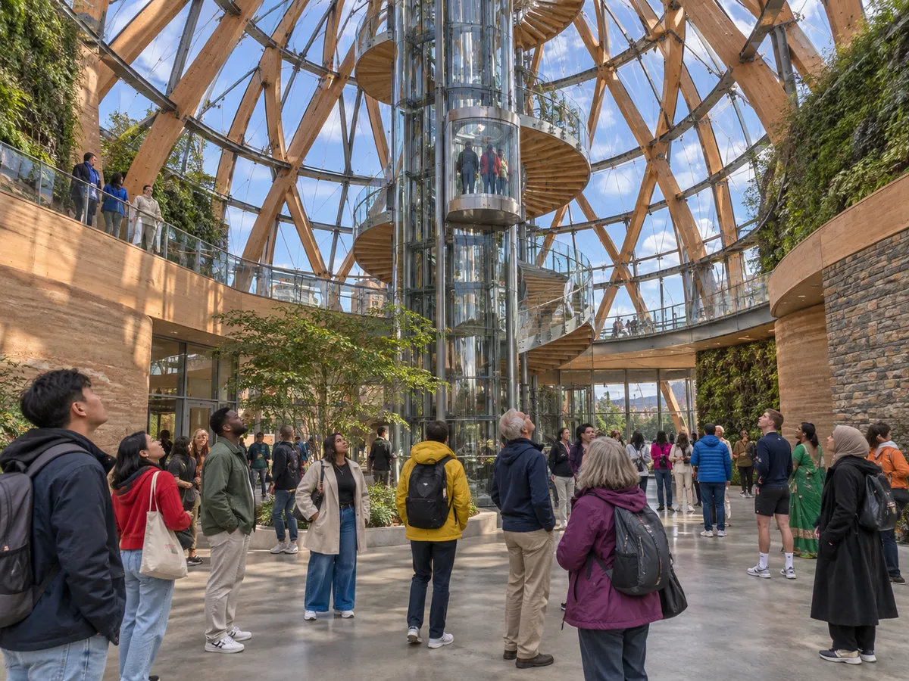

<figcaption>Spire lift core</figcaption>
</figure>

<figure>

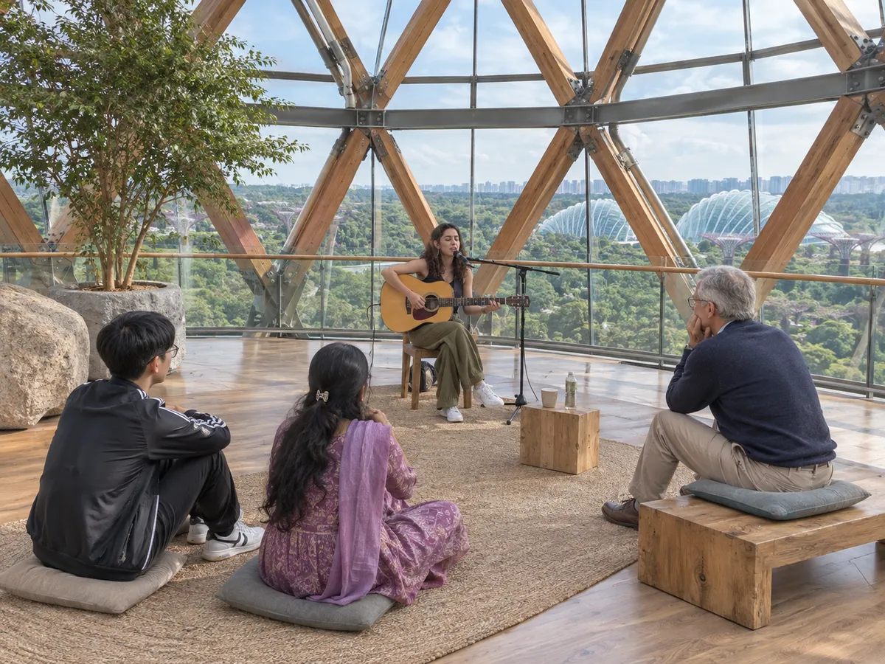

<figcaption>Spire gathering level</figcaption>
</figure>

<figure>

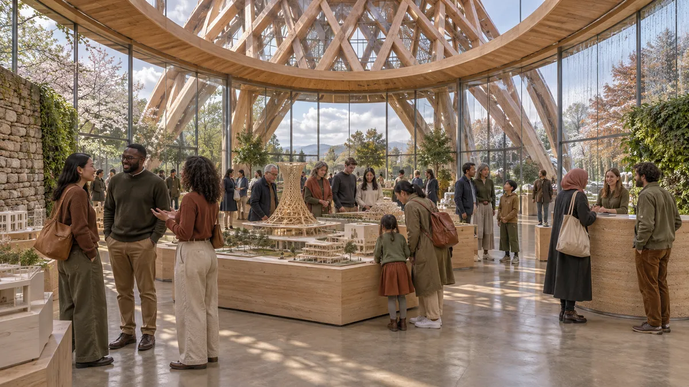

<figcaption>Spire base hall</figcaption>
</figure>

<figure>

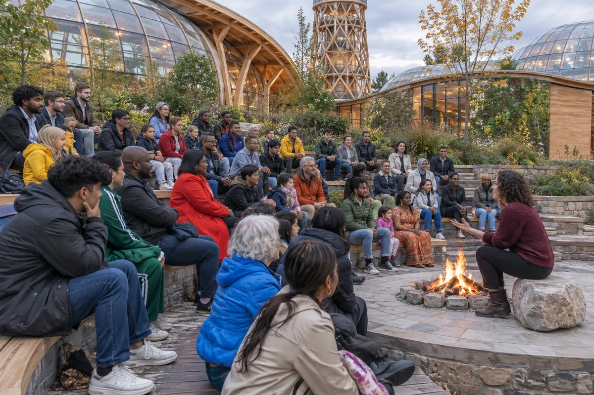

<figcaption>Plaza amphitheatre</figcaption>
</figure>

<figure>

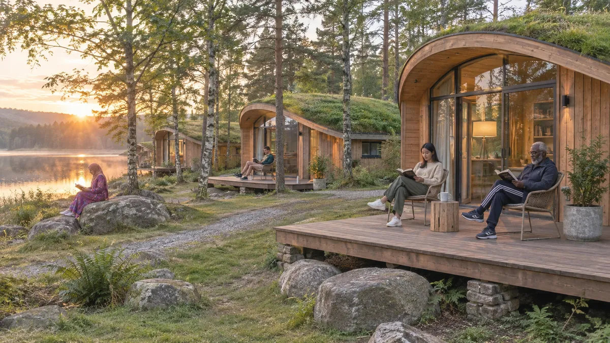

<figcaption>Retreat cabins</figcaption>
</figure>

<figure>

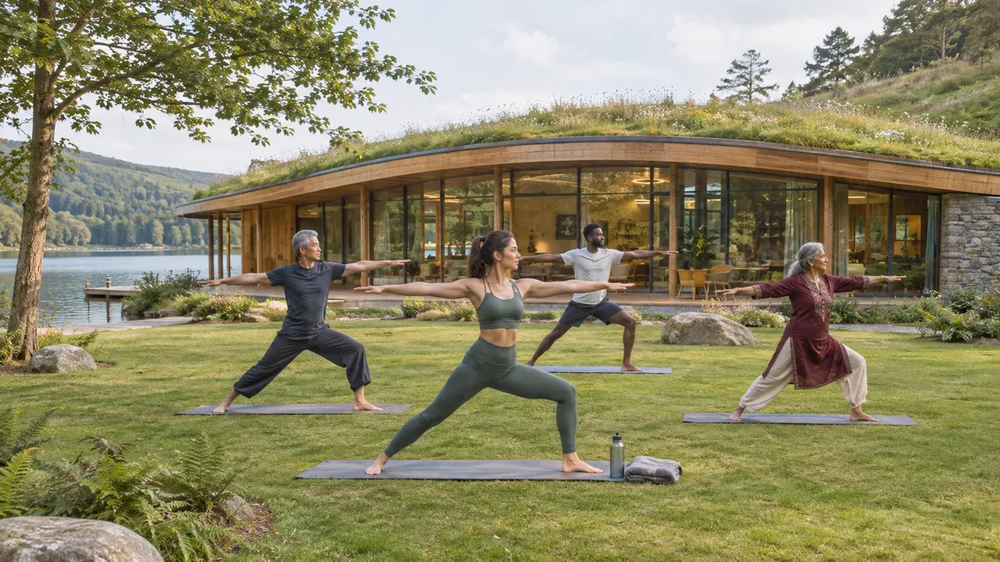

<figcaption>Retreat lodge</figcaption>
</figure>

<figure>

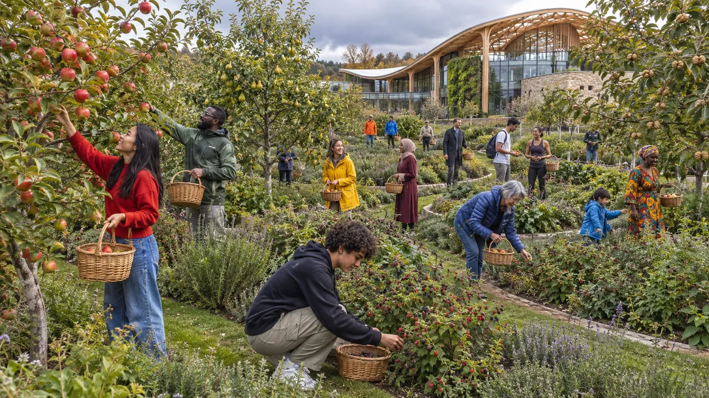

<figcaption>Orchard and food forest</figcaption>
</figure>

<figure>

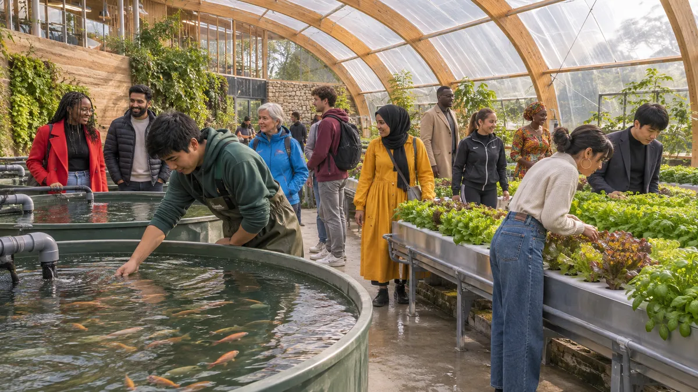

<figcaption>Aquaponics tunnels</figcaption>
</figure>

<figure>

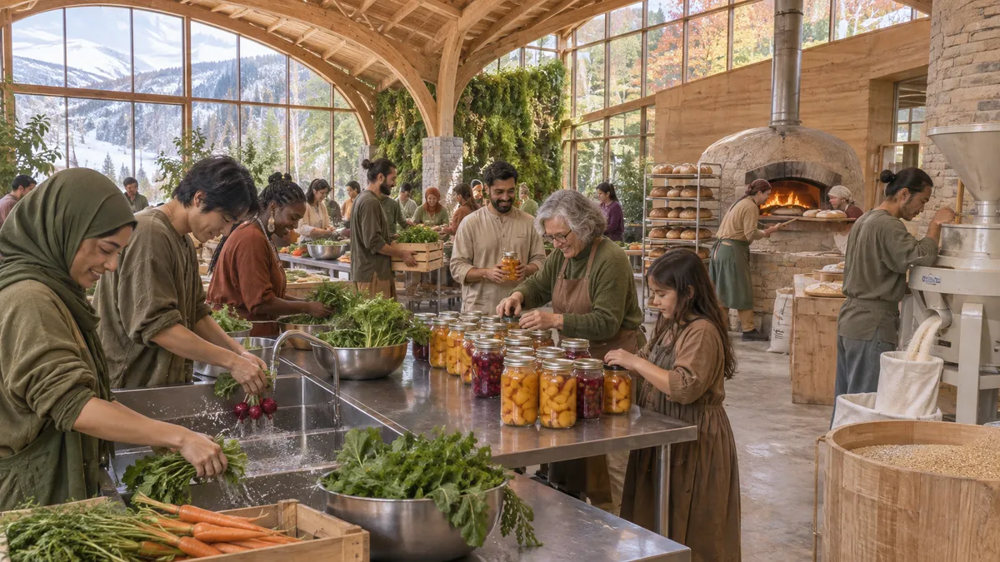

<figcaption>Food-processing hall</figcaption>
</figure>

<figure>

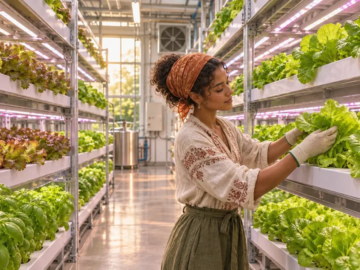

<figcaption>Vertical farm</figcaption>
</figure>

| | Phase 1 · Hamlet (200) | Phase 2 · Village (1,500) | Phase 3 · Town (8,000+) |
|---|---|---|---|
| **Homes** | About 110: about 80 flats in three domes and 30 homes on ring 4 | About 600: five more domes, the rest of ring 4 and the courtyard clusters | About 3,200: the town terraces, district domes and more ring domes |
| **Inside the domes** | Shared kitchen and dining, movement and yoga room, sound room, tool library and repair corner, childcare, laundry | The same in every new dome | The same in every new dome |
| **Wellness** | Temple pavilion with a meditation hall and sound-healing room; natural swimming pond by the lake | Larger temples; a bigger natural pool and a lake beach | A wellness and sports centre with an indoor pool |
| **Learning** | A learning pavilion with a small multi-age school and the library | A primary school; the library grows in the learning pavilions | A secondary school, more primary places and district libraries |
| **Health** | A health room in a dome, with first aid, telehealth and a visiting clinician | A health centre with at least one full-time clinician | A town health centre with five or six clinicians, dental and urgent care |
| **Civic and gathering** | Plaza with amphitheatre seating and a fire circle; spire observatory and gathering levels; the council meets in the spire hall | The Council House facing the spire; a festival meadow with a stage for about 3,000; work hub market halls | A covered event hall for about 1,000; district squares and halls |
| **Parks, play and sport** | The Spire Park with lawns, groves and a waterfall; a village green, a playground and a small field; the north woods and the first dog park | A sports field, courts, play areas and a running loop; a second dog park | A sports park in the outer belt, with a park within a short walk of every home; open hay meadows and two more dog parks |
| **Animals** | A care farm with goats, sheep, hens, ducks and bees | Stables for about ten horses, with an arena and paddocks | Grazing rotates over the hay meadows and food belt |
| **Water sports** | Swimming in the natural pond | A boathouse on the lake: kayaks, paddle boards and sailing dinghies | Paddling on the canals and the river |
| **Food** | Kitchen gardens, 1–2 ha of orchard and food forest | Greenhouses, aquaponics and a food-processing hall | A vertical farm, a larger processing hub and the outer food belt |
| **Guests** | Six to ten retreat cabins by the lake | A retreat lodge | A guest house by a mobility hub |
| **Water** | Rain cisterns at every dome; a well, a 300 m³ tank and two sand filters in a water yard behind the hamlet | A second, larger tank and more filters beside the first | North reservoirs and sand filters on the utility campus |
| **Sewage** | A settling tank and two reed beds just downhill of the hamlet | A compact treatment hall and four more reed beds beside them | A treatment hall and wetland at the water mouth |
| **Waste and energy** | Compost bays; solar on ring 5 and a hub battery | A biogas digester; solar on the food belt | Recycling hall, windrows, main digesters and substation on the north campus |
| **Movement** | North road and one mobility hub | A ring road and three hubs open to the south; shuttle | An outer ring road and six hubs |
| **Emergency** | A fire and rescue shed with a volunteer crew at the hub | A volunteer fire station on the ring road | A staffed station and ambulance base on the outer ring road |

The [model](pathname:///model/index.html?phase=2&view=reedbeds) shows the water yard, the treatment garden and the rain cisterns at each phase. The places in this table are in the model too, each in its own phase:

- **Phase 1:** the [Spire Park](pathname:///model/index.html?phase=1&view=spirepark) and its [waterfall](pathname:///model/index.html?phase=1&view=falls), the [lake falls](pathname:///model/index.html?phase=1&view=lakefalls), the [care farm](pathname:///model/index.html?phase=1&view=carefarm), the first [dog park](pathname:///model/index.html?phase=1&view=dogpark), the [amphitheatre and fire circle](pathname:///model/index.html?phase=1&view=amphitheatre), the spire's base hall, lift core and gathering level, the [village green and playground](pathname:///model/index.html?phase=1&view=green), the [swimming pond and retreat cabins](pathname:///model/index.html?phase=1&view=lakeside), the [orchard and food forest](pathname:///model/index.html?phase=1&view=orchard) and the fire shed at the hub.
- **Phase 2:** the [Council House](pathname:///model/index.html?phase=2&view=council), the [festival meadow](pathname:///model/index.html?phase=2&view=festival), the [stables](pathname:///model/index.html?phase=2&view=stables), the [boathouse](pathname:///model/index.html?phase=2&view=boathouse), the [primary school](pathname:///model/index.html?phase=2&view=school) and health centre, the [sports field](pathname:///model/index.html?phase=2&view=sport), the [aquaponics tunnels, food hall and fire station](pathname:///model/index.html?phase=2&view=food), a second swimming pond and the retreat lodge.
- **Phase 3:** the [event hall](pathname:///model/index.html?phase=3&view=eventhall), the [woods and hay meadows](pathname:///model/index.html?phase=3&view=woods), the secondary school, town health centre, [vertical farm](pathname:///model/index.html?phase=3&view=farm), [sports park and wellness centre](pathname:///model/index.html?phase=3&view=sportspark) and the staffed fire and ambulance station.

Each one sits between the radial paths, next to a path or ring, so nothing blocks the way and every building can be reached. Every structure type has a picture in the [photo guide](/docs/design/structures). A few smaller items are still missing (see [What the model does not show yet](/docs/design/visual-language#what-the-model-does-not-show-yet)).

---

## Inside the communospheres

<figure>

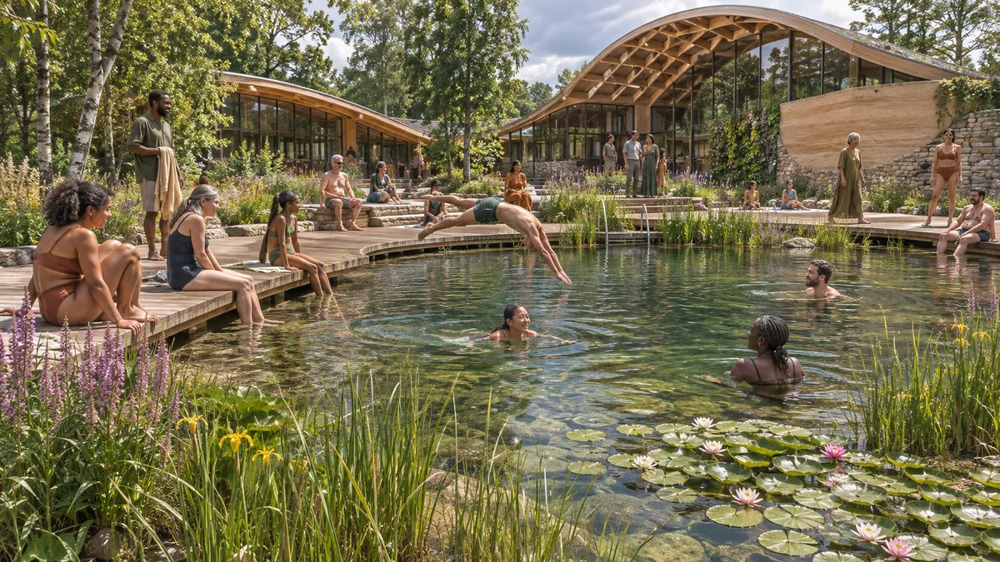

<figcaption>Natural swimming pond</figcaption>
</figure>

<figure>

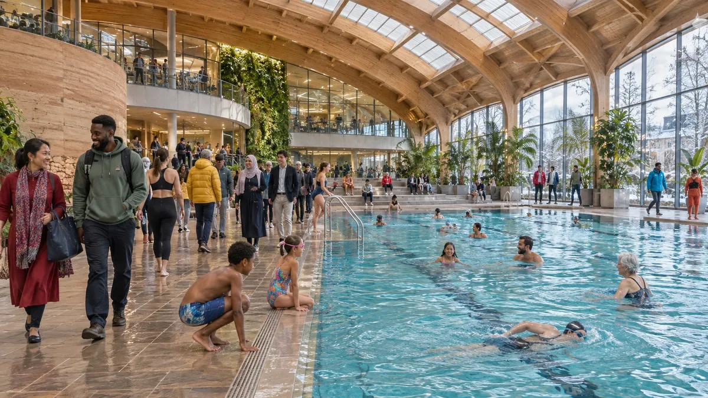

<figcaption>Wellness and sports centre</figcaption>
</figure>

Yes, most everyday wellness and making happen inside the domes. Each dome's ground floor is a shared commons under the glass. It holds:

- a shared kitchen and dining hall;
- a movement and yoga room;
- a small, quiet sound room;
- a tool library with a repair corner;
- childcare and a laundry.

Homes fill the levels above ([Planning principles](/docs/design/planning-principles)). Activities that need more room, sound control or heavy tools go in buildings made for them:

- **Temples** hold the large meditation and sound-healing halls, with the "resonant chambers" described in [Architecture](/docs/design/architecture#2-temples-and-meditation-spaces).
- **Creative studios and work hubs** hold woodshops, metal shops, ceramics and the bigger maker spaces ([Architecture](/docs/design/architecture#5-creative-studios)).
- **Swimming** is outdoors, in natural swimming ponds. These need no chlorine: plants in a regeneration zone of about half the area clean the water. The swimming zone is about 2 m deep, and ponds of 120 m² or more can run without a pump ([Low-impact Living Initiative](https://www.lowimpact.org/categories/land/natural-swimming-pools/)). Webber Park in Minneapolis runs a public natural pool on this principle ([Pool Magazine](https://www.poolmagazine.com/pool-news/natural-pools-the-pros-cons-of-going-au-naturel/)). A heated indoor pool comes only with the Phase 3 sports centre, when biogas heat and enough users make it worthwhile.

---

## Water

<figure>

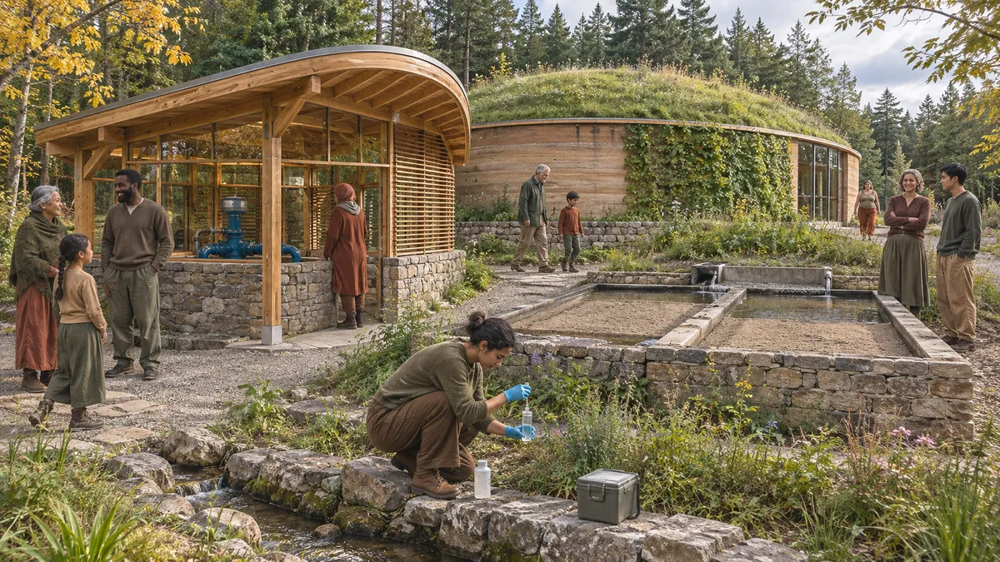

<figcaption>Phase 1 water yard</figcaption>
</figure>

<figure>

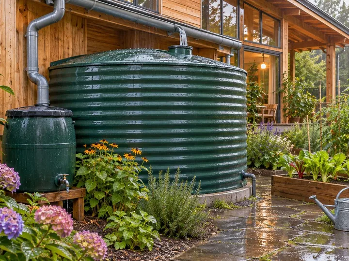

<figcaption>Rain cistern</figcaption>
</figure>

- **Rain first.** Each dome's shell drains to two buried cisterns on its outer side. A simple sizing rule is dry days × people × litres a day, plus 20% ([SamSamWater](https://www.samsamwater.com/library/TP40_7_Rain_water_harvesting.pdf)). For example, 60 people using 50 litres a day for toilets, laundry and gardens through a 30-day dry spell need about 110 m³ per dome. A 40 m dome's roof gathers several hundred cubic metres of rain a year in a temperate climate.
- **A water yard behind each phase.** Drinking water comes from a well and is filtered in slow sand beds. It is then stored in an earth-covered tank on the north side, the high ground behind the hamlet. Phase 1's tank holds about 300 m³, which is three days' use plus a fire reserve. Phase 2 builds a second, larger tank and more filters beside it. Phase 3 adds the reservoirs on the north campus, and the yard tanks stay in use as district and fire storage.
- **Pipes.** Mains and cables run in shallow service corridors under the ring paths. They can be reached from the path without digging up gardens, and each phase extends them outward ring by ring. Walk-in utility tunnels come only with the Phase 3 districts ([Infrastructure](/docs/design/infrastructure#utility-tunnels)).

## Sewage

<figure>

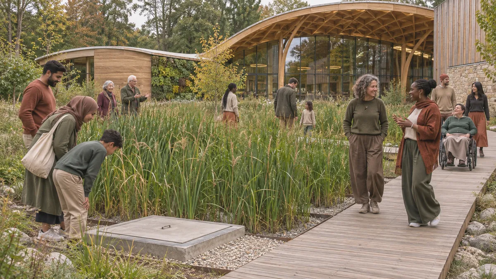

<figcaption>Phase 1 treatment garden</figcaption>
</figure>

<figure>

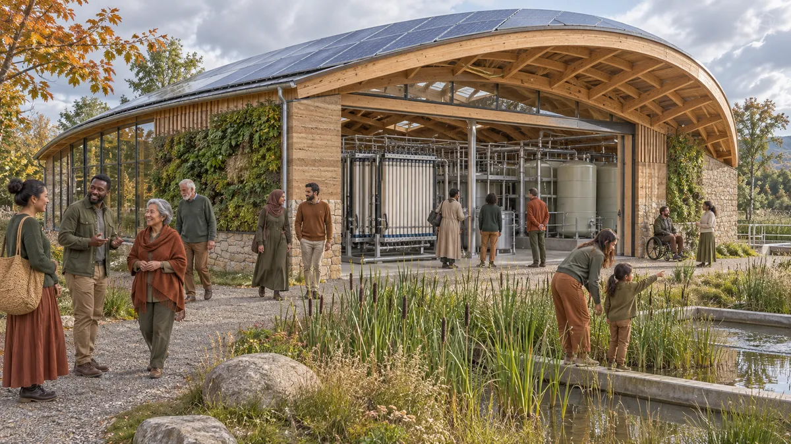

<figcaption>Village treatment hall</figcaption>
</figure>

- **Short and downhill.** Sewage from each phase falls by gravity to a treatment garden on the south-east side, the low side, just outside its own edge. It is kept away from the swimming lake.
- **Phase 1: reed beds.** A settling tank, then two planted vertical-flow reed beds of about 300 m² each. Vertical-flow beds in Europe use about 1–3 m² a person ([IHE Delft](https://ihedelftrepository.contentdm.oclc.org/digital/api/collection/p21063coll3/id/4431/download)). German guidance uses 4 m² and Danish guidance 3.2 m² ([Research Square](https://assets-eu.researchsquare.com/files/rs-2841067/v1/29587a5b-0921-4bf3-8e82-25442610573e.pdf?c=1685608195)). An SOS Children's Village near Tirana treats the sewage of 500 people on 550 m² ([SuSanA](https://www.susana.org/_resources/documents/default/2-806-en-susana-cs-albania-tirana-constructed-wetland-20120628.pdf)). The water stays under the gravel, so there is little smell and no open water ([Wikipedia](https://en.wikipedia.org/wiki/Constructed_wetland)).
- **Phase 2: a module and more beds.** A compact treatment hall goes beside the first beds, across the new ring path. Its settling and membrane units can be added one by one as the village fills. Four more reed beds then polish the water. The cleaned water irrigates the food belt.
- **Phase 3: the water mouth.** The town's larger flows go to a treatment hall and wetland at the water mouth, the lowest ground, as set out in [Infrastructure](/docs/design/infrastructure#sewage). The earlier beds stay and serve their own neighbourhoods. Nothing is torn out.

## Waste and energy

<figure>

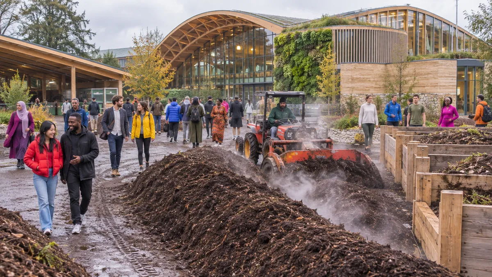

<figcaption>Compost bays</figcaption>
</figure>

<figure>

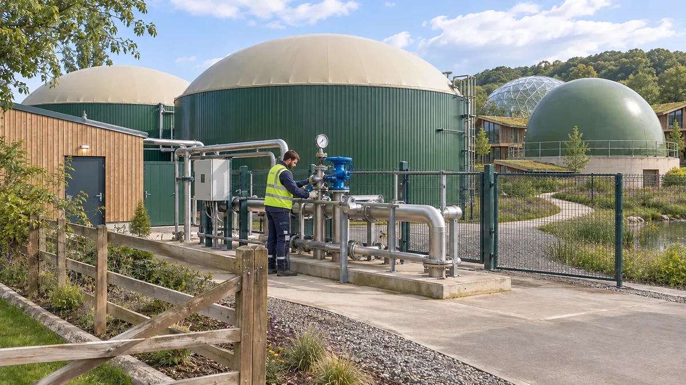

<figcaption>Village biogas digester</figcaption>
</figure>

Phase 1 composts its kitchen and garden waste in bays at the water yard and sorts recycling at the mobility hub. Phase 2 adds a small biogas digester for food waste beside the second water yard. Phase 3 adds the recycling hall, windrows, main digesters and substation on the north campus ([Infrastructure](/docs/design/infrastructure#waste)). Power grows in the same way: solar on ring 5 and a hub battery first, then the food-belt solar and a battery at every hub ([Energy systems](/docs/concepts/energy-systems)).

---

## Learning, health and care

<figure>

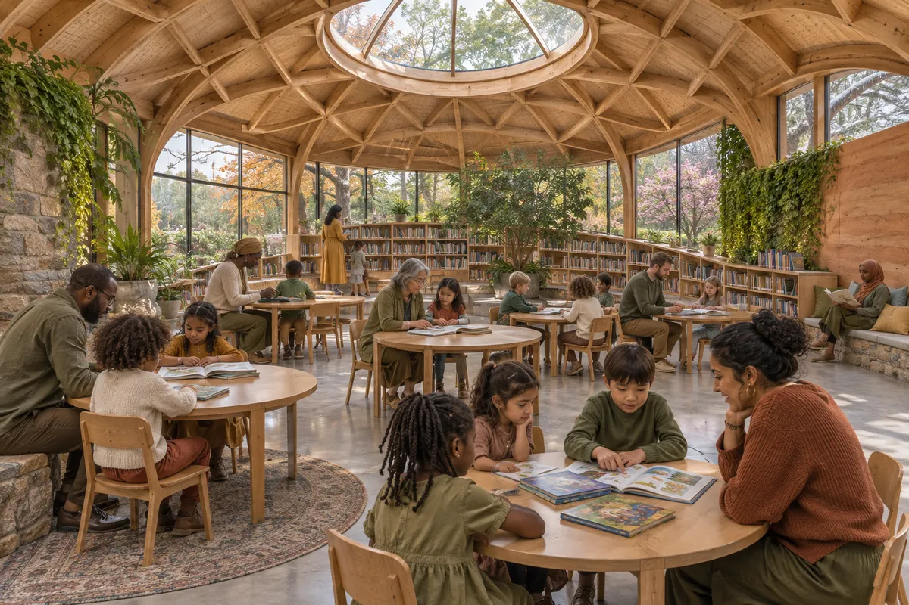

<figcaption>Learning pavilion</figcaption>
</figure>

<figure>

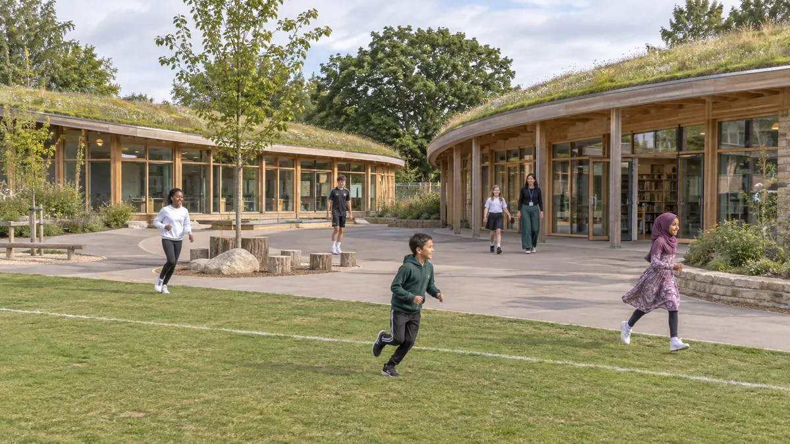

<figcaption>Primary school</figcaption>
</figure>

<figure>

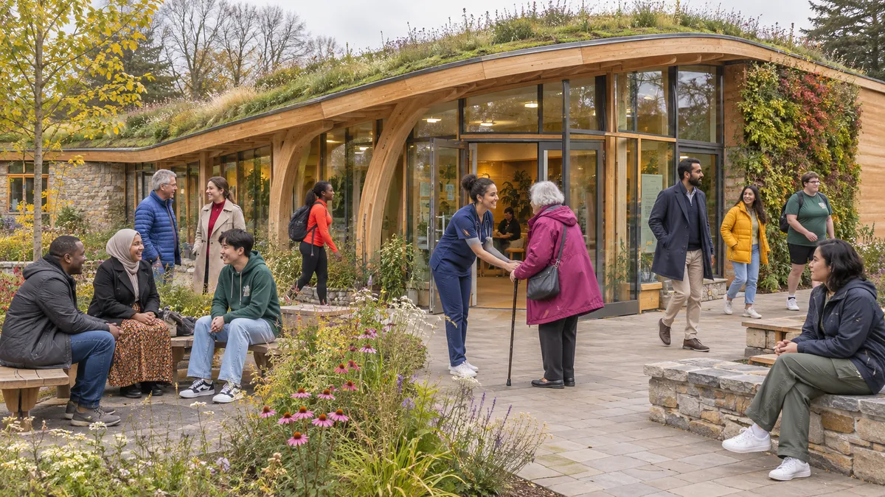

<figcaption>Village health centre</figcaption>
</figure>

<figure>

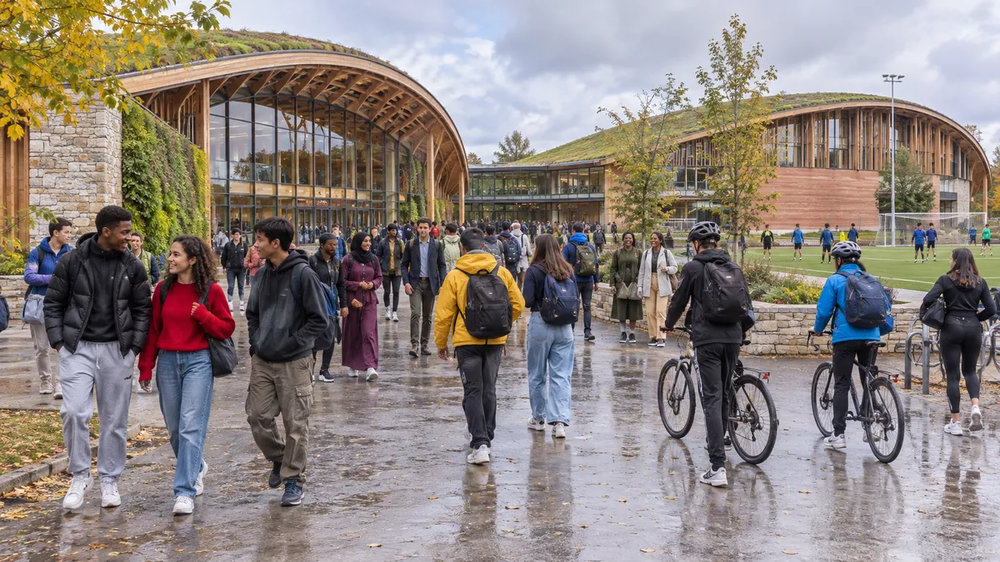

<figcaption>Secondary school</figcaption>
</figure>

- **School places.** New homes in England produce on average about 0.25 primary and 0.13 secondary pupils each ([UK Department for Education](https://www.gov.uk/government/publications/new-homes-fact-sheet-5-new-homes-and-school-places/fact-sheet-5-new-homes-and-school-places)). That gives about 30 primary children in Phase 1, enough for a multi-age school in the learning pavilion. Phase 2 has about 150, so it needs a one-form-entry primary school of 210 places on a site of about 1.1 ha ([Cheshire West and Chester](https://planningpolicy.cheshirewestandchester.gov.uk/sites/planningpolicy-cheshirewestandchester/files/2026-10/Education%20Developer%20Contributions%20Guidance%20Note.pdf)). Phase 3 needs about 800 primary and 400 secondary places, so it needs more primary schools and a secondary school.
- **Library.** The library starts in the learning pavilion and grows into district reading rooms.
- **Clinic.** A common target is one primary-care clinician for every 1,500 people ([North Carolina State Center for Health Statistics](https://schs.dph.ncdhhs.gov/units/ldas/docs/17-PrimaryCareCliniciansIndicator2023NCSHIP.pdf)). US federal rules treat more than 3,500 people per clinician as a shortage ([eCFR](https://www.ecfr.gov/current/title-42/chapter-I/subchapter-A/part-5/appendix-Appendix%20A%20to%20Part%205)). That means a health room with visiting care in Phase 1, a health centre with at least one full-time clinician in Phase 2, and five or six clinicians in Phase 3. Hospital care stays regional.

## Parks, play and sport

<figure>

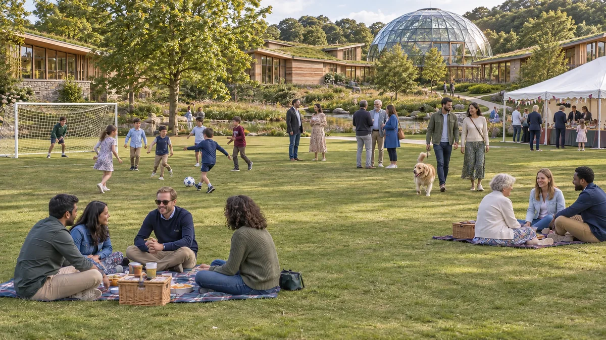

<figcaption>Village green</figcaption>
</figure>

<figure>

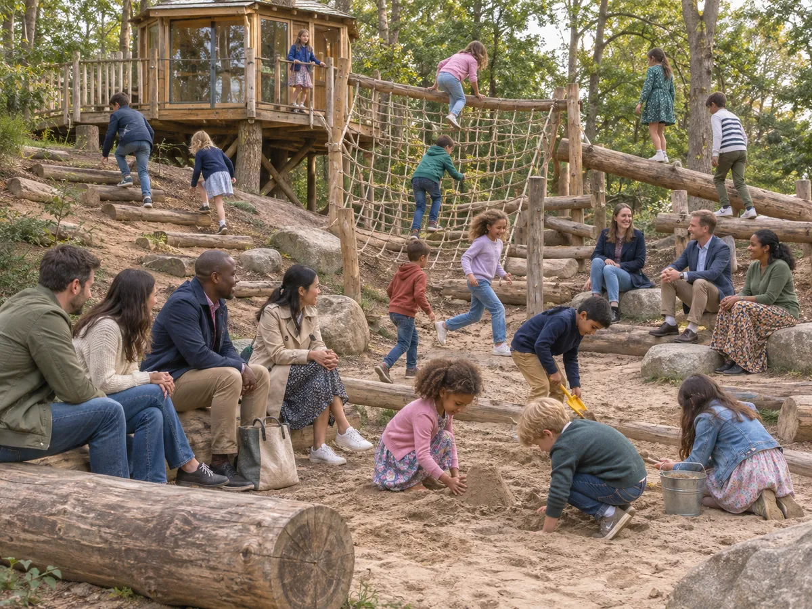

<figcaption>Playground</figcaption>
</figure>

<figure>

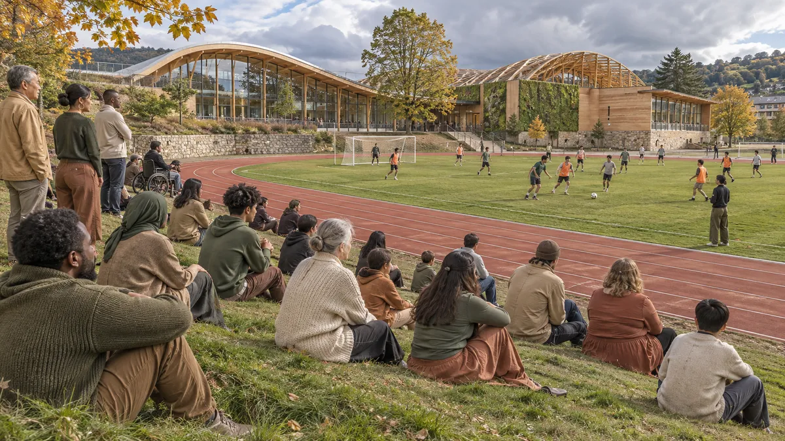

<figcaption>Village sports field</figcaption>
</figure>

<figure>

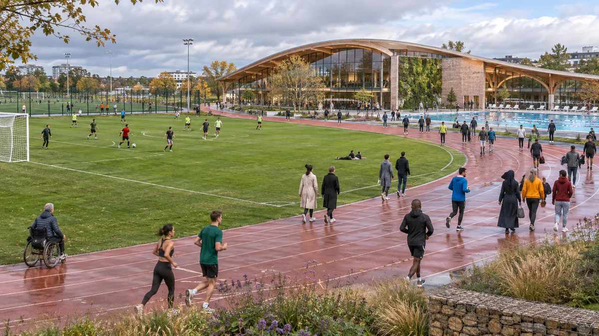

<figcaption>Town sports park</figcaption>
</figure>

The UK's Fields in Trust benchmarks, per 1,000 people, are:

- 1.6 ha of outdoor sport within 1,200 m;
- 0.55 ha of play space;
- 0.8 ha of parks and gardens within 710 m.

All green space together comes to 5.35 ha per 1,000 people ([Fields in Trust, via South Derbyshire](https://www.southderbyshire.gov.uk/assets/attach/16749/fields-in-trust-standards-2024-2-.pdf); [Bridgend guidance](https://www.bridgend.gov.uk/media/xq3bwp4i/guidance-for-outdoor-sport-and-play.pdf)).

| | Sport | Play | Parks |
|---|---|---|---|
| Phase 1 (200) | 0.3 ha: a small field on the green | 0.1 ha: a playground beside the green | 0.2 ha, plus the gardens and woods |
| Phase 2 (1,500) | 2.4 ha: a full pitch, courts and a running loop | 0.8 ha in the courtyard rings | 1.2 ha, plus the food belt |
| Phase 3 (8,000) | 12.8 ha: a sports park in the outer belt | 4.4 ha across the districts | 6.4 ha, a park within 710 m of every home |

The rings already give most of the park space: the gardens of ring 4, the belts, the lake and the woods.

## The Spire Park and the woods

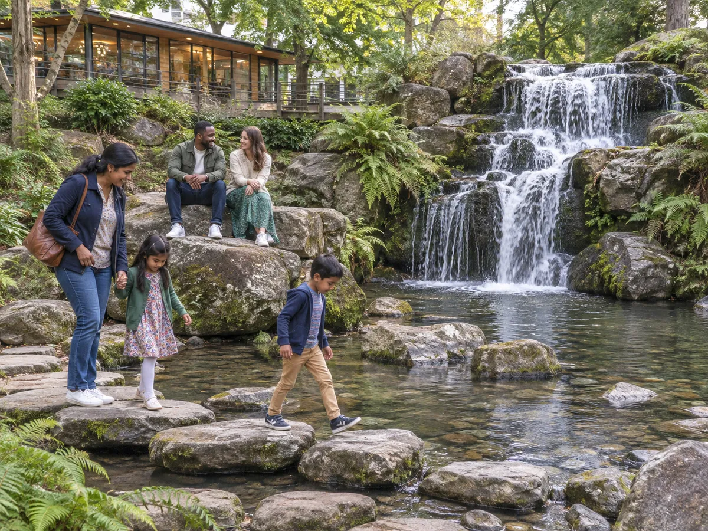

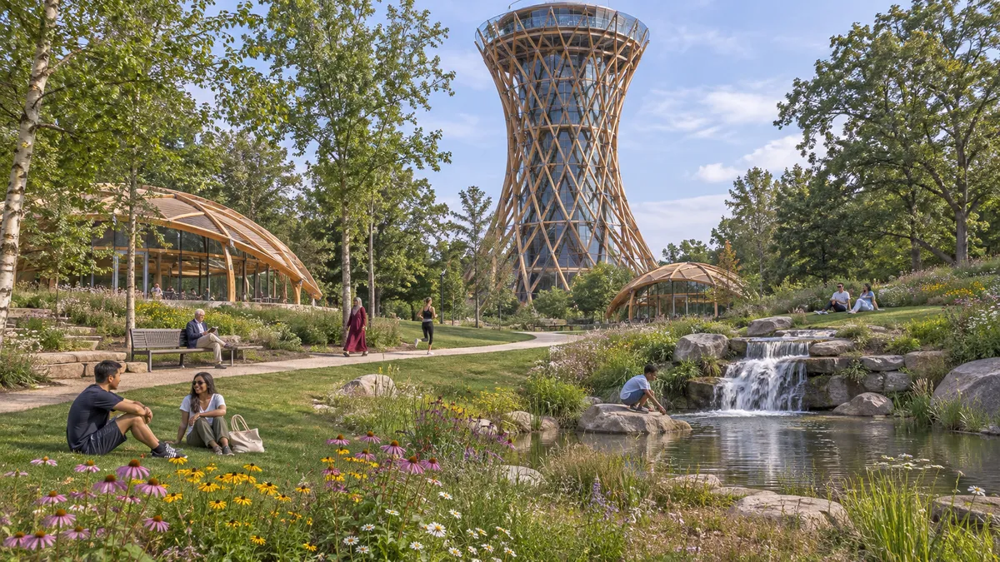

- **Spire Park.** Ring 2 around the spire is a park from the first day: open lawns, groves on the quiet sides, the amphitheatre and a waterfall of local boulders fed by the heart rill. It is the open ming tang (bright hall) in front of the spire, so no building stands in it except the Council House on its north edge.
- **Waterfalls.** The park waterfall and the lake falls are built like streams, not fountains: boulders, two ledges and a plunge pool. At the lake the falls are the weir that holds the water level. Its concrete core sits inside the boulders, so the hard engineering is still there, but hidden.
- **Woods behind, meadows in front.** Woodland grows on the north side of the city and along its flanks, the armchair of feng shui. That is also where a shelterbelt helps most: it breaks cold winds from the north, shades the soil and holds water. To the south the land stays open as hay meadows, so the city looks out over its water. The woods are planted only where no phase will ever build, so no tree is felled later.

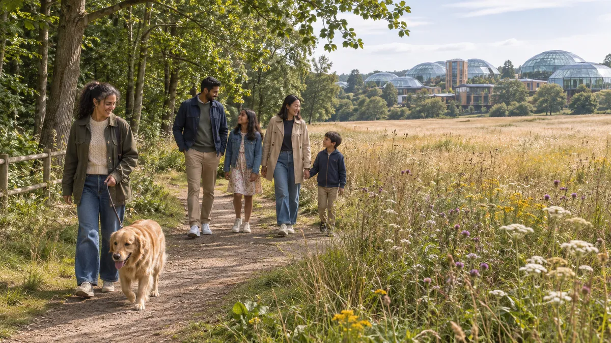

## Events and gathering

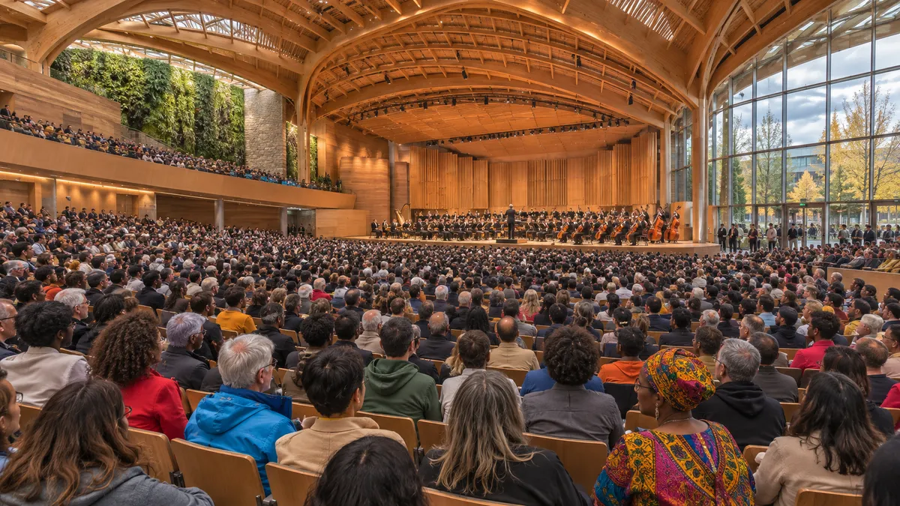

- **Open air.** The festival meadow by the south-east hub opens in Phase 2: about 4,500 m² of lawn with a timber stage shell and light towers. At a comfortable 1.5 m² a person it holds about 3,000 people, twice the Phase 2 population. UK event guidance plans open event areas at up to 2 people per m² ([OnePlan, on the Purple Guide](https://www.oneplan.io/articles/calculate-outdoor-event-capacity); [G. Keith Still](https://www.gkstill.com/Support/crowd-density/CrowdDensity-1.html)), so the hard limit is far above what the town needs.
- **Indoors.** The event hall comes in Phase 3, when the town is large enough to fill it: a long timber hall with a glass foyer, seating about 1,000, on the outer ring road so crowds and deliveries never pass through the homes.
- **Every day.** The plaza amphitheatre and the fire circle remain the everyday gathering places; the spire hall takes the first concerts and meetings in Phase 1.

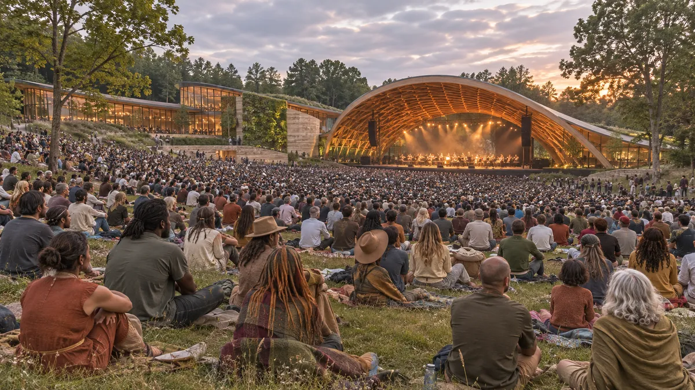

## Animals

<figure>

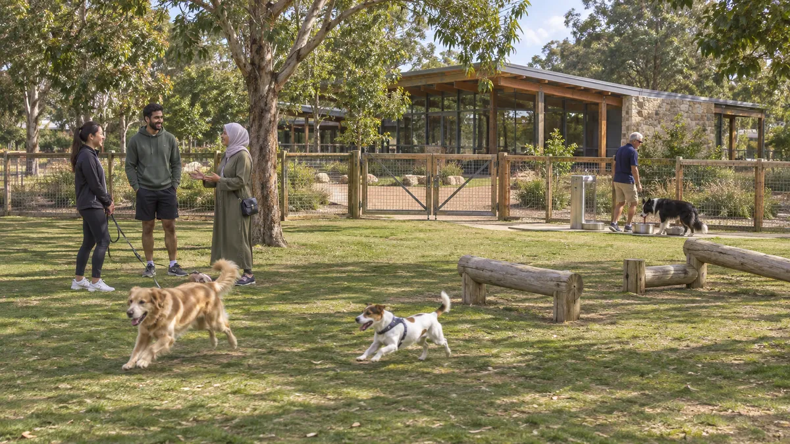

<figcaption>Dog park</figcaption>
</figure>

<figure>

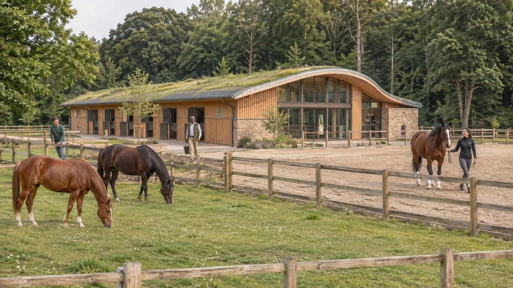

<figcaption>Stables</figcaption>
</figure>

- **Care farm (Phase 1).** By the orchard: goats, sheep, hens, ducks and bees, a barn, a hen house and a duck pond. Children learn to care for animals, the kitchens get eggs and honey, and the manure goes to the compost and the orchard.
- **Stables (Phase 2).** A barn for about ten horses, a sand arena and fenced turnout paddocks in the food belt. Horses need about one to two acres (0.4 to 0.8 ha) of pasture each if they graze all day, or about half an acre with less than three hours of turnout a day ([Rutgers Cooperative Extension](https://extension.rutgers.edu/e296); [University of Minnesota Extension](https://extension.umn.edu/agriculture/animals-and-livestock/horse/managing-established-horse-pastures)). The paddocks are for turnout; the herd grazes the hay meadows and the food belt in rotation, about 4 to 8 ha for ten horses.
- **Dog parks.** One in Phase 1, one more in Phase 2 and two in Phase 3, each fenced, with a gate and shade trees, off a radial path and away from playgrounds. Cities usually ask for half an acre to an acre ([Ann Arbor guidelines](https://www.a2gov.org/media/hvqhrksg/recommendations-and-guidelines-for-dog-park-site-selection-updated-4-10-15.pdf)); the ones in the model are smaller pocket parks, and the larger off-lead areas will be in the woods.

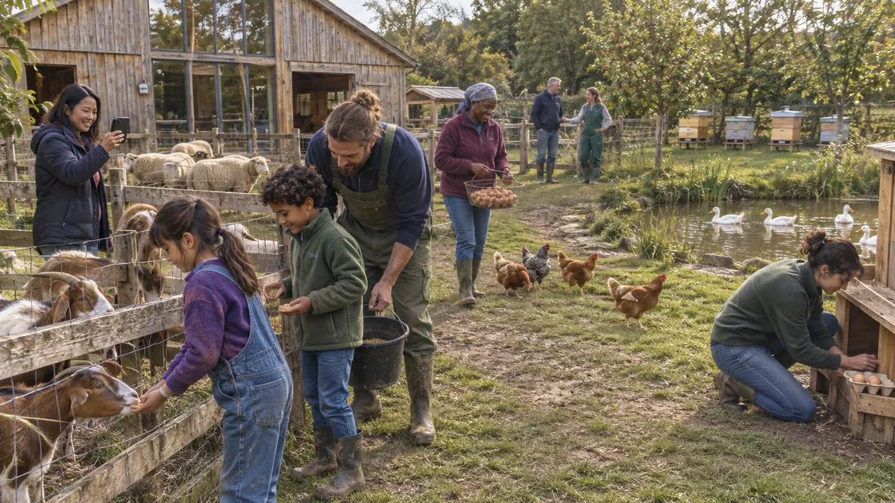

## Water sports

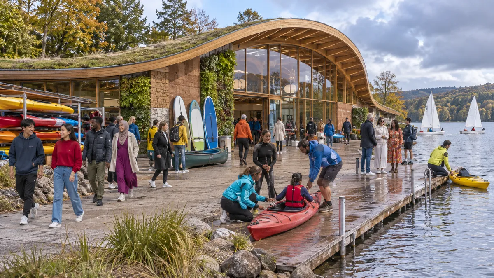

- **Phase 1:** swimming in the natural pond by the lake.
- **Phase 2:** a boathouse on the lake shore with a jetty, kayaks, paddle boards and sailing dinghies, and lessons for every age.
- **Phase 3:** paddling routes on the canal rings and the river, which need no new building.

## The Council House

What a city hall looks like here follows the [governance model](/docs/project/governance): a council of about one member for every 50 residents (4 in Phase 1, 30 in Phase 2, 160 in Phase 3), open meetings every month, town halls every quarter, and major decisions by 80% consent.

- **Phase 1:** the council of four meets in the spire hall; town halls are held in the amphitheatre.
- **Phase 2:** the Council House, a round glass hall with a timber roof open to the sky through an oculus, on the north edge of the Spire Park and facing the spire. Inside, the council sits in a circle with no raised seat, and the public sits in the outer rings. Glass walls mean anyone walking past can see the council at work.
- **Phase 3:** the 160-member council works mostly in committees in the district halls and meets in full in the Council House or the event hall.

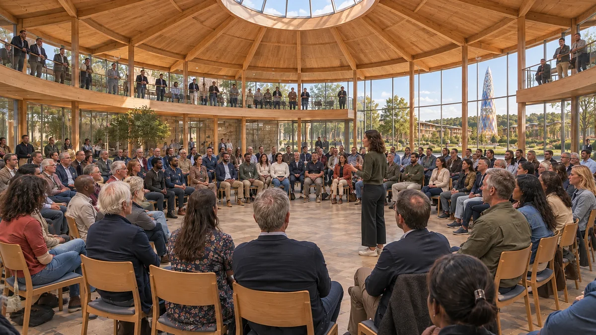

## Emergency services

<figure>

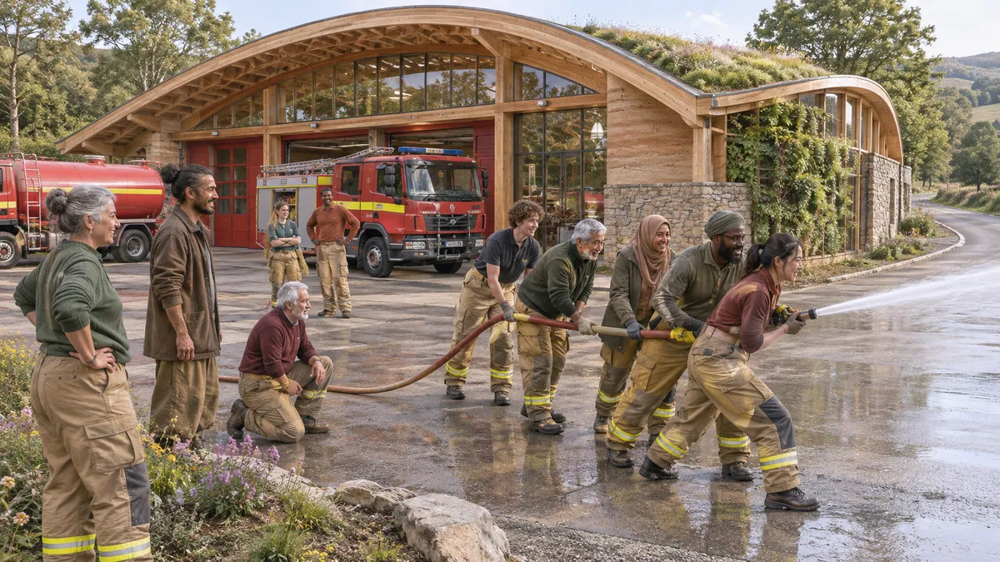

<figcaption>Fire and rescue shed</figcaption>
</figure>

<figure>

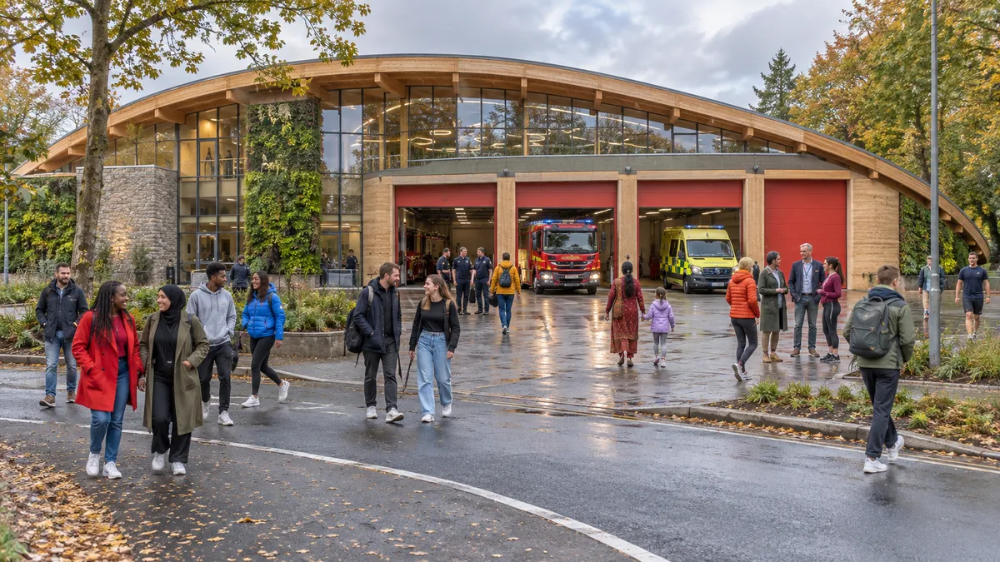

<figcaption>Town fire and ambulance station</figcaption>
</figure>

Volunteer fire departments in the US plan to the NFPA 1720 response times ([Salt Spring Island Fire Rescue](https://www.saltspringfire.com/ssifpd/docs/PDF%20NFPA%201720%20Deployment%20Standard%20Volunteer%20Departments.pdf)):

- **Rural areas:** 6 firefighters within 14 minutes.
- **Suburban areas:** 10 within 10 minutes.
- **Urban areas:** 15 within 9 minutes.

Phase 1 keeps a small fire and rescue shed with a water tender and trained volunteers at the mobility hub. Phase 2 builds a volunteer station on the ring road. Phase 3 adds a staffed station and an ambulance base on the outer ring road.

Fire engines need clear lanes about 6 m (20 ft) wide ([2021 International Fire Code via UpCodes](https://up.codes/viewer/colorado/ifc-2021/chapter/5/fire-service-features)), within about 45 m (150 ft) of every part of a building's outside walls ([Washington State Building Code Council](https://sbcc.wa.gov/sites/default/files/2021-05/Section%20503.pdf)). Some rules allow longer distances where buildings have sprinklers ([Minnesota Rules](https://www.revisor.mn.gov/rules/7511.0503/version/2016-05-12T10:07:55-05:00)). Light City will therefore run emergency lanes of flush pavers along selected radial paths. Fire water comes from the yard tanks and dry hydrants on the lake and canals.

---

## Still to decide on a real site

- **The landform.** The hills, river and slopes in the model are schematic. The yards go on the real high ground and the treatment gardens on the real low ground.
- **Water.** The well yield in a dry year, and whether the tanks need a small booster pump.
- **Sewage.** Local reed-bed area per person, the discharge permit, and the planted buffer between the beds and the nearest homes.
- **Services.** School, clinic and fire arrangements with the county, which may serve the hamlet before Phase 2.
