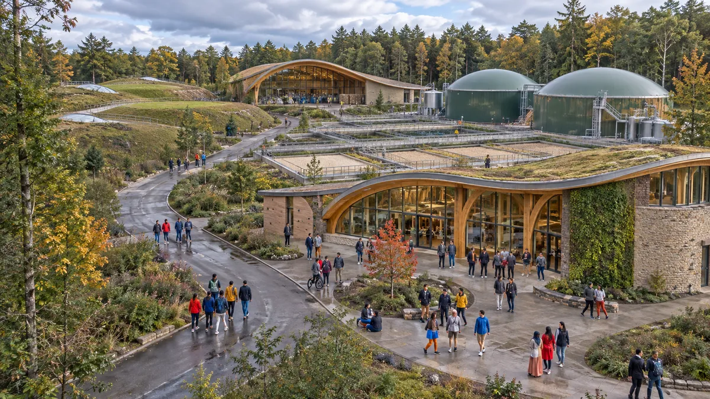
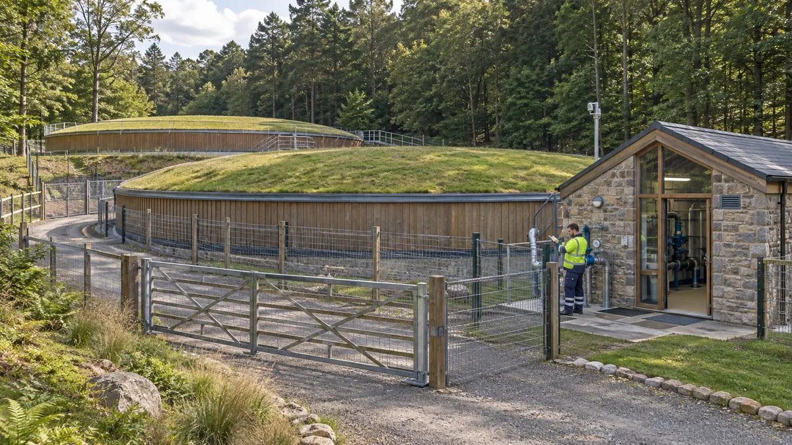
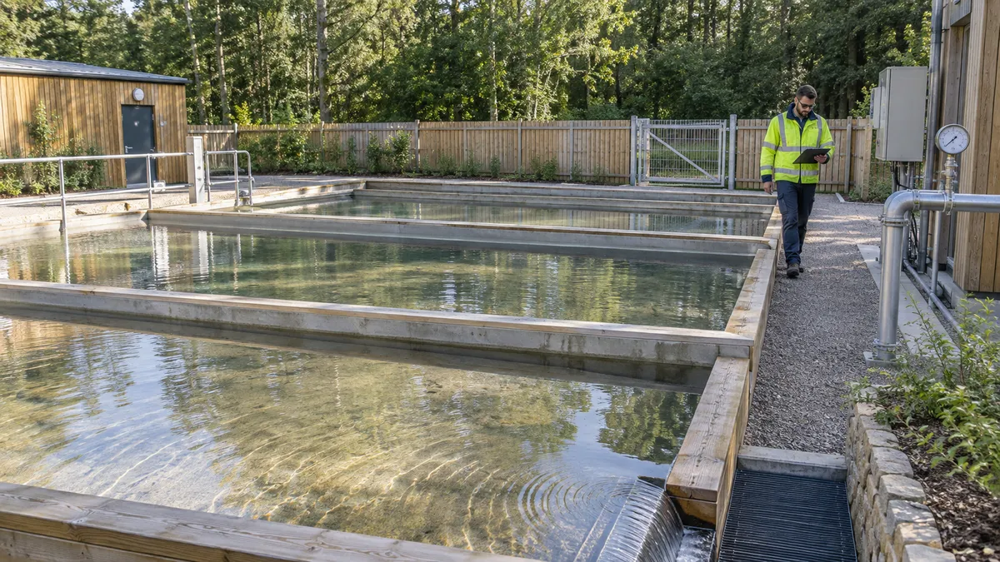
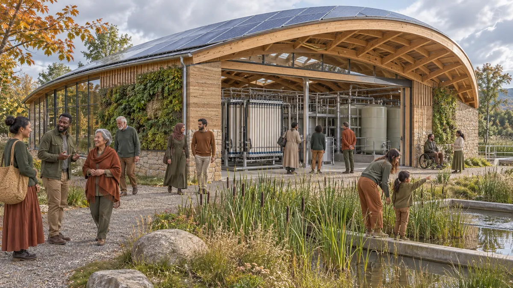
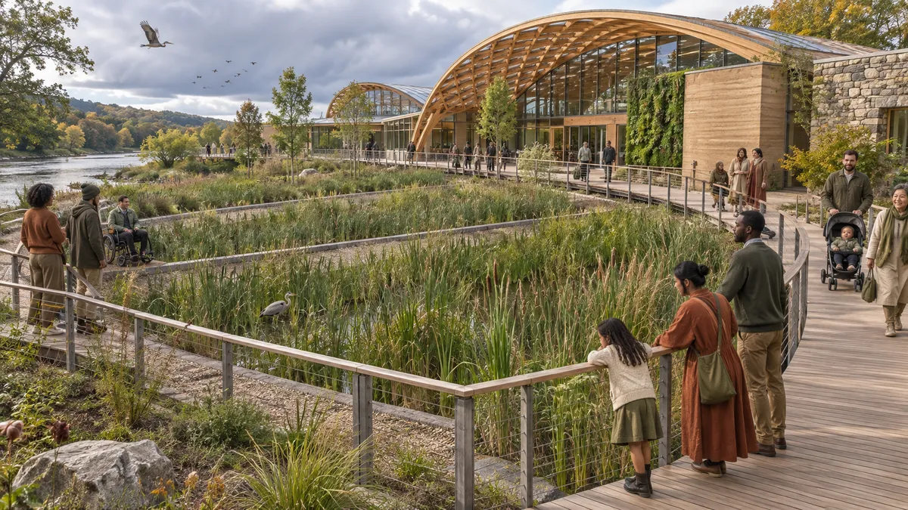
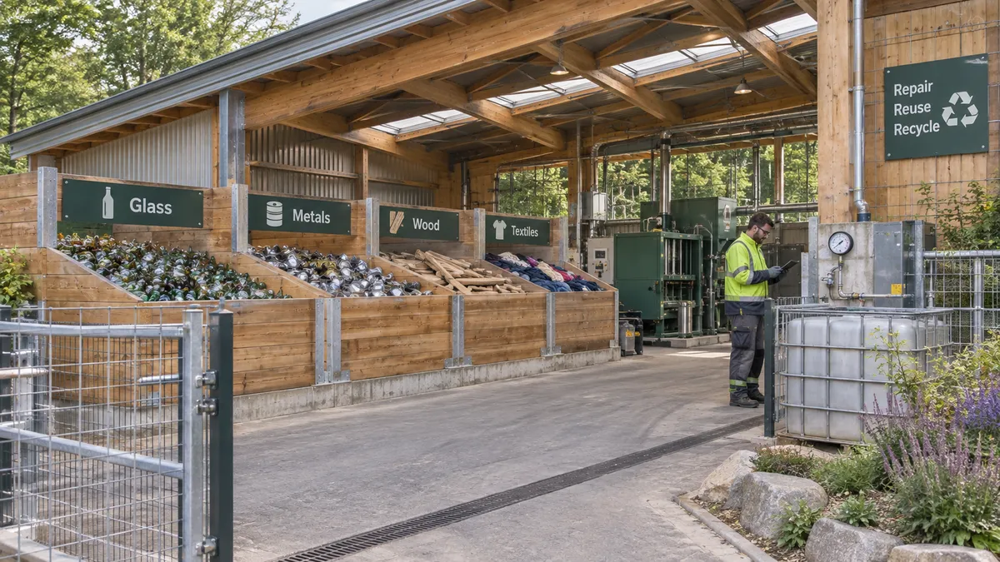
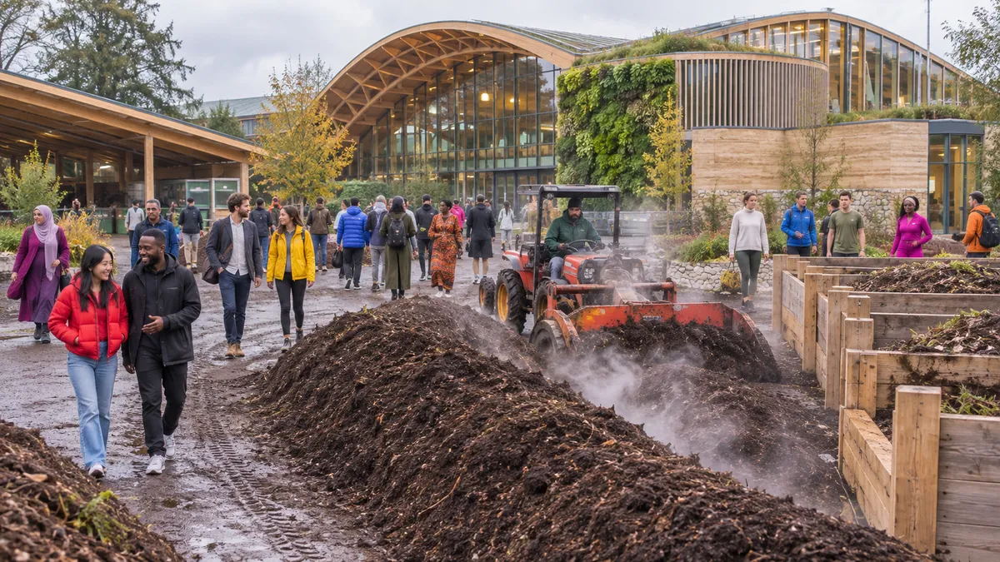
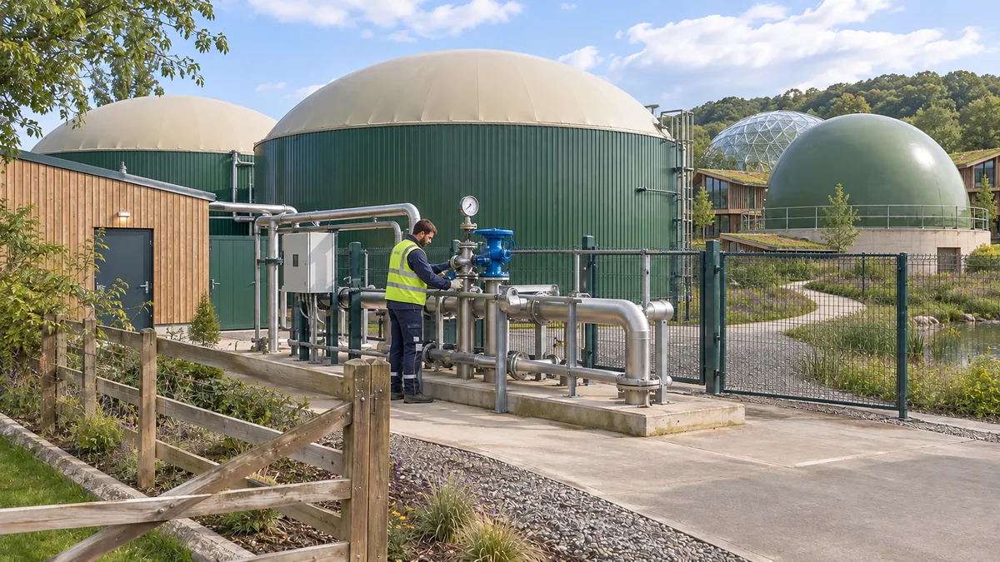
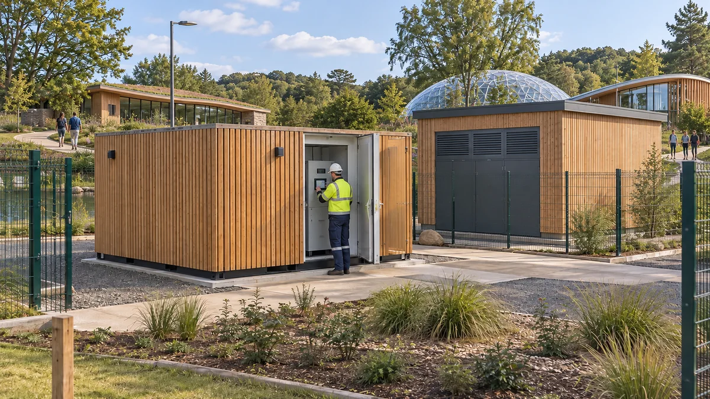
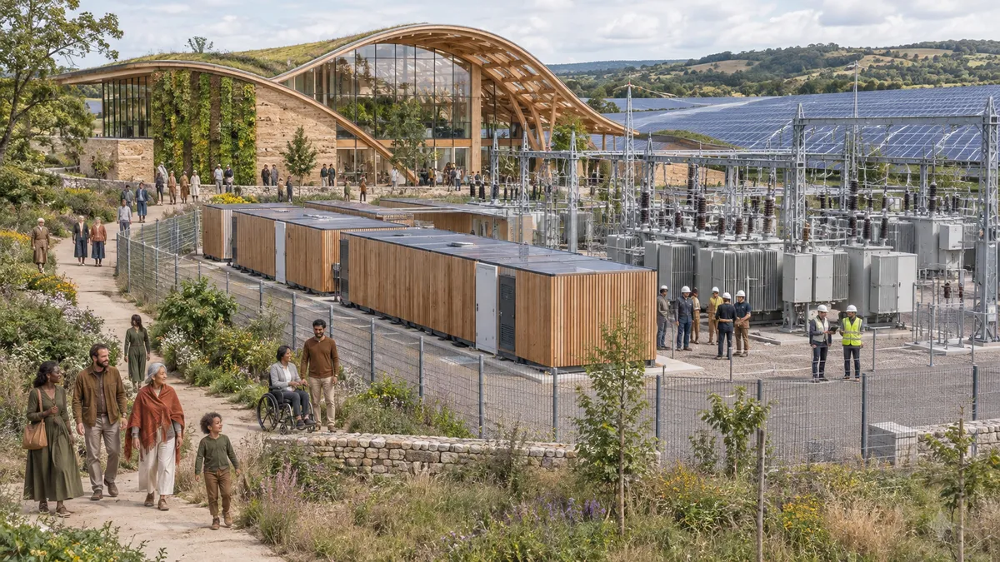

# Infrastructure: Water, Sewage, Waste and Power

A city works only if water arrives, sewage leaves clean, rubbish is collected and the lights stay on. This page sets out how Light City does each of these, where each system sits in the plan, and what the [3D model](pathname:///model/index.html?phase=3&view=utilities) shows, and how each system grows with the phases. It is a concept for engineers to test against a real site, not an engineering design.

> **Our rule: close the loops on site. Water is reused, waste becomes soil or fuel, and power is made and stored locally.**

The model follows one example closely. In Stockholm's Hammarby Sjöstad, the district's own systems for energy, water and waste were planned together as one loop. Sewage gives biogas and heat, waste gives district heat and fuel, and rainwater is treated locally ([Energy Innovation, Hammarby model](https://energyinnovation.org/wp-content/uploads/2015/12/Hammarby-Sjostad.pdf)).

---

## Where it sits

The plan follows the feng shui rule of a quiet front and service behind (see [Planning principles](/docs/design/planning-principles#feng-shui-reading-the-land)). The systems also grow with the town. Each phase builds small works at its own edge, close to the people it serves, and later phases add modules beside them. The full schedule is in [How the city grows](/docs/design/growth-plan).

- **Phases 1 and 2: close by.** A water yard sits just behind the hamlet to the north. It has a well, an earth-covered tank, slow sand filters and compost bays. A treatment garden with a settling tank and reed beds sits just downhill on the south-east, away from the swimming lake. Phase 2 adds a larger tank, a biogas digester, a compact treatment hall and four more reed beds beside them. Every dome keeps its own rain cisterns.

Phase 3 adds the town-scale works:

- **Behind, to the north.** The utility campus sits inside the woods on the higher ground behind the city. It holds water storage, the sand filters, the recycling hall, compost and the biogas digesters. The service road reaches it from the north road, so heavy vehicles never cross the town.
- **In front, to the south.** Sewage runs downhill to the water mouth, where the creek meets the river. The treatment hall and the treatment wetland clean it there, before any water leaves the city.
- **Under the paths.** Pipes and cables run under the ring paths and the curving radial paths, so they can be reached without digging up gardens.

| System | Where in the model | View |
|---|---|---|
| Rain cisterns | Two lids beside every dome | [entrances](pathname:///model/index.html?phase=1&view=entrances) |
| Phase 1 and 2 water yard | A well and pump house, earth-covered tanks, slow sand filters, compost bays and, from Phase 2, a small digester | [yard](pathname:///model/index.html?phase=2&view=yard) |
| Phase 1 and 2 treatment garden | A settling tank and two reed beds, then a treatment hall and four more beds | [reedbeds](pathname:///model/index.html?phase=2&view=reedbeds) |
| Phase 3 water storage and treatment | Two earth-covered reservoirs, a valve house and slow sand filter beds on the north campus | [utilities](pathname:///model/index.html?phase=3&view=utilities) |
| Phase 3 recycling, compost and biogas | Recycling hall and bins, four compost windrows, two digesters and a gas holder | [utilities](pathname:///model/index.html?phase=3&view=utilities) |
| Phase 3 sewage treatment | A treatment hall with a solar roof and three wetland cells at the water mouth | [watermouth](pathname:///model/index.html?phase=3&view=watermouth) |
| Power | Solar on ring 5 and the food belts, a battery bank and substation on the campus, a battery container and substation at every mobility hub | [hub](pathname:///model/index.html?phase=1&view=hub) |

---

## Water supply

<figure>

<figcaption>Covered reservoir</figcaption>
</figure>

<figure>

<figcaption>Slow sand filters</figcaption>
</figure>

- **Gravity first.** Water is drawn from the site's spring, well or stream, filtered and stored in reservoirs on the high ground to the north. From there it reaches the city downhill without pumping in normal use. Gravity schemes are simple to run and reliable, and should store at least one day's demand ([WaterAid](https://www.wateraid.org/us/publications/gravity-fed-schemes-technical-brief)).
- **Slow sand filters.** Beds of sand clean the water slowly by a living layer on top, with no chemicals beyond a final safety dose.
- **Rain.** Domes and roofs collect rain into cisterns for gardens, toilets and laundry. Streets and squares drain to planted swales, the canals and the lake, which also store floodwater.
- **Reuse.** Treated water from the wetland feeds irrigation of the food belts, meeting the target to reuse water at least once ([At a Glance](/docs/at-a-glance)).

## Sewage

<figure>

<figcaption>Town treatment hall (Phase 3)</figcaption>
</figure>

<figure>

<figcaption>Town treatment wetland (Phase 3)</figcaption>
</figure>

- **Downhill to the water mouth.** Sewers fall by gravity to the south, with the land. Only the lowest areas need small pump stations.
- **Treatment hall.** Screening and settling happen indoors, under a solar roof, so smells stay inside.
- **Treatment wetland.** The settled water then passes through three planted gravel cells. Constructed wetlands use plants, soil and microbes to clean wastewater and are well suited to small communities that have land ([EPA](https://www.epa.gov/wetlands/constructed-wetlands), [EPA design manual](https://cfpub.epa.gov/si/si_public_record_report.cfm?Lab=NRMRL&dirEntryId=64144)). In subsurface-flow cells the water stays below the gravel, so there is no open water for mosquitoes and little odour ([EPA](https://www.epa.gov/sites/default/files/2015-06/documents/wetlands-subsurface_flow.pdf)).
- **Sludge.** The model assumes sludge is thickened at the water mouth and taken to the north digesters along the service loop. A small digester at the water mouth is the alternative. Engineers will choose between them once the site, its slope and its loads are known.
- **Composting toilets** remain an option for single buildings and early phases ([Technology catalog](/docs/technical/technology-catalog)).

## Waste

<figure>

<figcaption>Recycling and repair hall</figcaption>
</figure>

<figure>

<figcaption>Compost windrows</figcaption>
</figure>

<figure>

<figcaption>Biogas digesters</figcaption>
</figure>

- **Sort at home, collect without trucks.** Each dome sorts food, recycling and residual waste. Where it pays, waste is carried away by underground vacuum pipes, as in Hammarby Sjöstad ([Smithsonian](https://www.smithsonianmag.com/innovation/this-stockholm-neighborhood-was-built-on-ambitious-sustainability-goals-when-it-came-up-short-it-doubled-down-and-became-a-blueprint-for-others-180988672)). Such systems can remove up to 90% of waste-collection traffic ([EU Urban Mobility Observatory](https://webgate.ec.europa.eu/circabc-ewpp/rest/download/2b393b16-d614-41ca-83e5-d3ab654cd22a)). Otherwise, small electric vehicles collect it along the service loop.
- **Recycling hall.** Sorting, repair and reuse workshops sit together on the north campus.
- **Compost.** Garden and crop waste is composted in windrows, and the compost goes back to the food belts.
- **Biogas.** Food waste, sewage sludge and manure feed anaerobic digesters. They make biogas for cooking, heat and the backup gensets, and digestate that fertilises the fields ([EPA](https://www.epa.gov/anaerobic-digestion/basic-information-about-anaerobic-digestion)). Digesting food waste together with sludge raises the gas yield ([OSTI](https://www.osti.gov/servlets/purl/2352208)).

## Power

<figure>

<figcaption>Hub battery and substation</figcaption>
</figure>

<figure>

<figcaption>Main substation and batteries</figcaption>
</figure>

- **Solar** on domes, carports, ring 5 and the food belts, as set out in [Energy systems](/docs/concepts/energy-systems).
- **Batteries in layers.** A main battery bank and substation on the north campus, and a battery container at every mobility hub, so each district can carry on alone. Community-scale batteries can keep a neighbourhood running for days in an outage when paired with solar ([NREL](https://docs.nrel.gov/docs/fy21osti/79778.pdf)).
- **An islanding microgrid.** The grid can disconnect from the regional utility and run on its own, then reconnect, which is how microgrids keep power on through outages ([NREL](https://docs.nrel.gov/docs/fy19osti/73506.pdf)). Biogas gensets are the last backup; there is no diesel.

## Utility tunnels

In the denser Phase 3 districts, water, power, data and heat can share walk-in tunnels under the main paths. These tunnels cost more to build, but they save digging up streets for repairs and make the systems easier to inspect ([Frontiers in Sustainable Cities](https://www.frontiersin.org/articles/10.3389/frsc.2022.847819/full)). The model does not show them, because they are underground.

---

## Still to decide on a real site

- The water source and how much it yields in a dry year.
- Whether the north campus really is higher than the city; if not, the reservoirs move or a small pump lifts the water.
- Wetland area per person in the local climate, and the river's discharge rules.
- Whether vacuum waste pipes pay for themselves at Phase 2 or Phase 3 density.
- Where sludge is digested: at the north campus or at the water mouth.
