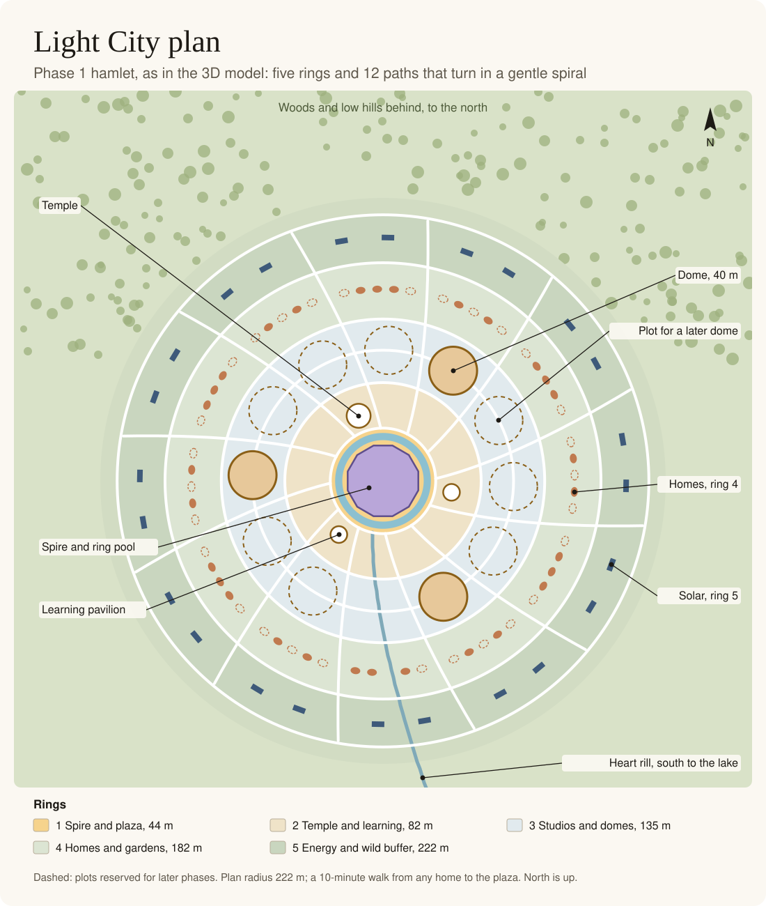
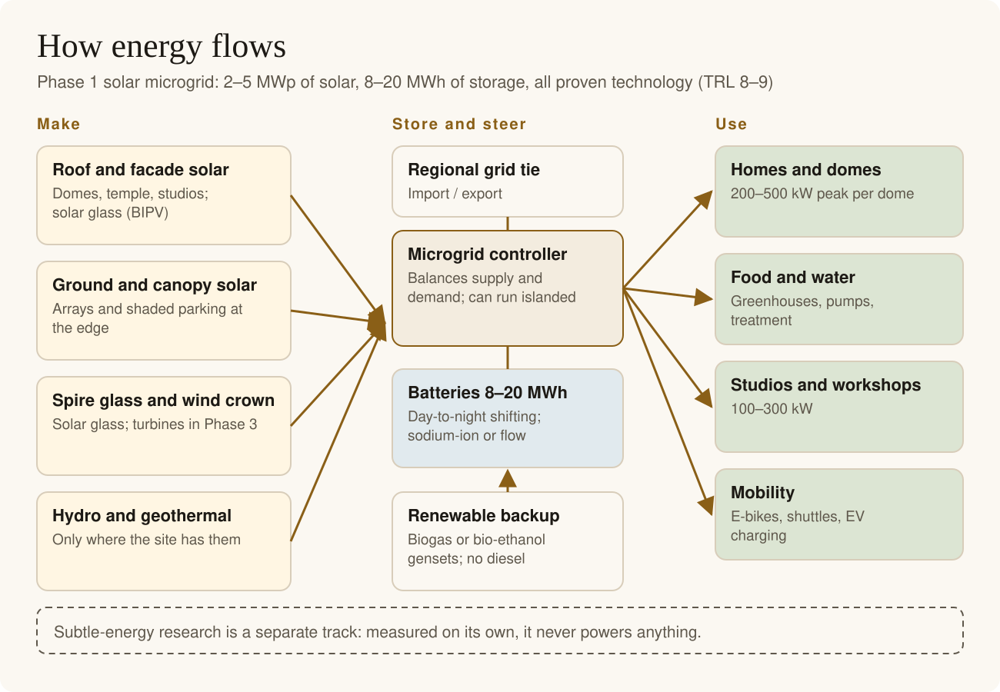
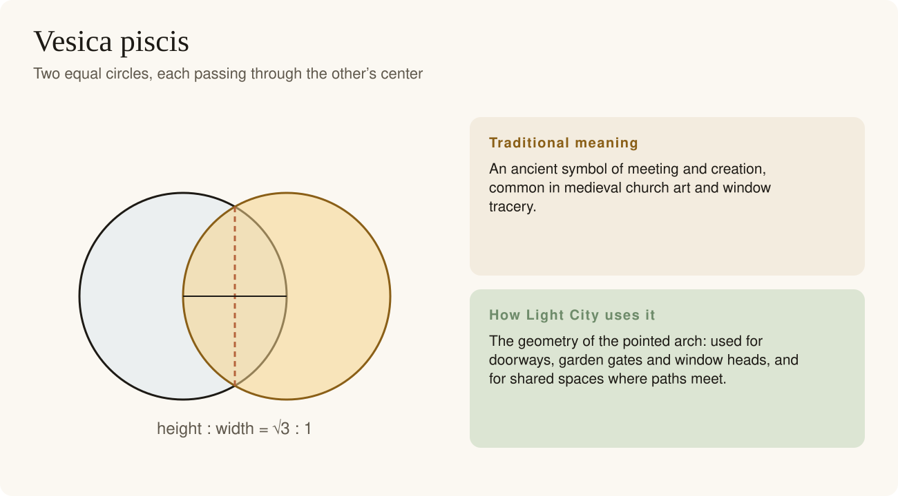
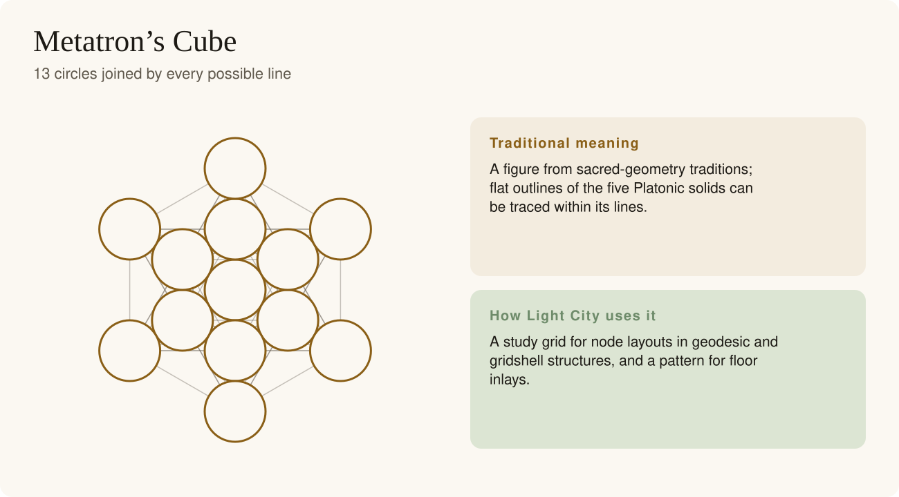

# Layout & Diagram Set

*Required diagrams and conventions for Light City*

## Completed Diagrams

### City Layout (Top-Down)

*Five rings and 12 radial paths around the spire and plaza; three communosphere domes in Phase 1.*

### Energy Flow System

*Phase 1 solar microgrid: make, store and steer, use. Proven technology only (TRL 8–9).*

### Sacred Geometry Foundations

*The Vesica Piscis: the geometry of the pointed arch, used for doorways and gates.*

*Metatron's Cube: a study grid for gridshell node layouts and floor inlays.*

## Required Diagram Set (Stage 1)
- City Plan (Top-Down): Concentric rings, radial spokes, ~12 communospheres
- Energy Grid: Nodes (spire, spheres, temples), pathways, flow direction
- Central Spire Cross Section: Structural zones, energy/resonance layers
- Communosphere Interior Concept: Levels, private/common spaces, resonance hardware
- Sacred Geometry Overlay: Flower of Life / Seed / Golden sections on city plan

## File Conventions
- Location: `assets/images/diagrams/`
- Naming: `diagram-<topic>-v1.png` (and source files if applicable)
- Export: PNG or SVG (prefer SVG for line work)
- Include legend and scale where possible

## Style Conventions
- Line: Deep Space Blue (#0B2447) at 70% opacity
- Highlights: Celestial Blue; Energy flows in Solar Gold → White Gold
- Background: Mist Gray or transparent
- Labels: Small caps, muted gray, leader lines at 1px

## Versioning
- Increment versions: `v1`, `v2` as you iterate
- Keep sources in `assets/images/diagrams/src/` (Figma, .blend, etc.)

## Delivery Checklist
- [ ] Exported PNG/SVG
- [ ] Source file saved
- [ ] Linked from relevant docs (`architecture.md`, `energy-systems.md`)
- [ ] Added to `assets/images/diagrams/README.md`

---

**Last reviewed**: November 2026  
**Related**: `architecture.md`, `energy-systems.md`, `visual-language.md`, `color-and-light.md`
