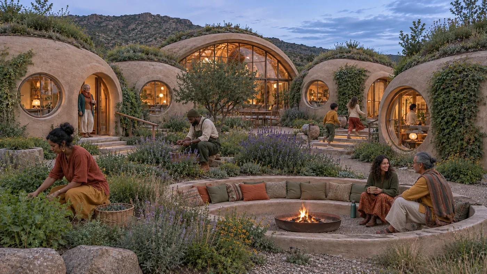
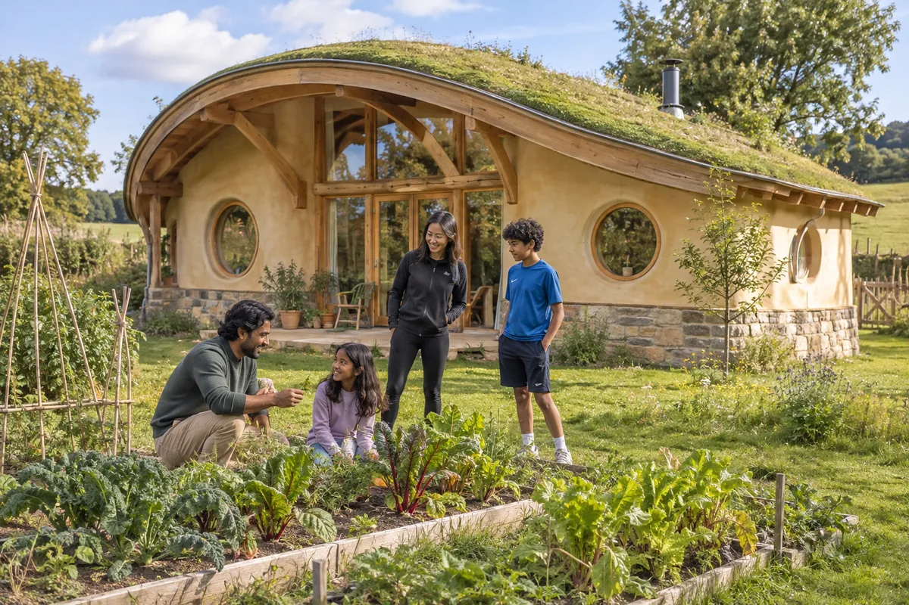
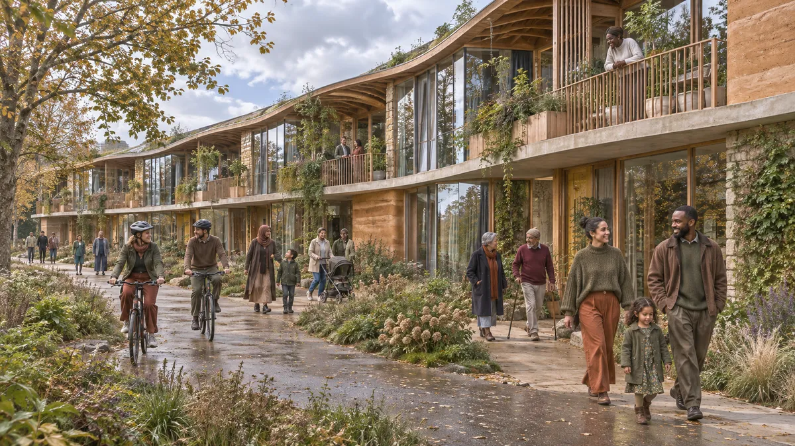
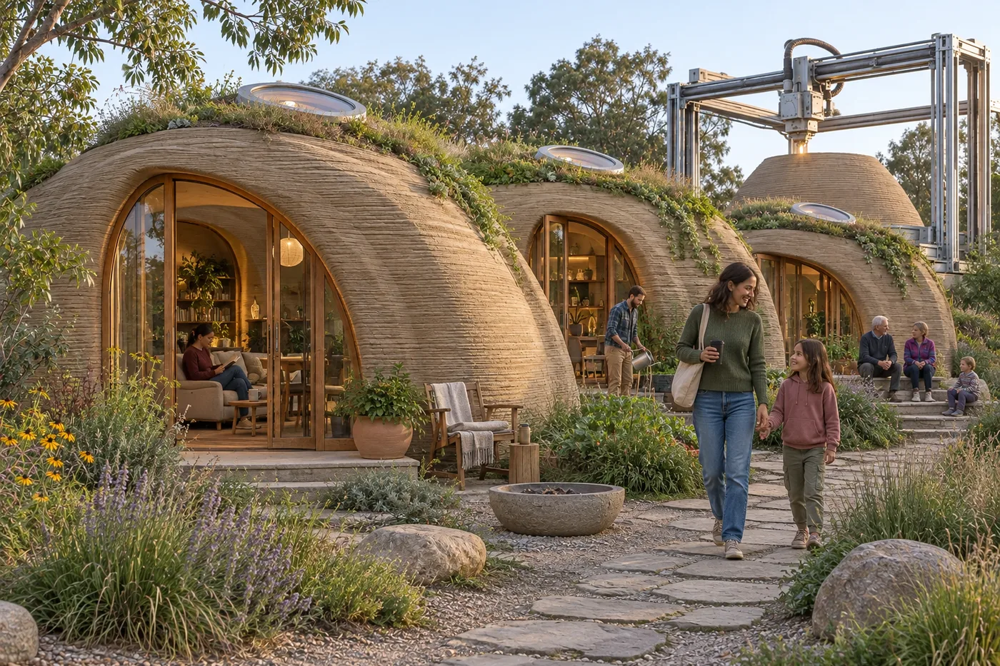
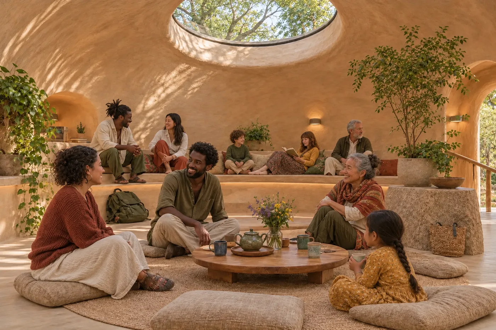
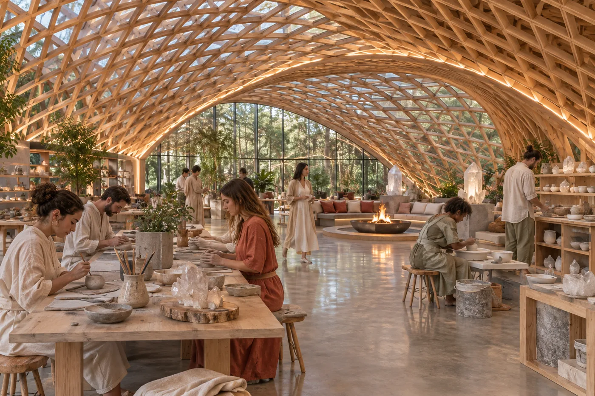
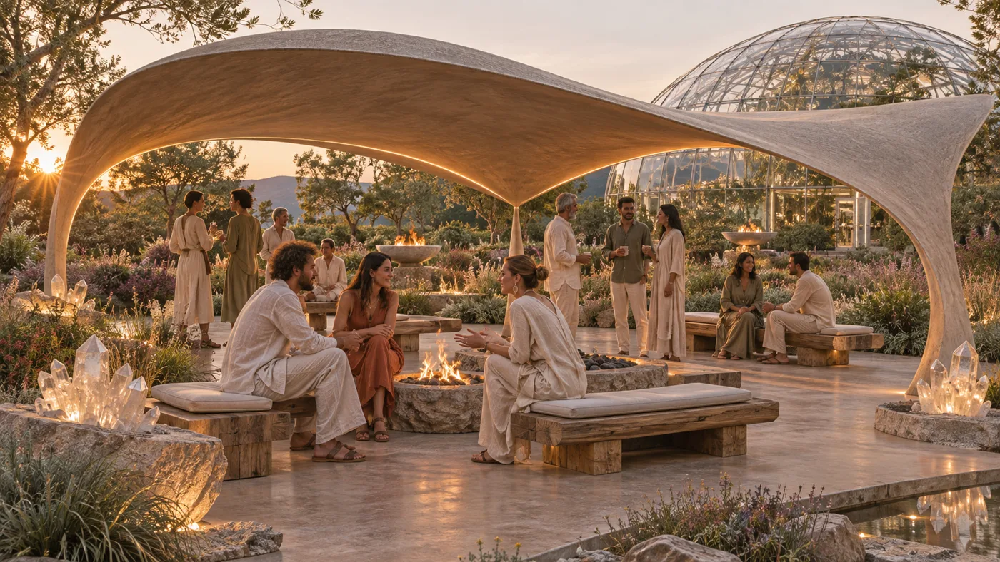

# Beyond the Box: Organic Forms & Healthy Materials

Most modern buildings are boxes because boxes are cheap to frame, furnish and permit. Light City wants buildings that feel alive: curved, daylit, made of breathing natural materials. This page sets out how to do that **without luxury budgets**, using a simple rule:

<figure>

<figcaption>Earthbag (superadobe) home</figcaption>
</figure>

<figure>

<figcaption>Timber and hempcrete home</figcaption>
</figure>

<figure>

<figcaption>Flowing terraces</figcaption>
</figure>

> **High-tech design, low-tech materials.** Use computers to find efficient curved shapes, then build them from earth, timber, bamboo, hemp and lime that local people can handle.

Each method shows its readiness horizon (**Proven, Scaling, Emerging, Frontier**), as defined in [Technology Horizon](/docs/technical/technology-horizon).

---

## What "energy flow" means here

People often say curved spaces have better "energy flow". We split that phrase into parts we can measure, plus one part we treat as research.

| Flow | What it means | Measurable today? |
|---|---|---|
| **Air** | Fresh air moving through a space without drafts or dead corners. Tall curved volumes encourage warm air to rise and exit through a top opening (the stack effect). | Yes: CO₂, air-change rate |
| **Heat** | Warmth stored and released smoothly. Spheres enclose the most space for the least surface, so less heat leaks in or out. | Yes: energy use, temperature swing |
| **Moisture** | Walls that absorb and release humidity, keeping air comfortable. | Yes: relative humidity |
| **Movement** | How people walk, meet and see each other. Curves remove dead-end corridors and corners. | Yes: observation, surveys |
| **Felt sense** | How a space feels: calm, uplifted, held. | Partly: preference and stress studies |
| **Subtle energy / bio-resonance** | Whether form, proportion and material affect the body in ways beyond the above. | No: **Frontier** research track (see below) |

---

## Why curves: the evidence

**People find curved rooms more beautiful.** In a brain-imaging study, participants judged curvilinear interiors more beautiful than rectilinear ones, and curved rooms activated the anterior cingulate cortex, a region linked to emotion ([Vartanian et al., PNAS 2013](https://www.pnas.org/doi/full/10.1073/pnas.1301227110)). A follow-up found design experts preferred curves for beauty, while non-experts were more likely to choose to enter curved spaces ([Vartanian et al., 2019](https://neuroaesthetics.med.upenn.edu/assets/user-content/documents/publications/vartanian-navarrete-chatterjee-fich-leder-modrono-rostrup-skov-corradi-nadal-2019-01.pdf)). The effect is real but modest; curves alone do not guarantee wellbeing.

**Curved shells use far less material.** Shapes that carry load in pure compression, like an arch or eggshell, can be very thin. ETH Zurich's funicular floor uses over 70% less concrete and 90% less reinforcing steel than a flat slab, and its low stresses allow weaker or recycled materials ([ETH Block Research Group](https://block.arch.ethz.ch/brg/publications/1106); [Design Build Review](https://designbuild.nridigital.com/design_build_review_dec21/concrete_floor_low_carbon)). The NEST HiLo roof shell averages only 8 cm thick ([Empa](https://block.arch.ethz.ch/brg/files/EmpaQuarterly53-NESTspecial-EN_HiLo_1465993628.pdf)).

**Domes can save heating and cooling energy, but check the numbers.** The Monolithic Dome Institute reports owners saving 50% or more on heating and cooling, thanks to the low surface area and exterior insulation over a thermal-mass shell ([Monolithic](https://www.monolithic.com/dome)). An independent thesis that modeled a dome school against the ASHRAE baseline found about **25%** savings, below the institute's 30–50% claim ([Polonkey thesis](https://www.monolithic.org/vault/pdf/thesis/polonkey.pdf)). We plan with the conservative figure.

### Honest trade-offs

| Challenge | What we do |
|---|---|
| **Furniture and fittings** are made for straight walls. | "Curved shell, efficient core": kitchens, baths and storage stay rectilinear inside a curved envelope; built-in curved benches use the edges. |
| **Acoustics.** Concave domes focus sound and can create strong echoes at the center ([Britannica](https://www.britannica.com/science/acoustics/Acoustic-problems)). Absorbers alone often cannot fix it; large redirecting surfaces or a changed geometry are needed ([ICA 2010](https://www.acoustics.asn.au/conference_proceedings/ICA2010/cdrom-ICA2010/papers/p707.pdf)). | Model acoustics from day one; use clay plaster, textiles and faceted or ribbed inner surfaces; avoid putting the focal point at ear height. |
| **Windows and openings** are harder in curved walls. | Standard flat glazing in timber frames set into openings; round skylights at the crown. |
| **Permits and insurance** favor familiar construction. | Start with small, permit-light structures (pavilions, studios, retreat pods) and gather test data before housing. |
| **Labor.** Curved builds often trade material savings for skilled labor. | Prefabricate parts, train residents, and use **faceted curves** (many flat panels approximating a curve) where full curves cost too much. |

---

## The toolbox

Methods ordered from cheapest and simplest to most engineered. Costs are indicative, from the cited sources; local prices vary widely.

| Method | Form | Cost signal | Health | Horizon | Best use in Light City |
|---|---|---|---|---|---|
| **Superadobe / earthbag** | Domes, vaults, round rooms | Materials $5–15/sf; owner-built homes $10–50/sf ([earth.dev](https://earth.dev/building-methods/earthbag)) | Earth walls, no off-gassing | **Proven** (permits vary) | Meditation pods, retreat cabins, self-build homes |
| **3D-printed earth** | Flowing ribbed domes | TECLA printer ~€132–160k; printed from local soil and rice husk ([3D Print](https://3dprint.com/280863/italian-eco-habitat-complete-thanks-to-wasps-3d-printing-cranes/)) | Raw earth, breathable | **Emerging** | Tiny-home clusters, garden walls, studios in dry climates |
| **Clay & lime plaster** | Any surface, especially curves | Low; hand-applied | Strong moisture buffering, ozone removal | **Proven** | Interiors of every building |
| **Bamboo (whole culm and composite walls)** | Arches, shells, curved frames | Two-bedroom homes under $20,000 in Ecuador ([BBC Future](https://bbc.com/future/article/20251028-the-bamboo-buildings-that-sway-in-earthquakes)) | Renewable, carbon-storing | **Proven** in tropics; codes elsewhere limited | Pavilions, shade structures, studios (climate permitting) |
| **Hempcrete** | Curved walls cast in forms | Installed $260–400/sf for recent US homes ([HempBuild](https://www.hempbuildmag.com/home/3-us-hempcrete-homes-2026)) | Breathable, carbon-storing | **Scaling** ([IRC Appendix BL](https://www.portotheme.com/hempcrete-vs-traditional-insulation-vs-mycelium-performance-cost-and-use-cases/)) | Insulating infill in timber frames; not a cost saver yet |
| **Timber gridshell** | Long-span double curves | Weald & Downland: gridshell 28% of £1,097/m² gross; erection labor is the main cost ([Univ. of Bath](https://purehost.bath.ac.uk/ws/portalfiles/portal/187940865/UnivBath_MPhil_2012_D_J_Naicu.pdf)) | Natural wood surfaces | **Proven** | Studios, greenhouses, dome roofs, market halls |
| **Thin funicular shells** | Vaults, floors, canopies | 70%+ less concrete; can use earth or recycled mixes ([ETH BRG](https://block.arch.ethz.ch/brg/publications/1106)) | Less cement | **Scaling** | Plaza canopies, floors in multi-level domes |
| **Local stone (dry-stone and lime-mortar masonry)** | Plinths, garden and terrace walls, thick curved walls, vaults | Lowest embodied carbon of common materials when quarried nearby; transport can outweigh extraction ([MPA, 2026](https://www.mineralproducts.org/MPA/media/root/Publications/2026/MPA-Dimension-Stone-naturally-low%E2%80%91carbon-report-Sept-2026.pdf)) | Inert, no off-gassing, high thermal mass | **Proven** for thousands of years | Foundations and plinths under earth walls, terraces, temple and hearth walls, paths |
| **Airform domes** | Monolithic domes | Fast, durable; uses spray foam and concrete | Foam needs careful specification | **Proven** | Storage, workshops, storm shelters (not living spaces by default) |

### Notes on the strongest options

**Superadobe (earthbag).** Long bags filled with moist earth are coiled into domes and tied with barbed wire. Nader Khalili's Cal-Earth developed the method; bag rolls cost $445–1,295 ([Cal-Earth](https://calearth.org/pages/superadobe-bags)), and UN refugee shelters have been built from about $625 ([WIPO](https://www.wipo.int/ar/web/ip-advantage/w/stories/the-poetry-of-architecture)). It is the most accessible way to build a curved room, and work parties can build it together.

**3D-printed earth.** TECLA in Italy (WASP with Mario Cucinella Architects) printed two linked raw-earth domes in about 200 hours from 60 m³ of local soil, with average power under 6 kW ([WASP](https://www.3dwasp.com/en/3d-printed-house-tecla/)). An earlier WASP print used about €900 of wall material ([Faircompanies](https://faircompanies.com/videos/wasp-3d-prints-round-eco-homes-from-any-local-raw-earth/)). Durability in wet or freezing climates is not yet proven, so this belongs in dry, mild sites first.

**Timber gridshells.** Thin wooden laths are laid flat as a grid, then bent into a double curve and locked. They span far with little material; the Savill Garden roof weighs about 40% of the British Museum Great Court roof for a similar area ([Univ. of Bath](https://purehost.bath.ac.uk/ws/portalfiles/portal/187940865/UnivBath_MPhil_2012_D_J_Naicu.pdf)). Optimized designs have cut material by about 26% ([BioResources](https://bioresources.cnr.ncsu.edu/wp-content/uploads/2019/01/BioRes_14_1_1364_Charest_PDM_Assess_Complex_Timber_Gridshells_Architect_14743.pdf)).

**Clay plaster: the cheapest health upgrade.** In full-scale simulations over four years, clay plaster held the indoor humidity swing to 10.8% versus 37% in a room with non-absorbent walls ([Univ. of Bath](https://purehost.bath.ac.uk/ws/portalfiles/portal/204879833/Comparison_of_moisture_buffering_properties_of_plasters_in_full_scale_simulations_and_laboratory_testing_noCorrection_1_.pdf)). EPFL research found clay plaster removes ozone with low byproducts and improved perceived air quality ([EPFL](https://www.epfl.ch/labs/hobel/the-effects-of-bio-based-construction-materials-on-indoor-air-quality/)). A German earth house held about 50% humidity for eight years ([PMC](https://pmc.ncbi.nlm.nih.gov/articles/PMC10381511/)). Clay works on curves, is repairable by hand and can go into every Light City building, including retrofits of existing homes.

## Stone, and materials that follow the place

Stone is one of the oldest and most widely used building materials on Earth, from mountain villages to volcanic islands. It belongs in Light City alongside earth and timber, with one rule: **the land decides the materials.** We build with what is underfoot or close by, and import only what the place cannot provide.

**Why stone.** Locally quarried natural stone has among the lowest embodied carbon of common building materials, averaging about 0.09 kg CO₂e per kg, but shipping it far can outweigh the quarrying itself ([Mineral Products Association, 2026](https://www.mineralproducts.org/MPA/media/root/Publications/2026/MPA-Dimension-Stone-naturally-low%E2%80%91carbon-report-Sept-2026.pdf)). A French study found cut-stone load-bearing walls 1.4 times less impactful than CLT and 2.7 times less than slag concrete at typical thicknesses ([Buildings & Cities](https://reference-global.com/download/article/10.5334/bc.278.pdf)). Stone is durable, repairable and reusable, and its thermal mass evens out day and night temperatures.

**A living craft.** Dry-stone building, without any mortar, is recognised by UNESCO as intangible cultural heritage across 13 European countries, including Spain ([UNESCO](https://ich.unesco.org/en/RL/the-art-of-dry-stone-walling-knowledge-and-techniques-02106)). On the Azores island of Pico, black basalt gathered on site built the walls, houses and cellars of a UNESCO World Heritage landscape ([UNESCO](https://whc.unesco.org/en/list/1117/)). In central Portugal, 27 restored schist villages show how local stone, clay and chestnut wood can be brought back to life ([Aldeias do Xisto](https://www.aldeiasdoxisto.com/en/villages/territory/)). In New Mexico, the ancestral Pueblo great houses of Chaco Canyon stand more than five storeys of sandstone and mud mortar after nearly a thousand years ([UNESCO](https://whc.unesco.org/en/list/353/)).

**How we use it.** Stone works best where it is strongest: in compression, close to the ground and in contact with water. Typical uses are plinths that keep earth walls dry, retaining walls for terraces, paths and courtyards, hearths and fire circles, the temple's inner wall, and thick walls in hot-dry climates. Glulam gridshells and glass stay above for light and long spans.

**Watch-outs.** Stone is heavy, so it needs careful engineering in earthquake zones (unreinforced masonry performs poorly). Dressing stone takes skilled labor, and only stone from the site or a nearby quarry keeps its low-carbon promise.

### Materials by candidate region

Each [candidate region](/docs/project/site-locations) has its own palette. The structure of the domes (glulam gridshell and glass) stays the same everywhere; walls, floors and landscape change with the place.

| Region | Main local materials | How the city would look and feel |
|---|---|---|
| **Northern New Mexico** | Adobe, rammed earth, sandstone, ponderosa and piñon timber | Earth-colored walls on sandstone plinths, deep window reveals, flat earth roofs on small buildings, as in the state's earthen code |
| **Klamath Basin, Oregon** | Mass timber and cob, local volcanic rock | Timber-forward buildings with cob infill, basalt plinths and garden walls, steep roofs for snow |
| **Central Portugal** | Granite and schist, rammed earth (taipa), chestnut and cork | Stone plinths and terrace walls on the slopes, lime-washed earth walls, cork insulation, chestnut beams |
| **Granada highlands, Spain** | Earth sheltering into clay hills, rammed earth, local stone | Homes partly dug into the hillside like the region's cave houses, white lime finishes, stone dry-walls on terraces |
| **Northern Costa Rica** | Timber and bamboo frames, river and volcanic stone, earth infill | Light, open, raised frames for airflow and earthquakes, stone only at the base and in landscape walls, deep roofs for rain |
| **Islands (if a future site is an island)** | Volcanic basalt or coral limestone, lime | Low, thick stone walls against wind and salt, as on Pico in the Azores |

---

## Applying it to Light City

| Building | Boxy default | Organic approach | Why it stays affordable |
|---|---|---|---|
| **Communosphere domes** | Steel frame and flat panels | CLT or glulam gridshell over curved terraces; clay-plastered interiors | Gridshell uses less wood; flat glazing panels |
| **Tiny homes** | Rectangular modules | Earthbag or printed-earth pods in clusters of 3–6 around a shared courtyard | Local soil; resident labor counts toward contribution-based residency |
| **Family ring housing** | Straight terraces | Gently curved terraces built from faceted prefab timber panels | Flat panels, curved plan |
| **Temple & quiet rooms** | Hall with flat ceiling | Earth, stone or timber dome tuned acoustically, with an oculus and one vertical quartz point on a stone pedestal at the center | Small spans; acoustic modeling is cheap compared with fixes |
| **Studios & market hall** | Shed | Timber or bamboo gridshell | Long span with little material |
| **Greenhouses** | Glass box | Gridshell with polycarbonate or glass | Proven agricultural shapes |
| **Plaza canopies & floors** | Concrete slab | Thin funicular shells | 70% less concrete |

### In the 3D model

The [3D model](pathname:///model/index.html?phase=2&view=builds) shows four home types on the same plots, so the plan does not depend on one method: earth-sheltered homes with green roofs, earthbag (superadobe) twin domes, ribbed 3D-printed earth domes with skylights in the style of [TECLA](https://www.3dwasp.com/en/3d-printed-house-tecla/), and timber frames with hempcrete infill, lime render and a stone plinth. Ring 4 mixes them plot by plot, and in Phase 1 it uses earth, earthbag and hempcrete only. Each Phase 2 courtyard is built by one crew with one method. Harder materials stay where they earn their place: stone plinths and paving, printed or thin-shell concrete for footings on wet ground, terrace floors and plaza canopies. Which mix is used depends on the site: printed earth suits dry, mild climates, and hempcrete suits cooler, wetter ones.

### An accessibility ladder

1. **Anyone, now:** clay plaster, natural textiles and rounded built-in furniture in an existing home. Costs a weekend and materials.
2. **Community build (Stages 2–4):** an earthbag meditation pod or garden pavilion at a retreat or partner site, built in a workshop. It becomes a teaching and test structure.
3. **Pilot homes (Phase 1):** a cluster of earth or printed tiny homes for residents on the lower contribution tiers, with sensors for humidity, temperature, CO₂ and sound.
4. **Signature structures (Phase 1–2):** gridshell domes, studios and shell canopies designed by engineers and built partly by trained residents.

Every step is useful by itself, so no one has to wait for the full city to benefit.

---

## Bio-resonance and subtle energy: a research track

Many people drawn to Light City sense that form, proportion and natural materials affect the body beyond comfort. We take that seriously **as a question**, not a claim. In line with the [Frontier horizon](/docs/technical/technology-horizon#frontier--study-openly-never-depend-on) rule (study openly, never depend on it), no health benefit is promised until it is measured.

**Low-cost, precautionary choices** that cost little and need no unproven claim:
- Natural, breathable, low-toxicity materials (earth, lime, timber, wool).
- Wired data in bedrooms and Wi-Fi that switches off at night, as a resident choice.
- Daylight-tuned lighting and quiet mechanical systems.
- Rooms tuned for pleasant acoustics (sound, chanting, music).

**Open research questions** (**Frontier**, TRL 1–3):
- Do curved, clay-plastered rooms change heart-rate variability, sleep or stress compared with matched rectangular rooms?
- Does room resonance (the frequencies a space naturally reinforces) affect relaxation during sound or meditation practice?
- Do residents of earth and timber homes report different wellbeing over a year, once cost and community are controlled for?

**How we would test it:** build matched pairs of rooms (curved vs. box, clay vs. gypsum) at the first pilot, measure air, heat, humidity and sound continuously, and invite residents into simple, consent-based studies with university partners. Results are published either way. See [Open Questions](/docs/research/open-questions).

---

## Related

- [Architecture](/docs/design/architecture): the city plan and building types
- [Communospheres](/docs/concepts/communospheres): the dome neighborhoods
- [Sacred geometry](/docs/concepts/sacred-geometry): proportion systems behind the plan
- [Technology catalog](/docs/technical/technology-catalog): systems with TRL and suppliers
- [Urban retrofit guide](/docs/technical/urban-retrofit-guide): bringing these ideas to existing homes
