# Structures of Light City: A Photo Guide

Every structure you can click in the [3D model](pathname:///model/index.html) has a picture here, with what it is, when it is built and a link to see it in the model. The pictures are concept renderings made for this project, not photographs of a built place. They show the intended materials: curved glulam and CLT timber, glass, living walls, rammed earth and clay plaster, local stone, and concrete where it does the hard work out of sight, in foundations, tanks and weirs.

The model and its info cards use the same pictures. The full reasoning for each part is in [How the City Grows](/docs/design/growth-plan) and the pages linked under each entry.

## The centre and civic life

### Central plaza {#plaza}

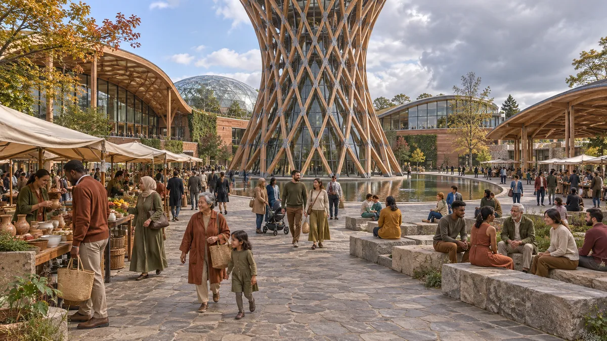

The round stone plaza at the heart of the city, with a ring of reflecting water around the foot of the spire. The heart rill brings water from the lake into this pool. It is the main gathering place for festivals and the daily market.

[See it in the 3D model](pathname:///model/index.html?view=plaza) · [Read the full description](/docs/design/architecture/#1-the-central-plaza)

### Crystal Point spire {#spire}

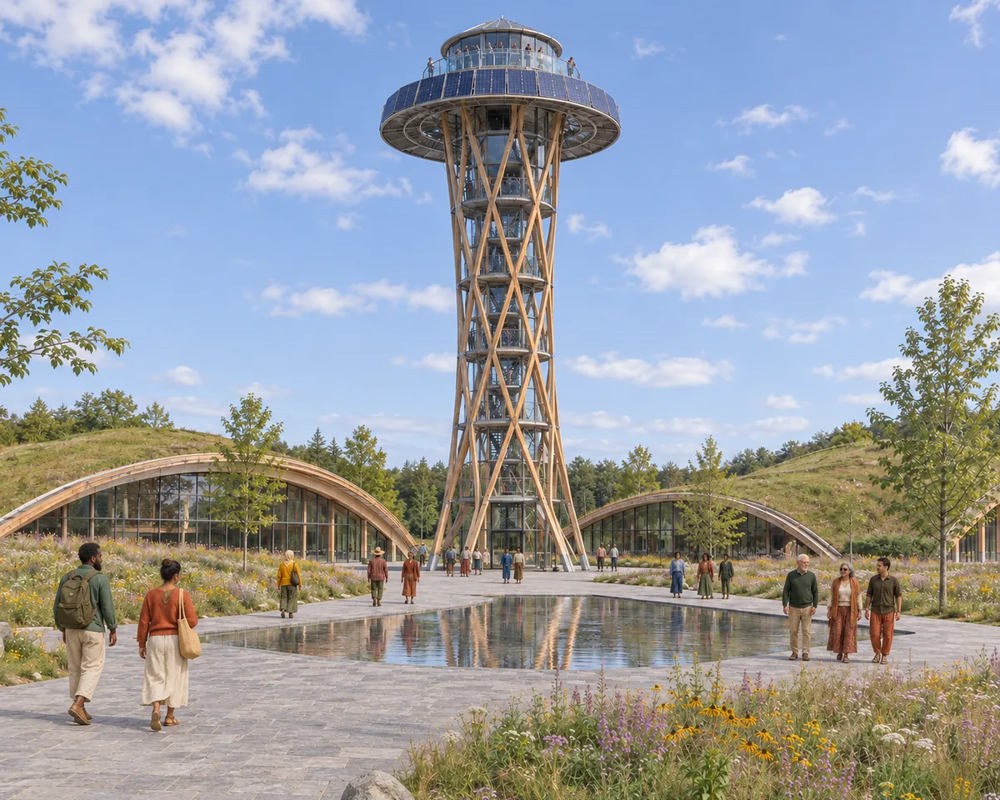

The city's landmark, shaped like a natural quartz point: a twelve-sided crystal of solar glass diamonds on a white steel diagrid, 61 m across at the foot, narrowing like a gentle cone to 44 m at 150 m, then curving in at the shoulders to a blunt 26 m faceted glass point at 230 m, with its mast reaching 240 m. Each tall diamond is cut into four glass facets, blue and violet above, warm amber and clear below, so the crystal sparkles like a cut stone. It is built in sections on a foundation sized for the final height: 90 m in Phase 1, 150 m in Phase 2 and 240 m in Phase 3, with a short temporary glass point on top until the full point and wind crown are built. Inside: a base hall, a gathering level at 30 m, a water tank at about 60 m, an enclosed double-height observatory with a café at 72 m, a mirrored globe room at 82 m, a learning level, a prism hall and a star room inside the glass point. The glass skin and the wind crown give supplemental power, not the city's main supply.

[See it in the 3D model](pathname:///model/index.html?view=spire&phase=3) · [Read the full description](/docs/design/architecture/#the-central-spire)

### Wind crown {#spirecrown}

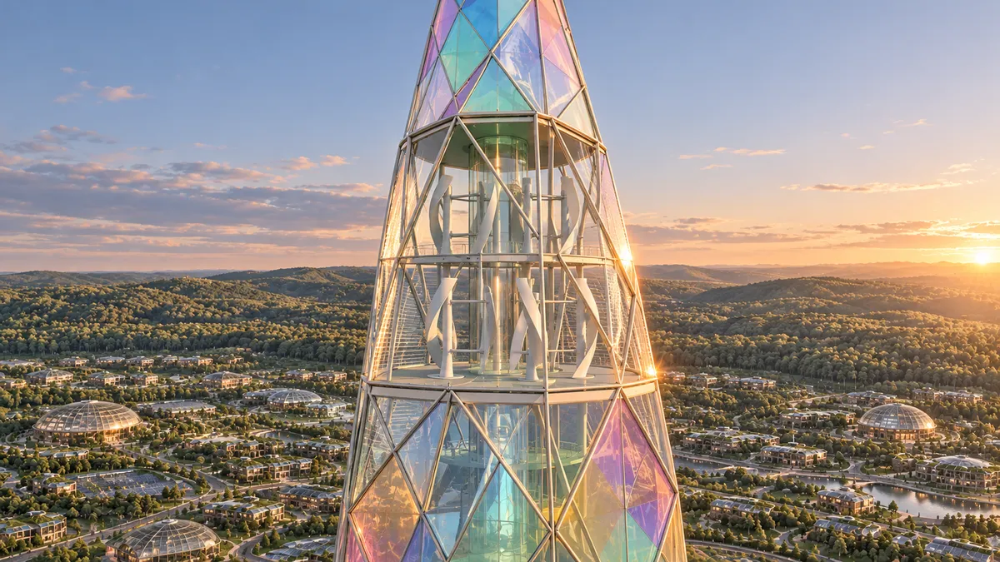

Phase 3 only. Between 150 and 204 m the glass climbs on a slant into an open white lattice with a fine ring in every other open diamond and slim members round the turbines, higher on one side than the other, so the wind passes through: six helical vertical-axis turbines about 9 m across and 18 m tall, three per level round a central mast, the upper row turned 60 degrees so the six fill every corner. Helical blades give smooth torque; rubber mounts, speed control, the open lattice and a tuned water damper at 214 m keep vibration out of the rooms below, and the turbine floors are not occupied. Expect very roughly 0.5 to 1 GWh a year from the glass and the wind together, a supplement to the city's solar fields.

[See it in the 3D model](pathname:///model/index.html?view=crown&phase=3) · [Read the full description](/docs/design/architecture/#the-wind-crown)

### Spire lift core {#spirecore}

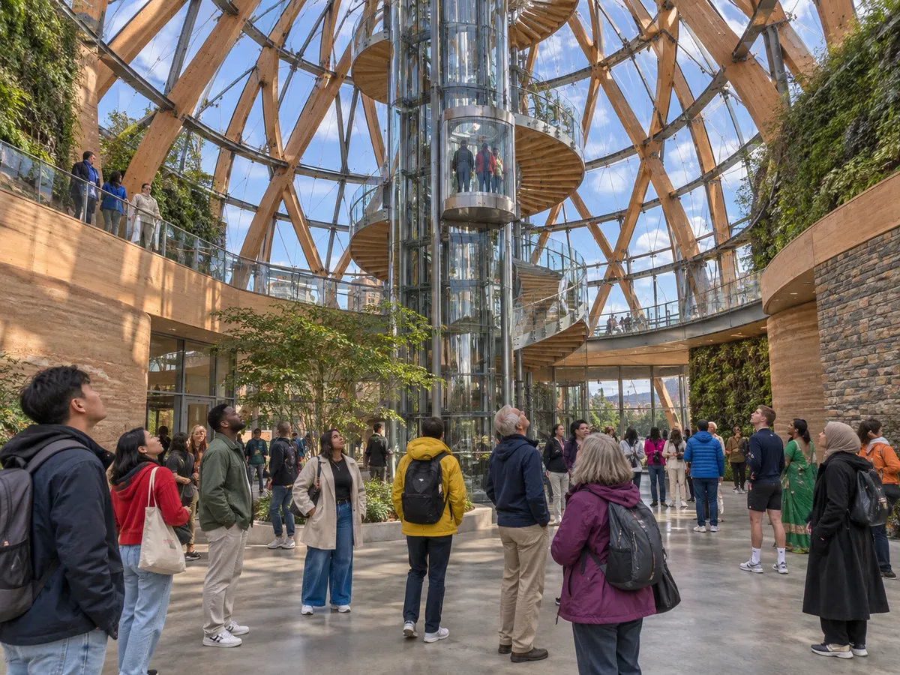

A concrete shaft wrapped in a glass core at the centre of the crystal, with two public lifts, a fire and goods lift and two stairs. It rises with each new section and serves every level from the base hall to the wind crown; the double glass skin around it works as a solar chimney that draws fresh air up the tower.

[Read the full description](/docs/design/architecture/#the-central-spire)

### Spire gathering level {#spirelevel}

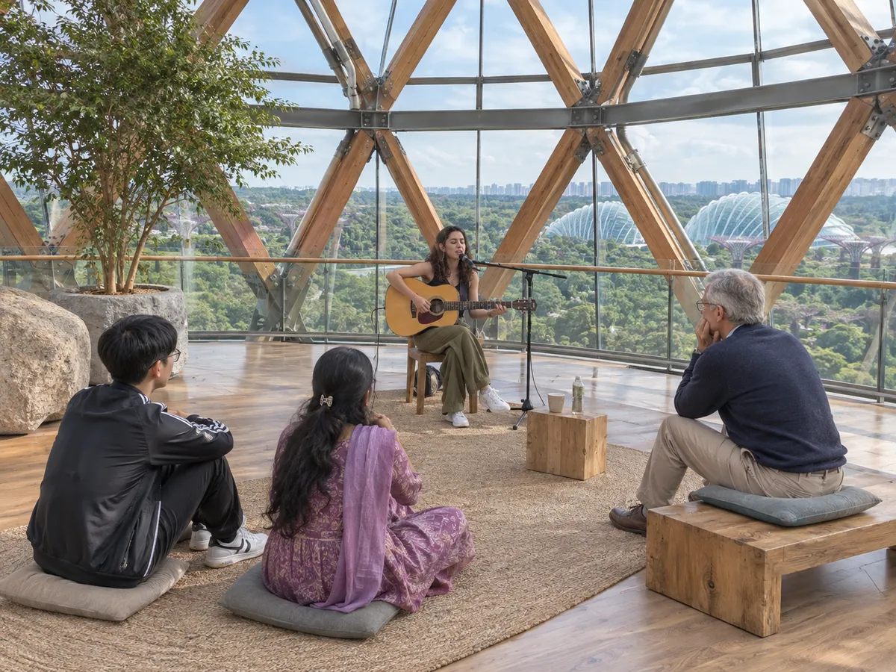

A twelve-sided hall at 30 m for talks, small concerts and quiet sitting above the trees, with about 120 seats, reached by the lifts. The enclosed observatory is higher up, at 72 m.

[Read the full description](/docs/design/architecture/#the-central-spire)

### Spire base hall {#spirehall}

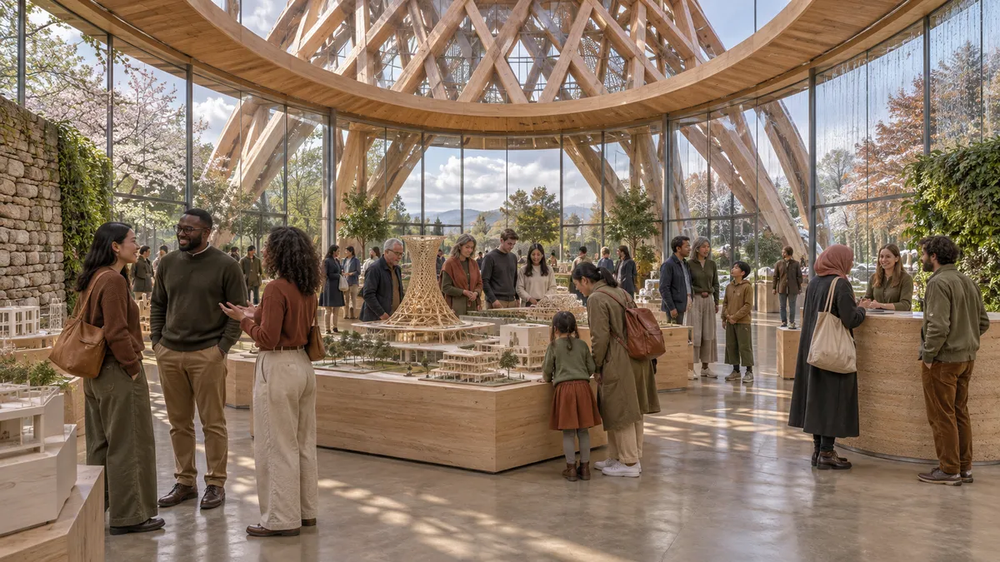

The glass hall at the foot of the crystal, where the lifts start. The main entrance faces south across the park; service comes in from the north. It holds the welcome desk, exhibitions about the project, a café and, in Phase 1, the room where the council meets. Batteries, grid control and pumps sit in the basement below.

[Read the full description](/docs/design/architecture/#the-central-spire)

### Spire Park {#spirepark}

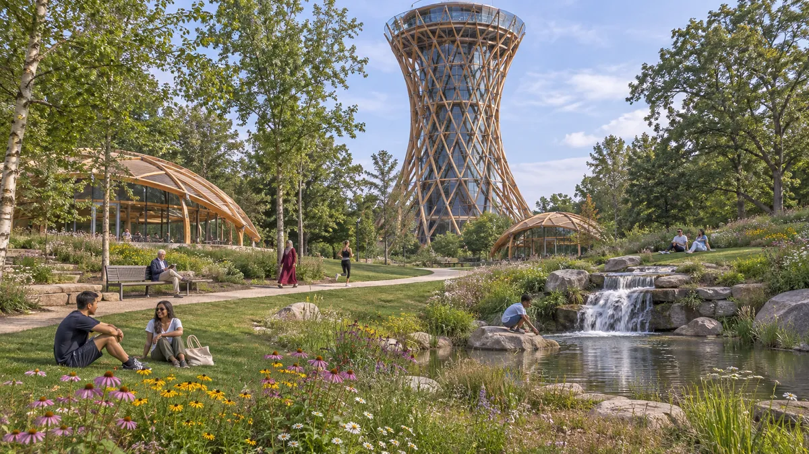

The park in ring 2 around the foot of the spire: open lawns for picnics and play, groves of trees on the quiet sides, the park waterfall and the amphitheatre. It is the open ming tang in front of the spire, kept free of buildings so the whole town can gather and see the tower.

[See it in the 3D model](pathname:///model/index.html?view=spirepark) · [Read the full description](/docs/design/growth-plan/#the-spire-park-and-the-woods)

### Park waterfall {#waterfall}

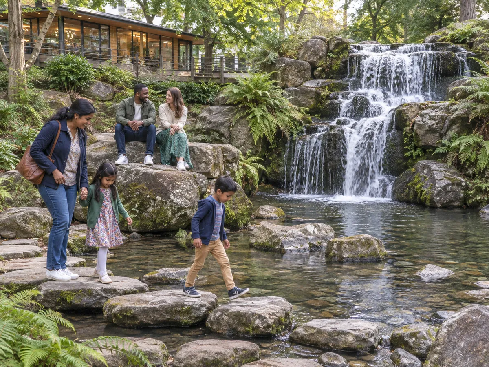

A waterfall of local boulders in the Spire Park. Water pumped by solar from the heart rill falls over two ledges into a plunge pool and runs back to the rill, so it cools the air and sounds like a stream.

[See it in the 3D model](pathname:///model/index.html?view=falls) · [Read the full description](/docs/design/growth-plan/#the-spire-park-and-the-woods)

### Plaza amphitheatre {#amphitheatre}

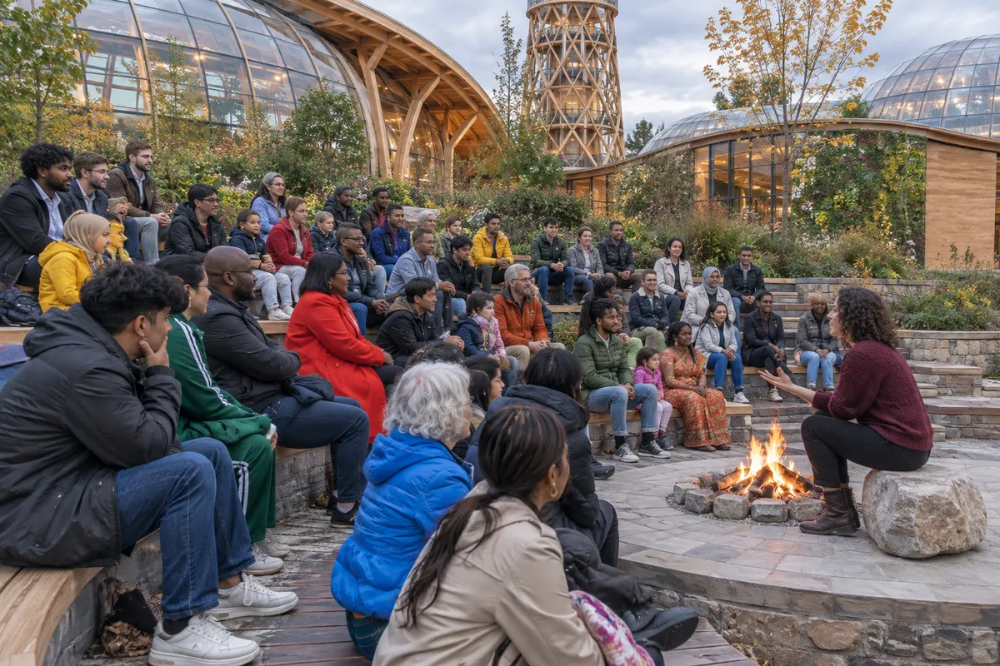

Curved timber and stone steps on the plaza, facing a fire circle, for gatherings, storytelling, music and festivals. It sits between two radial paths, so the paths pass beside it, not through it.

[See it in the 3D model](pathname:///model/index.html?view=amphitheatre) · [Read the full description](/docs/design/growth-plan/#phase-by-phase)

### Council House {#councilhouse}

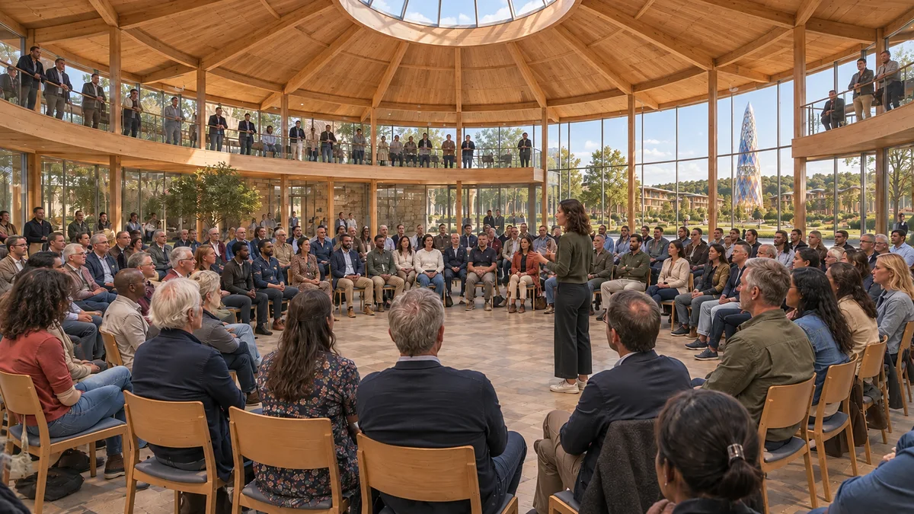

The city hall of Light City: a round glass hall with a timber roof and an oculus open to the sky, facing the spire across the park. Inside, the council sits in a circle with no raised seat, and the public sits in the outer rings. Open council meetings every month and town halls every quarter; major decisions need 80% consent. In Phase 1 the council of four meets in the spire hall; this house is built in Phase 2 for the council of thirty.

[See it in the 3D model](pathname:///model/index.html?view=council&phase=2) · [Read the full description](/docs/design/growth-plan/#the-council-house)

### Temple {#temple}

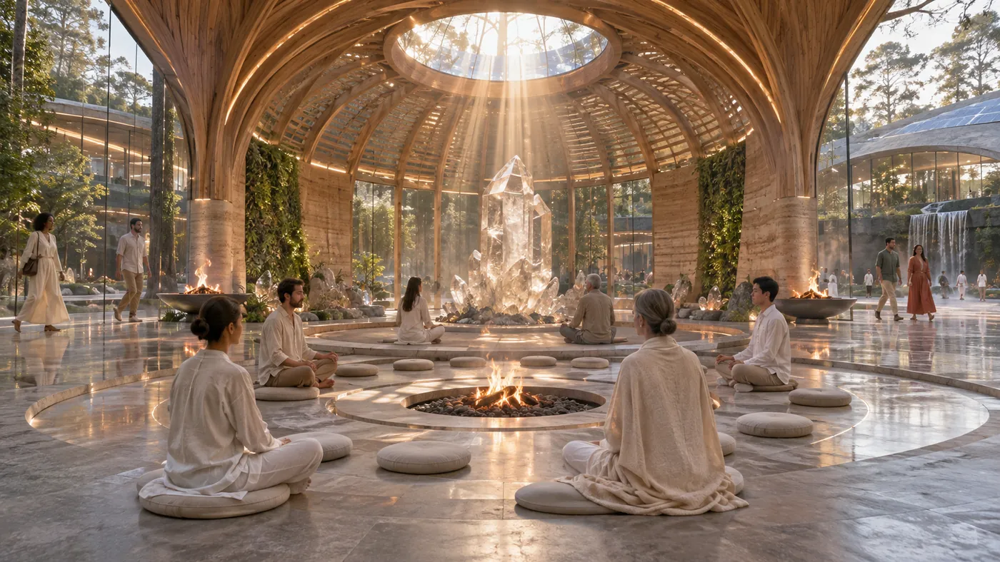

The first temple, a timber-frame dome on a stone base in the ring around the plaza. A quiet space for meditation, ceremony and sound, open to everyone.

[Read the full description](/docs/design/architecture/#2-temples-and-meditation-spaces)

### Learning pavilion {#learning}

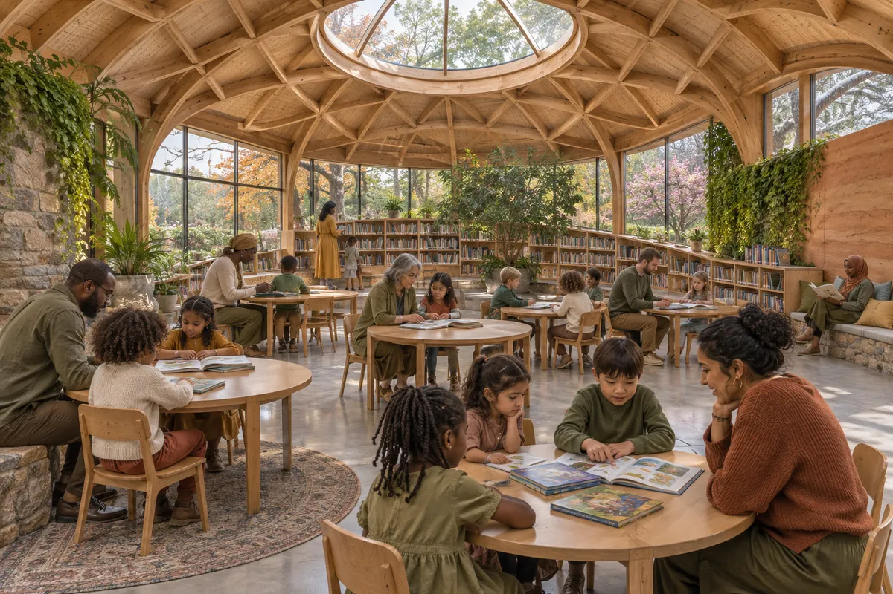

A timber pavilion for classes, workshops and shared study, one of the ring of pavilions around the plaza. In Phase 1 it holds a small multi-age school and the library. More are added on reserved sites in each phase.

[Read the full description](/docs/design/growth-plan/#learning-health-and-care)

## Homes

### Communosphere, 40 m {#dome40}

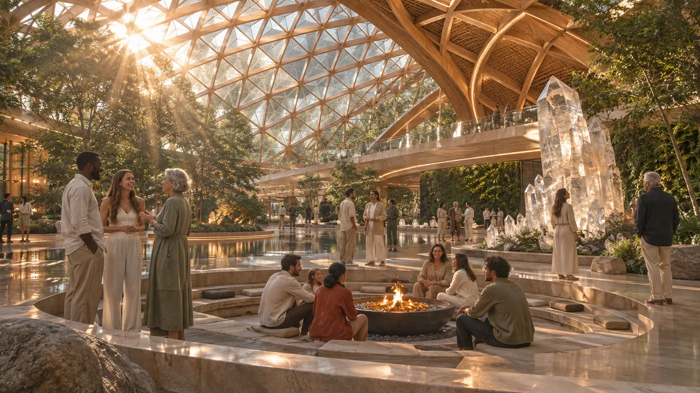

A home for about a hundred people: a timber gridshell with clear glazing low down, solar glass on the sunny side and green panels on the shaded side. Homes step back on three levels around a garden atrium with a rain pool under an open oculus; the ground floor is a shared commons with the kitchen and dining hall, a movement and yoga room, a sound room, a tool library, childcare and a laundry. In Phase 1 one dome also keeps a health room for first aid and a visiting clinician. The dome sits between two radial paths, so no path runs into it. Its main doors, under timber vaults, face the plaza and the outer rings and open onto forecourts on the ring paths; smaller side doors open onto the radials.

[See it in the 3D model](pathname:///model/index.html?view=dome) · [Read the full description](/docs/concepts/communospheres/)

### Communosphere, 44 m {#dome52}

A larger Phase 2 dome on a plot reserved since Phase 1, with homes on four terraced levels around a garden atrium, a shared commons with a kitchen, yoga room, sound room, tool library and childcare, and solar glass on the sunny side. The dome sits between two radial paths, so no path runs into it. Its main doors, under timber vaults, face the plaza and the outer rings and open onto forecourts on the ring paths; smaller side doors open onto the radials.

[Read the full description](/docs/concepts/communospheres/)

### District communosphere, 80 m {#dome80}

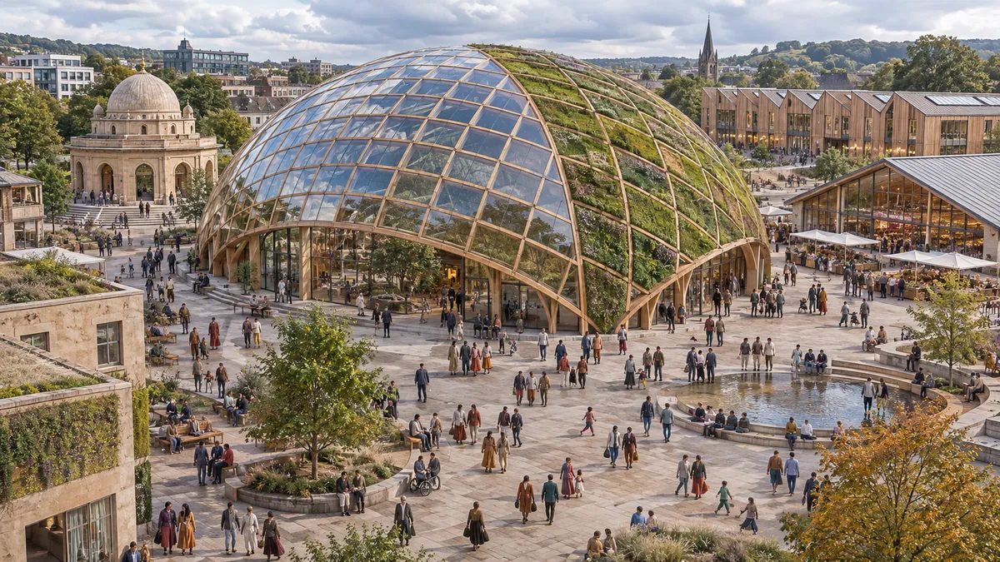

The largest dome, at the centre of each Phase 3 district, with homes on five terraced levels. Its square also holds the district temple, a market hall and a row of workshops. The dome sits between two radial paths, so no path runs into it. Its main doors, under timber vaults, face the plaza and the outer rings and open onto forecourts on the ring paths; smaller side doors open onto the radials.

[Read the full description](/docs/concepts/communospheres/)

### Reserved dome plot {#nursery}

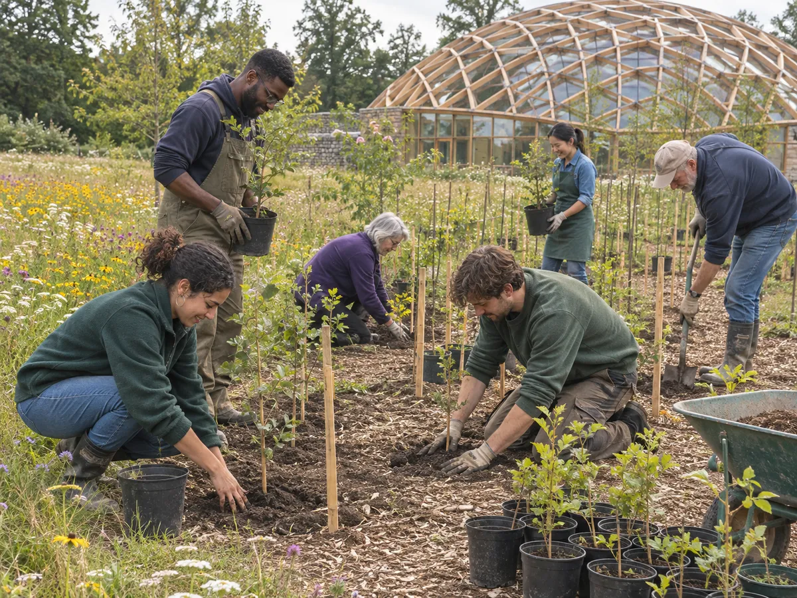

A plot kept for a future dome. Until it is built it is meadow and a tree nursery; the young trees are replanted elsewhere when the dome goes up. Nothing built in one phase is torn down in the next.

[Read the full description](/docs/design/architecture/#phased-development--scale)

### Earth-sheltered home {#earthhome}

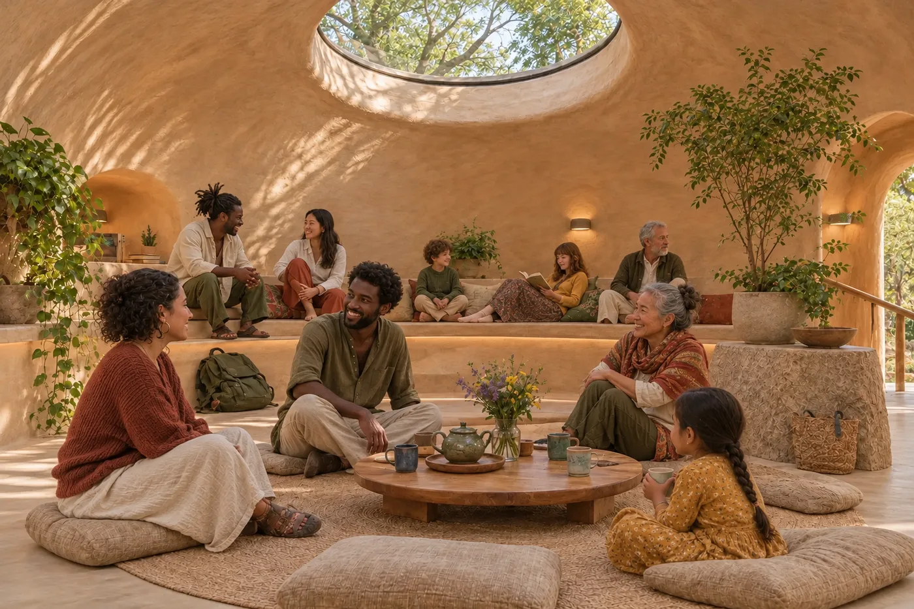

A small family home with rammed-earth walls and a green roof, half dug into the ground for steady temperatures. Ring 4 has 60 fixed plots built with four methods: earth-sheltered, earthbag domes, timber and hempcrete, and 3D-printed earth. Phase 1 builds 30 and later phases fill the gaps.

[Read the full description](/docs/design/organic-forms-and-materials/)

### Earthbag (superadobe) home {#earthbaghome}

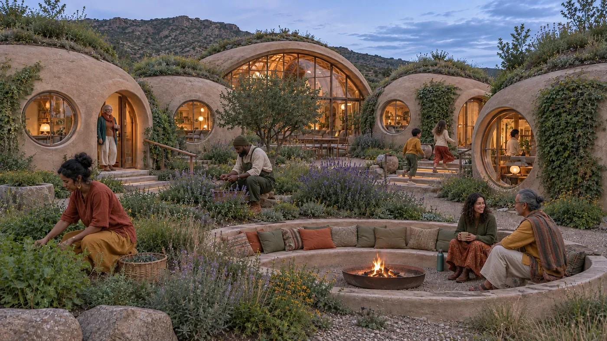

Two joined domes of long earth-filled tubes, coiled and laid by hand, then lime-plastered. Cheap, quick to learn and strong in earthquakes and storms, so it suits the first self-build homes.

[Read the full description](/docs/design/organic-forms-and-materials/)

### 3D-printed earth home {#printedhome}

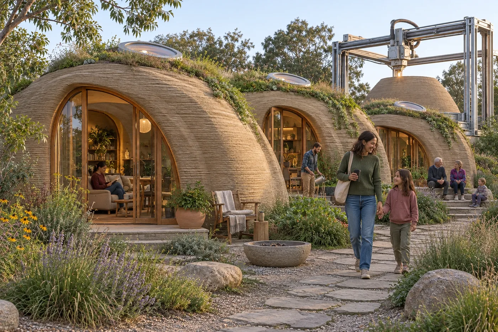

Twin ribbed domes printed from local clay and fibre, in the style of the TECLA house, with skylights at the top. A good fit for dry, mild sites; a printed-concrete footing can sit under wet ground.

[Read the full description](/docs/design/organic-forms-and-materials/)

### Timber and hempcrete home {#hemphome}

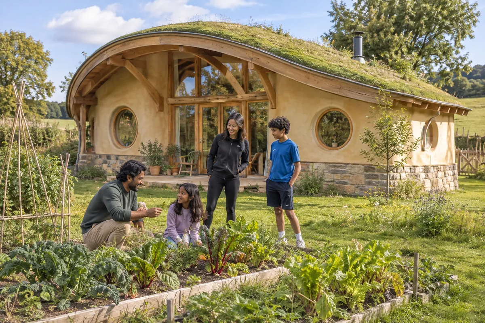

A timber frame filled with hempcrete (hemp hurd and lime), finished with lime render on a stone plinth, under a curved green roof. Hempcrete stores carbon, breathes and insulates well, and suits cooler, wetter sites.

[Read the full description](/docs/design/organic-forms-and-materials/)

### Courtyard cluster {#courtyard}

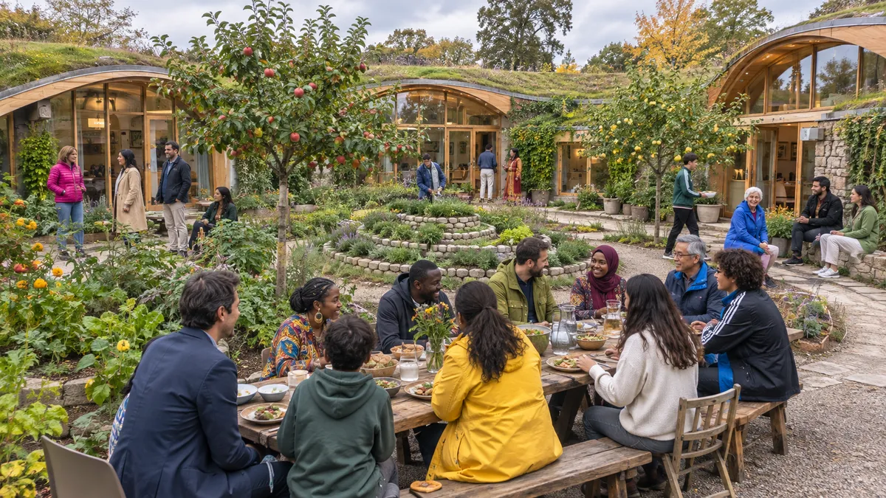

A Phase 2 neighbourhood unit: six homes set round a shared garden. Each courtyard is built by one crew with one method (earth-sheltered, earthbag, timber and hempcrete, or 3D-printed earth), so the mix varies from cluster to cluster. The clusters form a new ring outside the village core.

[See it in the 3D model](pathname:///model/index.html?view=courtyards&phase=2) · [Read the full description](/docs/design/architecture/#phased-development--scale)

### Flowing terraces {#terrace}

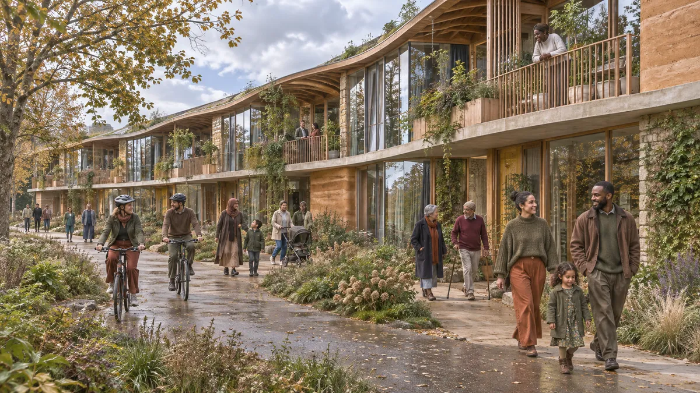

Phase 3 homes in crescents along the rings, two storeys rising to three. Curved glass facades, thin-shell concrete floor and balcony bands, timber roof edges, green roofs with skylights and living-wall ends; gardens pass between the buildings.

[See it in the 3D model](pathname:///model/index.html?view=terraces&phase=3) · [Read the full description](/docs/design/organic-forms-and-materials/)

### Courtyard terraces {#cityblock}

Two- and three-storey buildings that fill in the rings as the city grows: timber frames, wide glass, green or solar roofs and balconies, with homes above and studios, cafés and workshops at street level. They curve with the rings, sit between the paths and gardens, and leave room for glass garden halls and trees.

[See it in the 3D model](pathname:///model/index.html?view=close&phase=2) · [Read the full description](/docs/design/architecture/)

## Neighbourhoods and work

### District square {#districtsquare}

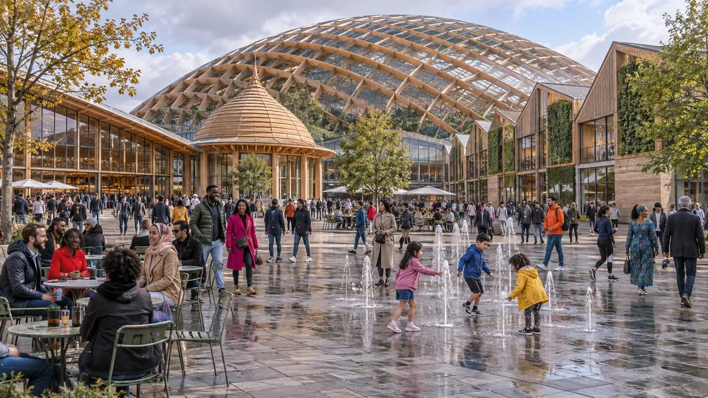

The paved centre of a Phase 3 district, with an 80 m communosphere, a small temple, a market hall and a row of workshops.

[Read the full description](/docs/design/planning-principles/#work-and-daily-flows)

### District temple {#districttemple}

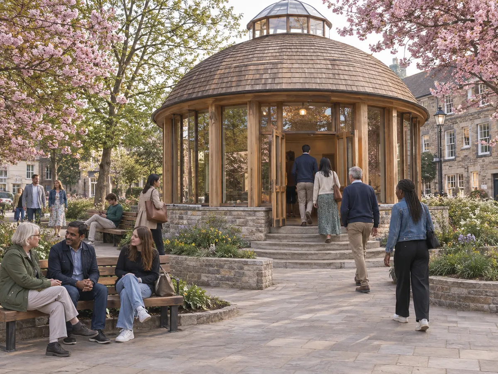

A small temple on each Phase 3 district square, so a quiet space is a short walk from every home.

[Read the full description](/docs/design/architecture/#2-temples-and-meditation-spaces)

### Mobility hub {#hub}

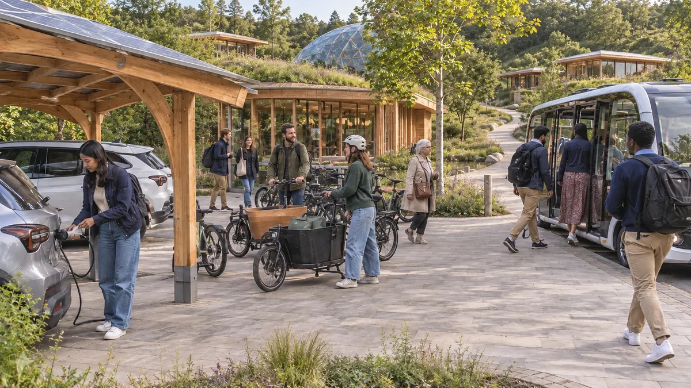

Where cars stop: shared electric cars under solar carports, e-bikes and a shuttle stop. Inside the city people walk, cycle or take the boats; each district is reached by car from one point. A footpath leads from every hub to the nearest ring path.

[See it in the 3D model](pathname:///model/index.html?view=hub) · [Read the full description](/docs/design/planning-principles/#movement)

### Hub battery and substation {#hubbattery}

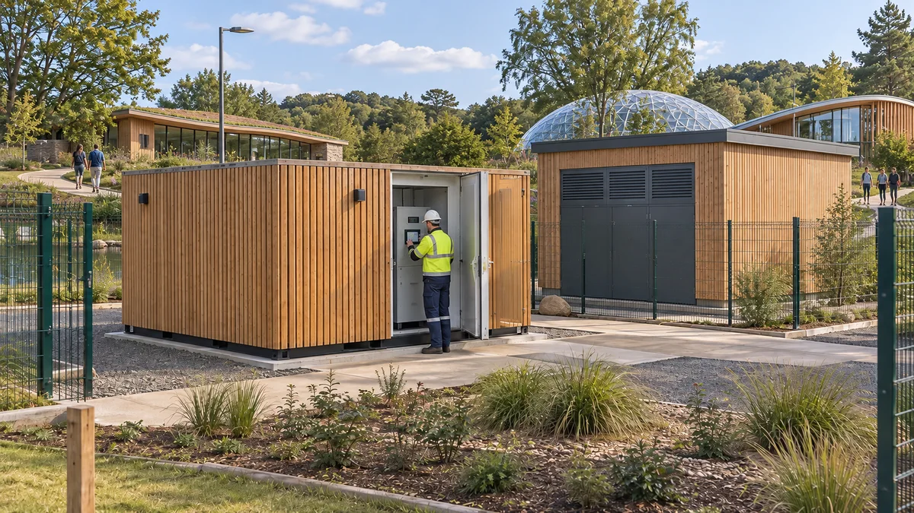

A battery container and compact substation at each mobility hub. They store solar power for the chargers and the district, and let it carry on alone in an outage.

[Read the full description](/docs/design/infrastructure/#power)

### Neighbourhood work hub {#workhub}

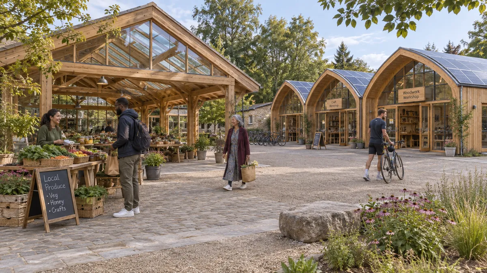

A small square with a timber market hall and three workshops with solar roofs, a few minutes on foot from every home. Work is spread through the city, so most people walk to work and the morning traffic runs in every direction.

[See it in the 3D model](pathname:///model/index.html?view=work&phase=2) · [Read the full description](/docs/design/planning-principles/#work-and-daily-flows)

### Market hall {#market}

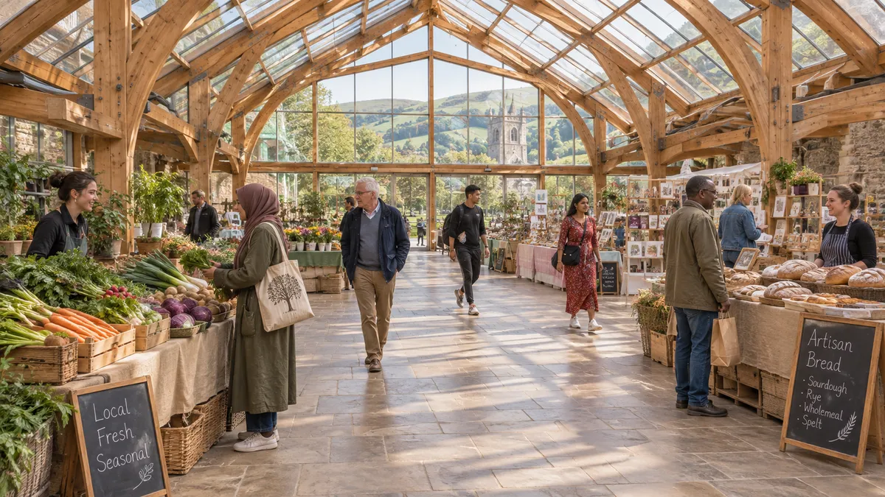

A timber market hall with a glass roof, part of a work hub or district square, for food, crafts and everyday trade.

[Read the full description](/docs/design/planning-principles/#work-and-daily-flows)

### Workshop {#workshop}

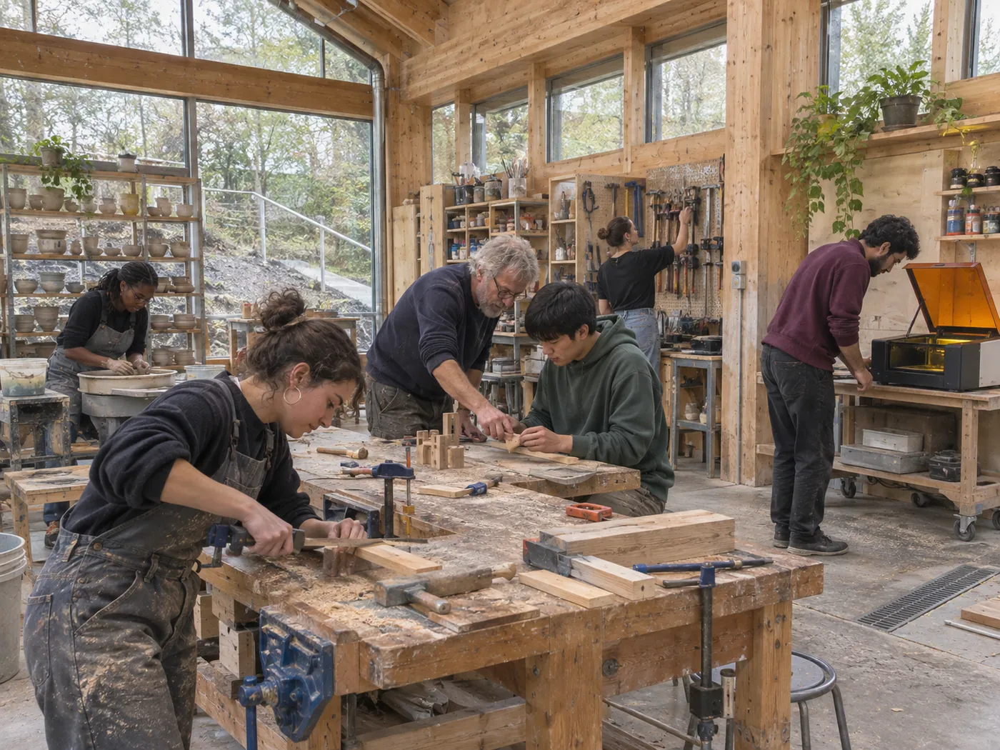

A timber vault with a solar roof for making, repair and small businesses. Workshops sit beside the market halls in each work hub and district.

[Read the full description](/docs/design/architecture/#5-creative-studios)

## Food and energy

### Orchard and food forest {#orchard}

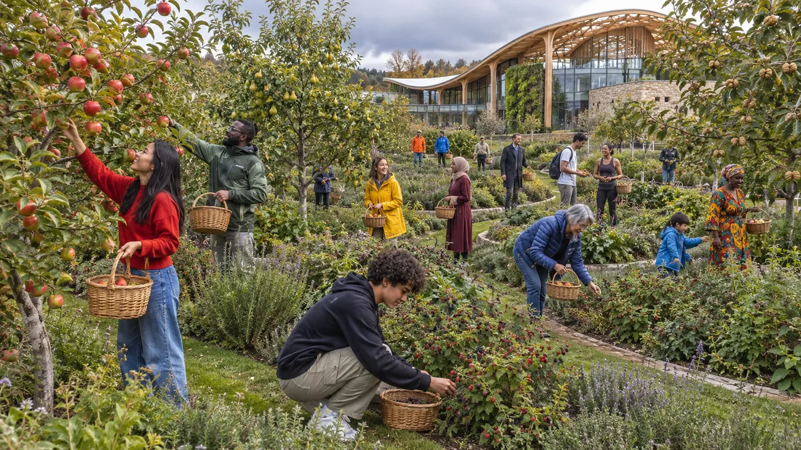

Curving rows of fruit and nut trees, about 1–2 ha, planted in Phase 1 with berries and herbs beneath them. They are watered with cleaned water from the reed beds.

[See it in the 3D model](pathname:///model/index.html?view=orchard) · [Read the full description](/docs/design/growth-plan/#phase-by-phase)

### Care farm {#carefarm}

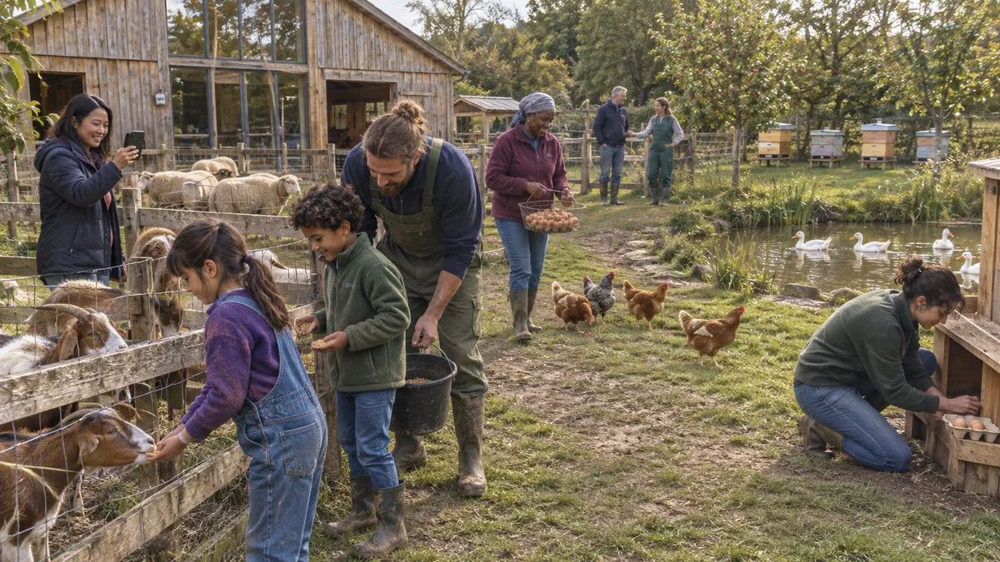

A small farm by the orchard where children and adults look after goats, sheep, hens, ducks and bees. A timber barn, a hen house, fenced paddocks, beehives and a duck pond. Manure goes to the compost bays and the orchard; eggs and honey go to the shared kitchens.

[See it in the 3D model](pathname:///model/index.html?view=carefarm) · [Read the full description](/docs/design/growth-plan/#animals)

### Solar greenhouse {#greenhouse}

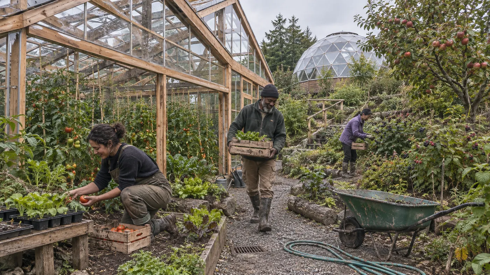

A vaulted greenhouse in the food and energy belt for year-round vegetables and seedlings, alongside food-forest rows and agrivoltaic fields.

[Read the full description](/docs/technical/technology-catalog/#food-production)

### Aquaponics tunnels {#aquaponics}

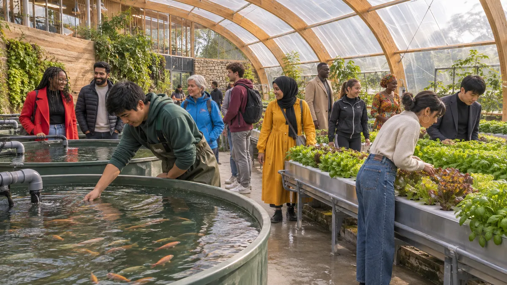

Polytunnels where fish tanks feed vegetable beds and the plants clean the water for the fish.

[See it in the 3D model](pathname:///model/index.html?view=food&phase=2) · [Read the full description](/docs/design/growth-plan/#phase-by-phase)

### Food-processing hall {#foodhall}

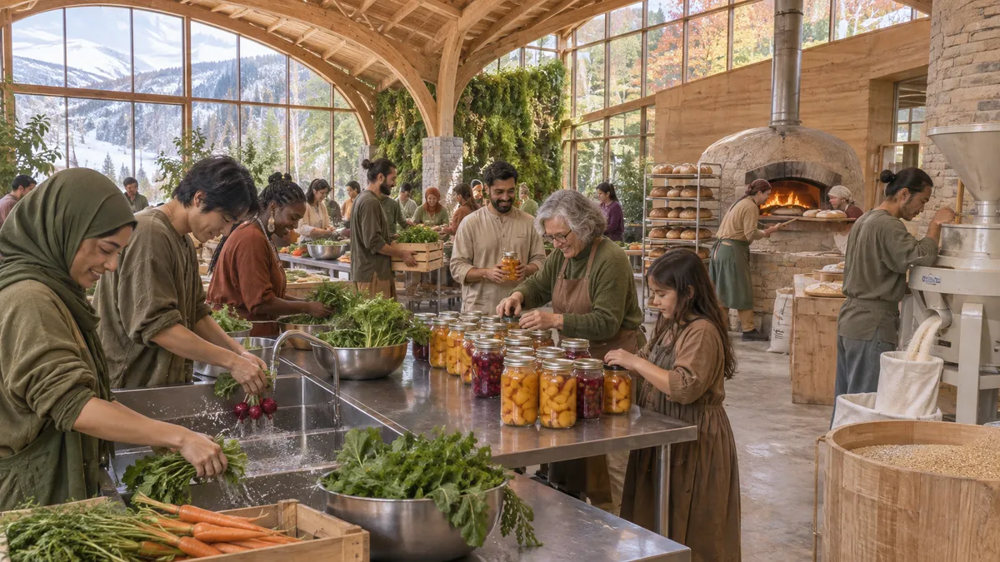

A shared hall for washing, preserving, drying, milling and storing the harvest, next to the aquaponics tunnels.

[See it in the 3D model](pathname:///model/index.html?view=food&phase=2) · [Read the full description](/docs/design/growth-plan/#phase-by-phase)

### Vertical farm {#verticalfarm}

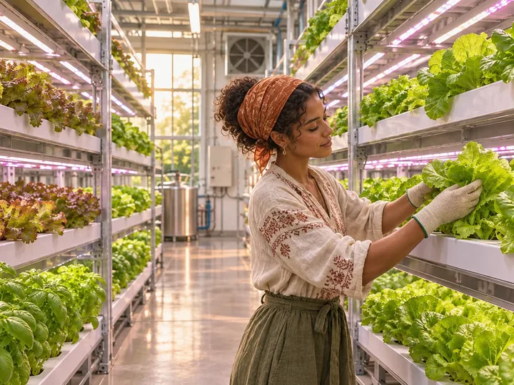

A glazed tower of growing floors for leafy greens and herbs all year, powered by the town's solar fields.

[See it in the 3D model](pathname:///model/index.html?view=farm&phase=3) · [Read the full description](/docs/design/growth-plan/#phase-by-phase)

### Solar array, ring 5 {#solar}

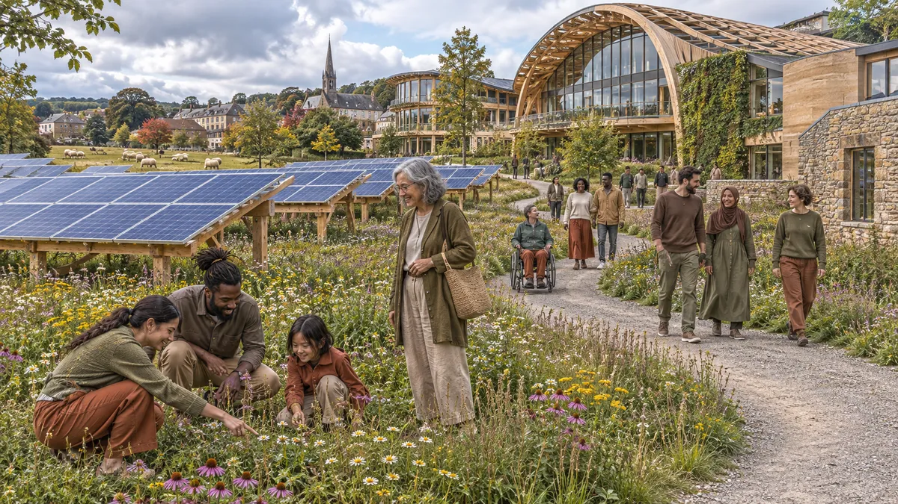

Solar panels raised over meadow on the outer ring of the core, set clear of the paths. Together with roofs and carports they feed the microgrid and its batteries.

[See it in the 3D model](pathname:///model/index.html?view=solar) · [Read the full description](/docs/concepts/energy-systems/)

### Agrivoltaic array {#agrivoltaic}

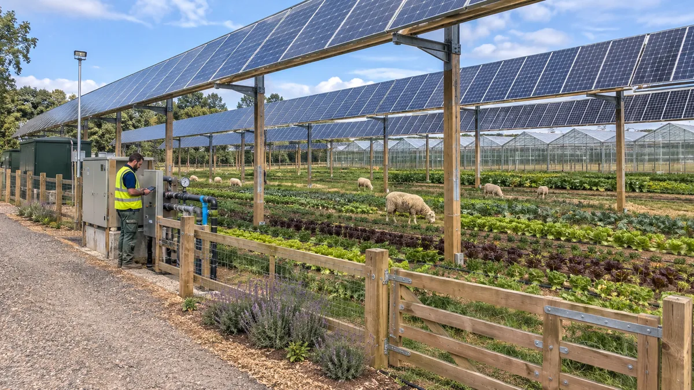

Solar panels raised high enough to farm or graze beneath, in the food and energy belt. The panels shade the crops in summer and power the town.

[Read the full description](/docs/technical/technology-catalog/#food-production)

## Parks, play, sport and events

### Village green {#villagegreen}

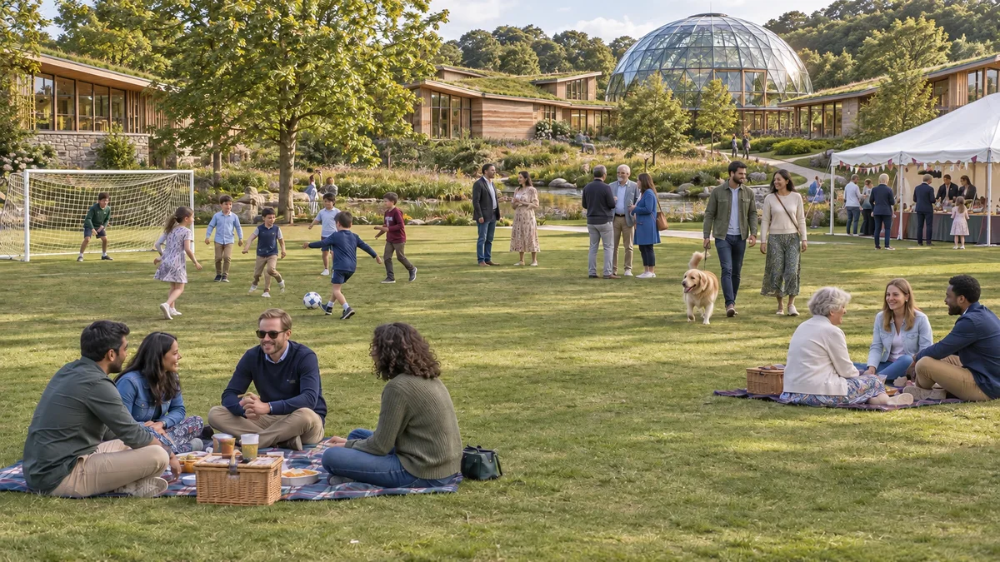

An open lawn with a small field of about 0.3 ha for games, fairs and markets, the first piece of sport and park space in Phase 1.

[See it in the 3D model](pathname:///model/index.html?view=green) · [Read the full description](/docs/design/growth-plan/#parks-play-and-sport)

### Playground {#playground}

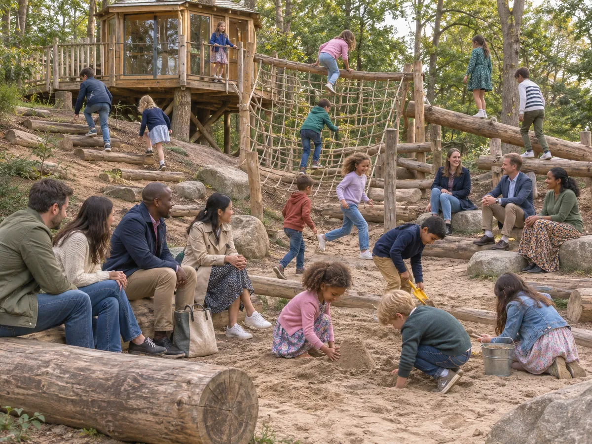

A natural play space of sand, logs, mounds and a tree house beside the green, about 0.1 ha, within sight of the homes.

[See it in the 3D model](pathname:///model/index.html?view=green) · [Read the full description](/docs/design/growth-plan/#parks-play-and-sport)

### Village sports field {#sportsfield}

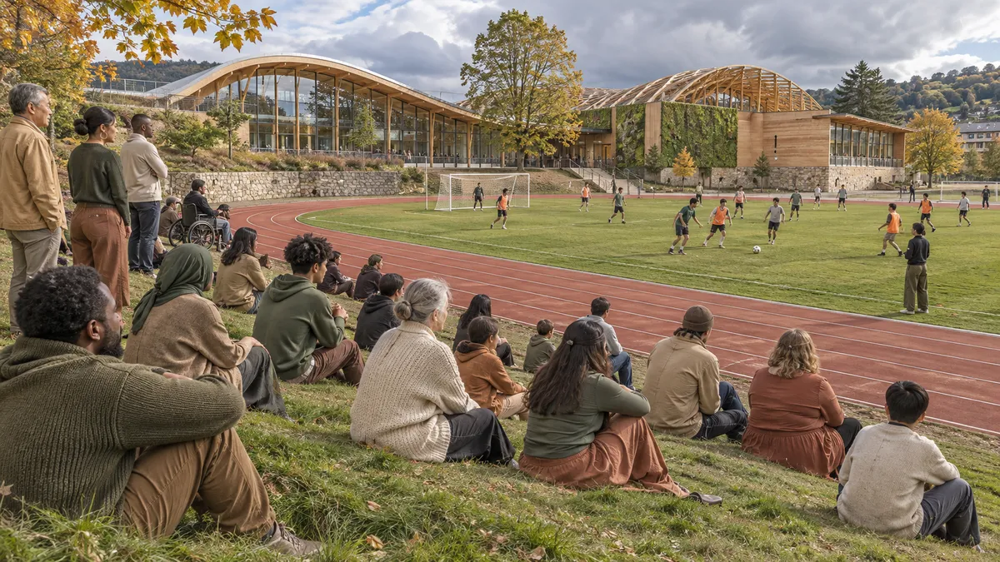

A full pitch inside a running track, part of the village's 2.4 ha of outdoor sport, between the canal and the outer belt.

[See it in the 3D model](pathname:///model/index.html?view=sport&phase=2) · [Read the full description](/docs/design/growth-plan/#parks-play-and-sport)

### Town sports park {#sportspark}

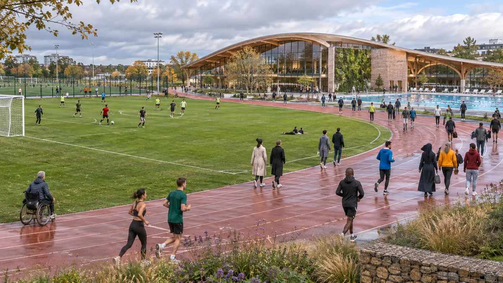

The town's main sports ground in the outer belt: a running track, pitches and an outdoor pool, part of about 12.8 ha of outdoor sport for 8,000 people.

[See it in the 3D model](pathname:///model/index.html?view=sportspark&phase=3) · [Read the full description](/docs/design/growth-plan/#parks-play-and-sport)

### Wellness and sports centre {#wellnesscentre}

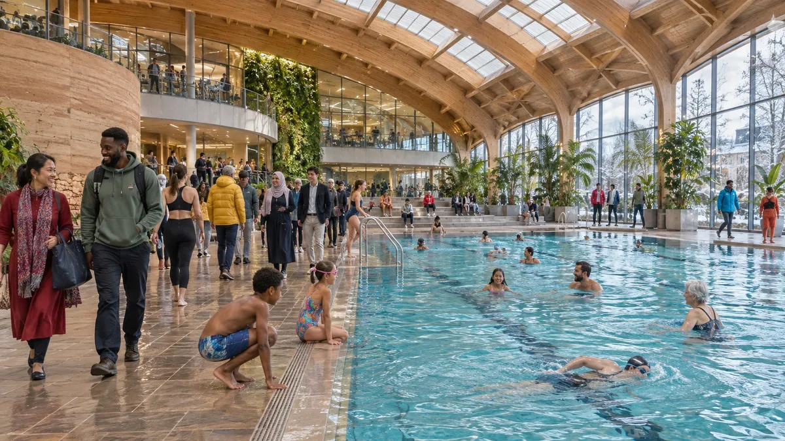

A hall with an indoor pool, a sports hall and treatment rooms, heated with biogas from the north campus. It comes with Phase 3, when there are enough users.

[Read the full description](/docs/design/growth-plan/#inside-the-communospheres)

### Natural swimming pond {#swimpond}

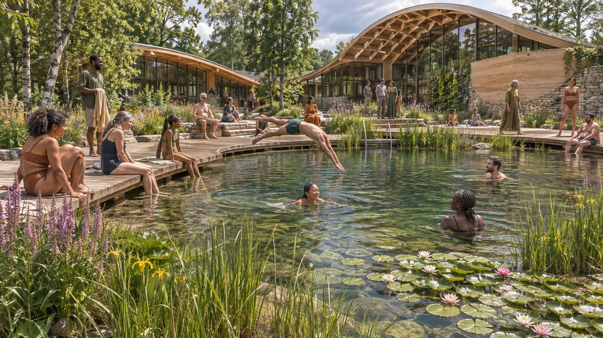

A chlorine-free pond beside the lake. Plants in the shallow zone around the edge clean the water, and the swimming zone is about 2 m deep. Phase 2 adds a second, larger pond nearby.

[See it in the 3D model](pathname:///model/index.html?view=lakeside) · [Read the full description](/docs/design/growth-plan/#inside-the-communospheres)

### Village swimming pond {#swimpond2}

A second, larger natural pond for the village, cleaned by its planted edge like the first one, with a timber deck.

[Read the full description](/docs/design/growth-plan/#inside-the-communospheres)

### Festival meadow {#festivalmeadow}

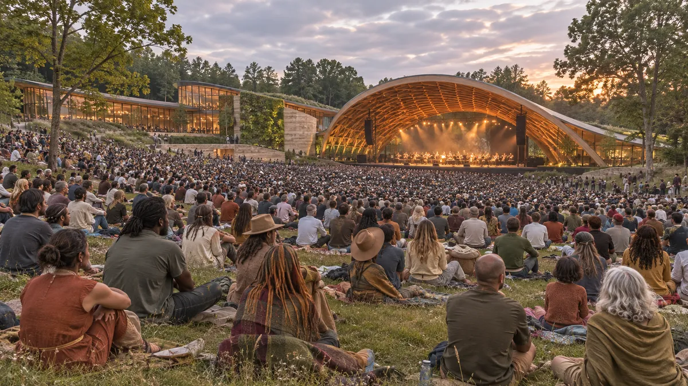

The open-air gathering place: an oval lawn with a timber stage shell and light towers, about 4,500 m² of lawn, room for about 3,000 people at a comfortable 1.5 m² each. Concerts, festivals, markets and the whole-town celebrations happen here; on other days it is a meadow.

[See it in the 3D model](pathname:///model/index.html?view=festival&phase=2) · [Read the full description](/docs/design/growth-plan/#events-and-gathering)

### Event hall {#eventhall}

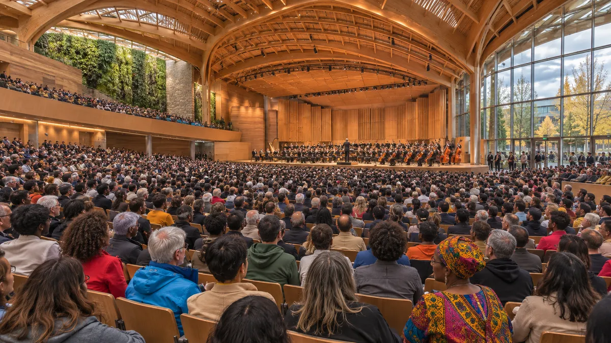

The covered event hall for concerts, theatre, conferences and winter festivals: a long gridshell hall of glulam with a glass foyer, seating about 1,000. It sits on the outer ring road so crowds and deliveries arrive without passing through the homes.

[See it in the 3D model](pathname:///model/index.html?view=eventhall&phase=3) · [Read the full description](/docs/design/growth-plan/#events-and-gathering)

### Woods and meadows {#woodland}

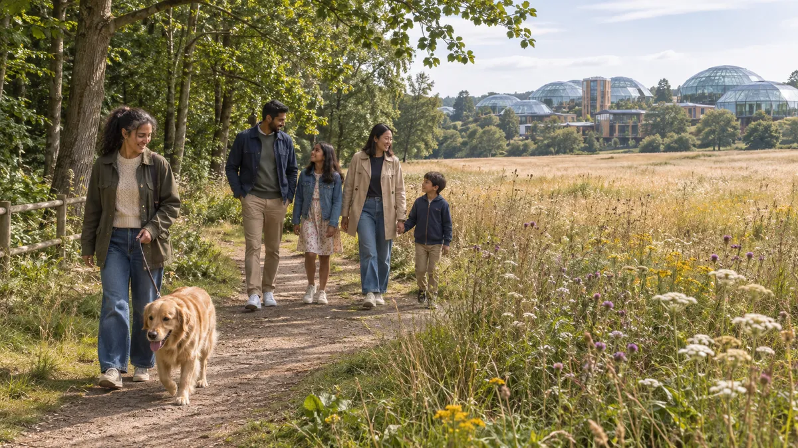

Woodland stands on the north side of the city and along the flanks, with open hay meadows kept to the south. The woods shelter the city from cold winds, hold water in the soil and give shade, timber and wildlife; the meadows keep views open towards the water.

[See it in the 3D model](pathname:///model/index.html?view=woods&phase=3) · [Read the full description](/docs/design/growth-plan/#the-spire-park-and-the-woods)

## Animals and water sports

### Stables {#stables}

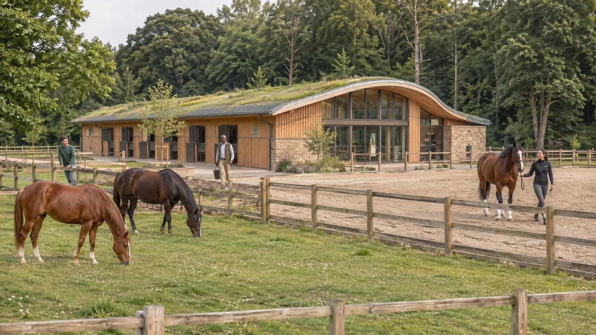

A stable barn for about ten horses, a sand riding arena and fenced paddocks for turnout. Horses graze the hay meadows and the food belt in rotation, and riders use the woodland trails. Manure feeds the compost and the biogas digester.

[See it in the 3D model](pathname:///model/index.html?view=stables&phase=2) · [Read the full description](/docs/design/growth-plan/#animals)

### Dog park {#dogpark}

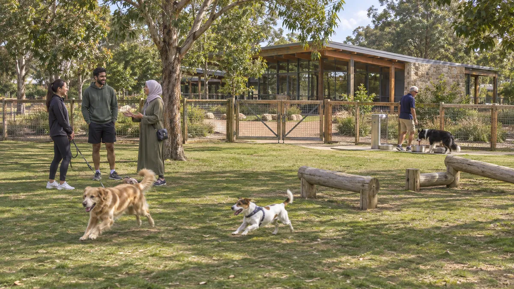

A small fenced off-leash dog park with a gate and shade trees, set off a radial path and away from playgrounds. One in Phase 1, one more in Phase 2 and two in Phase 3, so most homes have one within a short walk; dogs on leads can also use the woodland trails.

[See it in the 3D model](pathname:///model/index.html?view=dogpark) · [Read the full description](/docs/design/growth-plan/#animals)

### Boathouse {#boathouse}

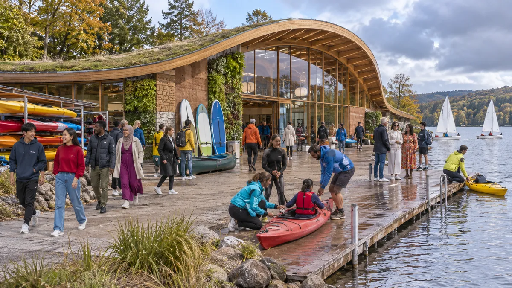

A timber boathouse on the lake shore with a jetty, kayaks, paddle boards and sailing dinghies. Swimming, paddling and sailing lessons start here; in Phase 3 paddlers also use the river and the canals.

[See it in the 3D model](pathname:///model/index.html?view=boathouse&phase=2) · [Read the full description](/docs/design/growth-plan/#water-sports)

## Guests

### Retreat cabins {#retreatcabin}

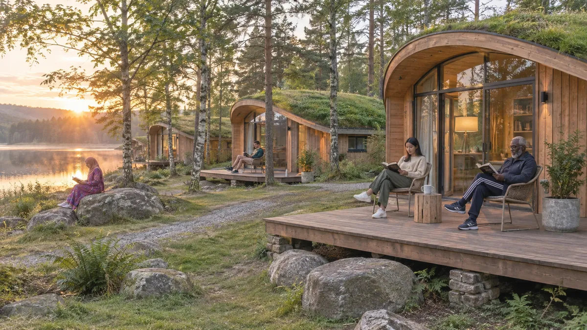

Six small timber cabins with green roofs by the lake for guests, retreats and new arrivals trying out life in the hamlet.

[See it in the 3D model](pathname:///model/index.html?view=lakeside) · [Read the full description](/docs/design/growth-plan/#phase-by-phase)

### Retreat lodge {#retreatlodge}

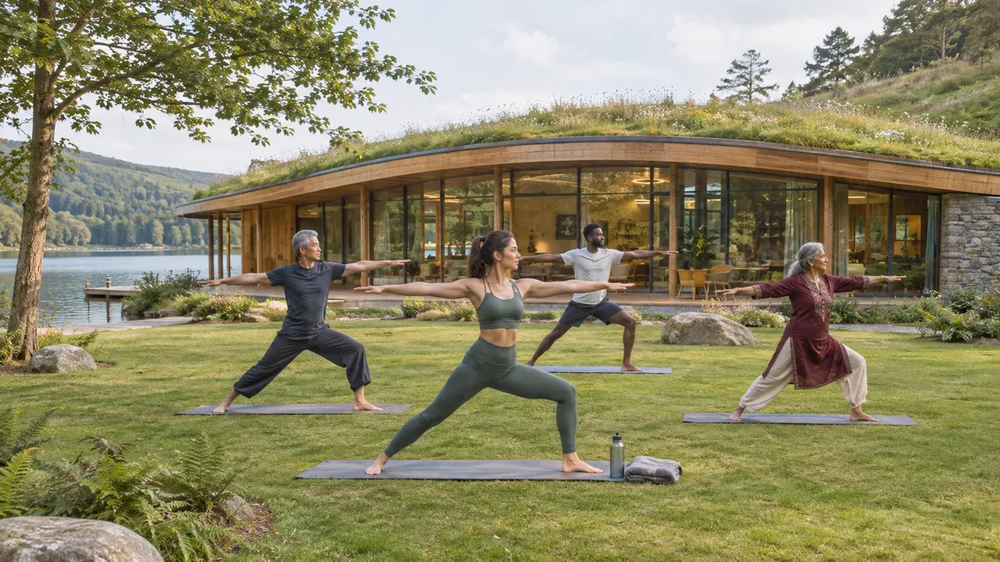

A Phase 2 lodge for groups and longer retreats, near the cabins and the lake, with a shared kitchen and a practice room.

[Read the full description](/docs/design/growth-plan/#phase-by-phase)

## Learning, health and emergency

### Primary school {#school}

A one-form-entry primary school of about 210 places for the village, with a green roof and its own playing field. The library grows alongside it in the learning pavilions.

[See it in the 3D model](pathname:///model/index.html?view=school&phase=2) · [Read the full description](/docs/design/growth-plan/#learning-health-and-care)

### Secondary school {#secondaryschool}

A secondary school of about 400 places for the town, with labs, workshops and a hall, added in Phase 3.

[Read the full description](/docs/design/growth-plan/#learning-health-and-care)

### Village health centre {#healthcentre}

A health centre for the village with at least one full-time clinician, a nurse, a treatment room and telehealth links to the regional hospital.

[Read the full description](/docs/design/growth-plan/#learning-health-and-care)

### Town health centre {#townhealth}

The Phase 3 health centre for five or six clinicians, with dental care, urgent care and a pharmacy. Hospital care stays regional.

[Read the full description](/docs/design/growth-plan/#learning-health-and-care)

### Fire and rescue shed {#fireshed}

A shed by the mobility hub for a water tender and rescue gear, crewed by trained volunteers. It opens straight onto the north road.

[Read the full description](/docs/design/growth-plan/#emergency-services)

### Village fire station {#firestation}

A volunteer fire station on the ring road, with two engine bays and a training yard.

[See it in the 3D model](pathname:///model/index.html?view=firestation&phase=2) · [Read the full description](/docs/design/growth-plan/#emergency-services)

### Town fire and ambulance station {#firestation3}

A staffed fire station and ambulance base on the outer ring road, reaching the whole town within the response times set for urban areas.

[Read the full description](/docs/design/growth-plan/#emergency-services)

## Water, sewage, waste and power

### Rain cistern {#cistern}

Each dome drains its rain to two buried tanks, shown by their lids. The water serves toilets, laundry and gardens, and carries the dome through dry spells.

[Read the full description](/docs/design/growth-plan/#water)

### Phase 1 water yard {#wateryard1}

The hamlet's own water works, just behind it to the north: a well and pump house, one earth-covered tank of about 300 m³ (three days' use plus a fire reserve) and two small slow sand filters. Rain from the domes tops it up. Later phases add tanks beside it.

[See it in the 3D model](pathname:///model/index.html?view=yard) · [Read the full description](/docs/design/growth-plan/#water)

### Phase 2 water yard {#wateryard2}

Phase 2 grows the water yard beside the first one: a larger tank, two more sand filters and a small biogas digester for food waste.

[Read the full description](/docs/design/growth-plan/#water)

### Phase 1 treatment garden {#reedbeds1}

Sewage from the hamlet runs a short way downhill to a settling tank and two planted reed beds of about 300 m² each, about 3 m² a person. The water stays under the gravel, so there is little smell and no open water. The cleaned water irrigates the orchards.

[See it in the 3D model](pathname:///model/index.html?view=reedbeds) · [Read the full description](/docs/design/growth-plan/#sewage)

### Village reed beds {#reedbeds2}

Four more planted reed beds that polish the water from the treatment hall. With the first two they give about 2,400 m² for the village. The water goes to the food belts.

[Read the full description](/docs/design/growth-plan/#sewage)

### Village treatment hall {#treatment2}

A compact treatment unit for the village of 1,500, added beside the first reed beds, under a solar roof. It settles the sewage and cleans it through a membrane module before the reed beds polish it. More modules can be added as the village grows.

[Read the full description](/docs/design/growth-plan/#sewage)

### Town treatment hall (Phase 3) {#treatmenthall}

Added for the town of 8,000. At the water mouth, the lowest ground, sewage arrives by gravity and is screened and settled indoors under a solar roof before it passes to the wetland.

[Read the full description](/docs/design/infrastructure/#sewage)

### Compost bays {#compost1}

Three compost heaps for the hamlet's kitchen and garden waste, next to the water yard. The compost goes back to the orchards and gardens.

[Read the full description](/docs/design/growth-plan/#waste-and-energy)

### Compost windrows {#compost}

Long heaps of garden and crop waste turning into compost, which goes back to the food belts.

[Read the full description](/docs/design/infrastructure/#waste)

### Village biogas digester {#biogas2}

A small digester for the village's food waste and sludge. It makes cooking gas and digestate for the fields. The big digesters on the north campus come with Phase 3.

[Read the full description](/docs/design/growth-plan/#waste-and-energy)

### Biogas digesters {#biogas}

Two digesters and a gas holder. Food waste and sewage sludge become biogas for heat and the backup generators, and digestate that fertilises the fields.

[Read the full description](/docs/design/infrastructure/#waste)

### Utility campus (Phase 3) {#utilitycampus}

The town's main service yard, added in Phase 3 behind the city to the north inside the woods: water storage and filters, recycling, compost, biogas and the main substation. The service road reaches it from the north, so heavy vehicles never cross the town.

[See it in the 3D model](pathname:///model/index.html?view=utilities&phase=3) · [Read the full description](/docs/design/infrastructure/)

### Covered reservoir {#reservoir}

Two earth-covered water tanks and a valve house on the high ground. From here clean water reaches the city downhill by gravity, with at least a day's storage.

[Read the full description](/docs/design/infrastructure/#water-supply)

### Slow sand filters {#sandfilter}

Open beds where water is cleaned slowly by sand and a living layer on top, with no chemicals beyond a final safety dose.

[Read the full description](/docs/design/infrastructure/#water-supply)

### Recycling and repair hall {#recycling}

Where sorted materials are collected, repaired and reused, with bays for each kind of material.

[Read the full description](/docs/design/infrastructure/#waste)

### Main substation and batteries {#substation}

Where the solar belts join the microgrid, with the main battery bank. The grid can disconnect from the regional utility and run on its own; there is no diesel backup.

[Read the full description](/docs/design/infrastructure/#power)

### Town treatment wetland (Phase 3) {#wetland}

Three planted gravel cells that clean the settled water with plants, soil and microbes. The water stays below the gravel, so there is no open water for mosquitoes and little odour. The cleaned water irrigates the food belts.

[See it in the 3D model](pathname:///model/index.html?view=watermouth&phase=3) · [Read the full description](/docs/design/infrastructure/#sewage)

## Waterways

### Heart lake {#lake}

A lake south-west of the core, fed by rain and the land, with a wooded island and a boat landing. It feeds the heart canal and spills down a winding creek to the river.

[See it in the 3D model](pathname:///model/index.html?view=lake) · [Read the full description](/docs/design/planning-principles/#water)

### Lake falls {#lakefalls}

Falls where the creek leaves the swimming lake. The weir that holds the lake level is built as a pile of boulders so the overflow tumbles down a natural-looking cascade instead of a concrete spillway; the concrete core is hidden inside.

[See it in the 3D model](pathname:///model/index.html?view=lakefalls) · [Read the full description](/docs/design/growth-plan/#the-spire-park-and-the-woods)

### Heart rill {#rill}

A narrow stone channel, 2 to 3 m wide, that carries water from the harbour between the domes into the ring pool around the spire.

[See it in the 3D model](pathname:///model/index.html?view=heart) · [Read the full description](/docs/design/planning-principles/#water)

### Heart canal {#heartcanal}

A winding canal that brings electric boats from the lake to the harbour at the edge of the core, with a towpath along its east bank.

[See it in the 3D model](pathname:///model/index.html?view=harbour&phase=3) · [Read the full description](/docs/design/planning-principles/#water)

### Harbour {#harbour}

A crescent basin along the ring where the heart canal ends. The canal enters at one horn and the stone rill leaves from the other, carrying the water on to the plaza.

[See it in the 3D model](pathname:///model/index.html?view=harbour&phase=3) · [Read the full description](/docs/design/planning-principles/#water)

### Creek {#creek}

The lake spills down this winding creek to the river. Where it meets the river is the water mouth, with the treatment wetland, a grove and a pavilion.

[See it in the 3D model](pathname:///model/index.html?view=water) · [Read the full description](/docs/design/planning-principles/#water)

### Canal {#canal}

Part of the canal network: a ring at 377 m in Phase 2, then an outer ring and three S-curved canals in Phase 3. The banks are public paths and parks, shaped to store flood and drought water.

[See it in the 3D model](pathname:///model/index.html?view=canal&phase=3) · [Read the full description](/docs/design/planning-principles/#water)

### River {#river}

A slow river curving round the south of the town, so the city sits on the inside of the bend, a site feng shui favours. Larger electric water buses run along it.

[See it in the 3D model](pathname:///model/index.html?view=water&phase=3) · [Read the full description](/docs/design/planning-principles/#feng-shui-reading-the-land)

### Water-mouth pavilion {#shuikou}

Where the creek meets the river, a grove, a bridge and this pavilion "lock" the water as it leaves the city, as Huizhou villages in China do.

[See it in the 3D model](pathname:///model/index.html?view=watermouth&phase=3) · [Read the full description](/docs/design/planning-principles/#feng-shui-in-the-plan-point-by-point)

### Electric boat {#boat}

A small solar-roofed electric boat. Water buses run on the canal rings, the heart canal and the lake; larger ones run on the river.

[Read the full description](/docs/design/planning-principles/#movement)

### Boat pier {#pier}

A timber pier where boats moor, in the harbour and at the lake end of the heart canal.

[Read the full description](/docs/design/planning-principles/#movement)

### Footbridge {#bridge}

An arched timber footbridge where a path crosses the water, many with a small boat landing beside them.

[Read the full description](/docs/design/planning-principles/#movement)
