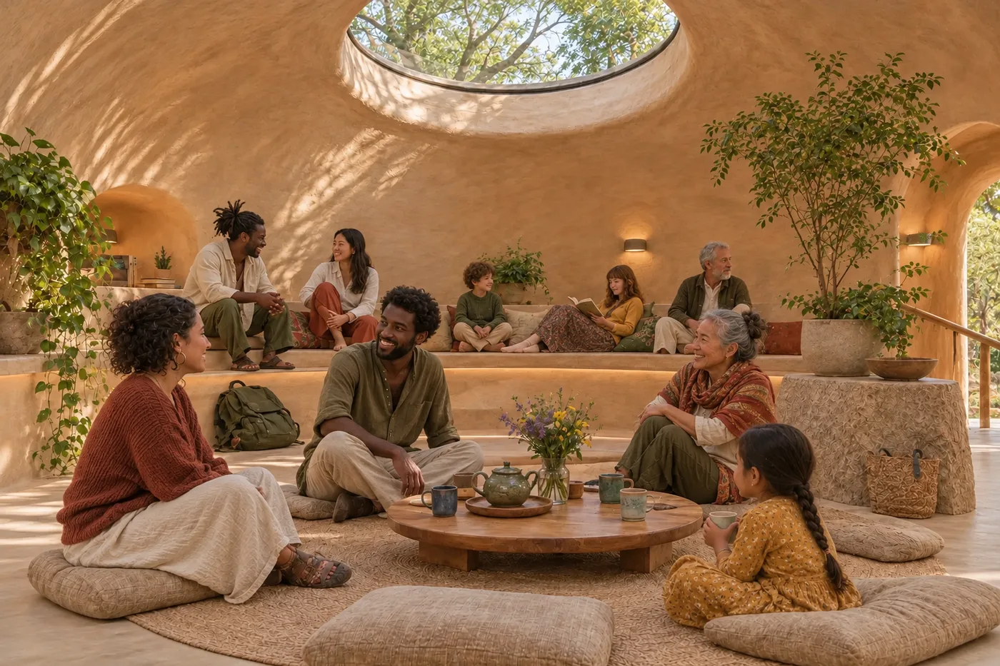
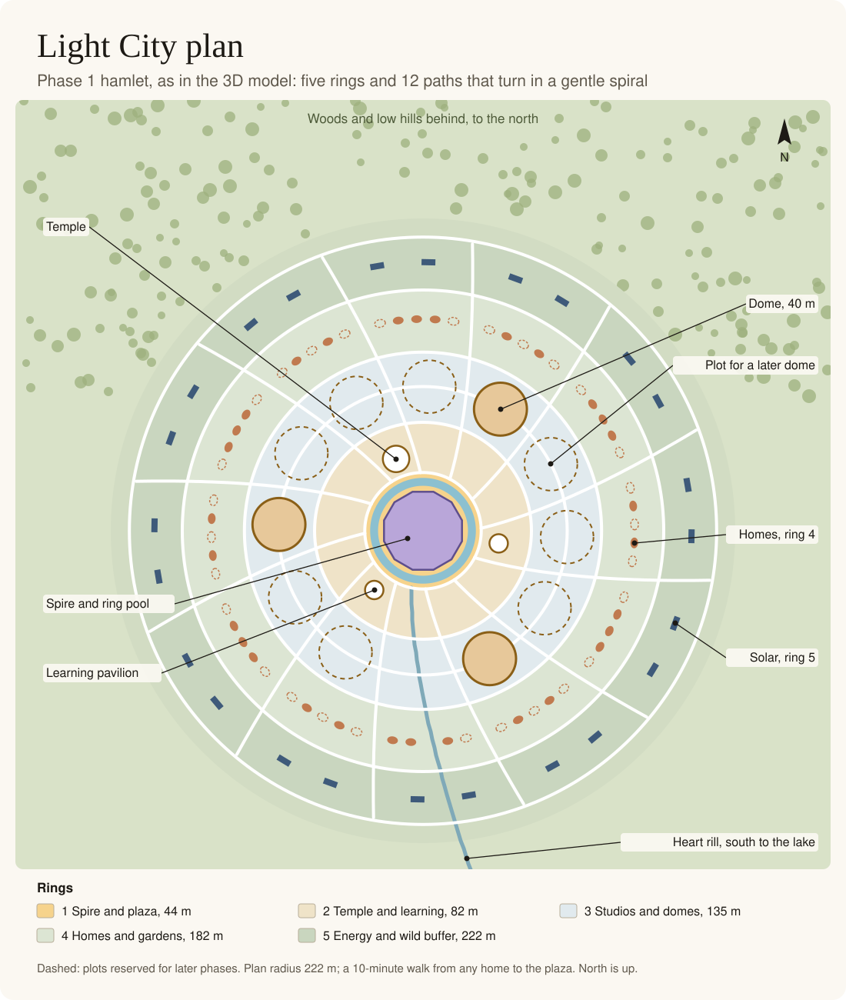
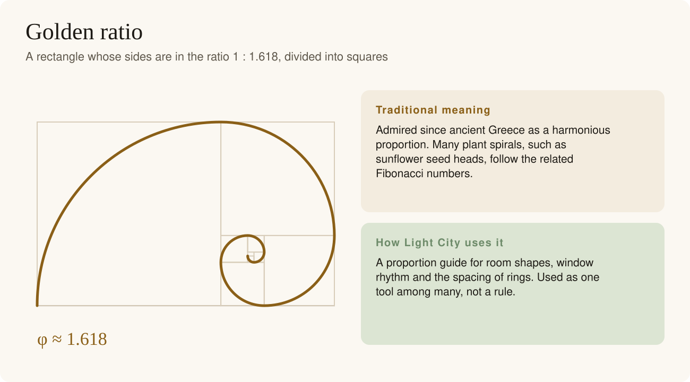
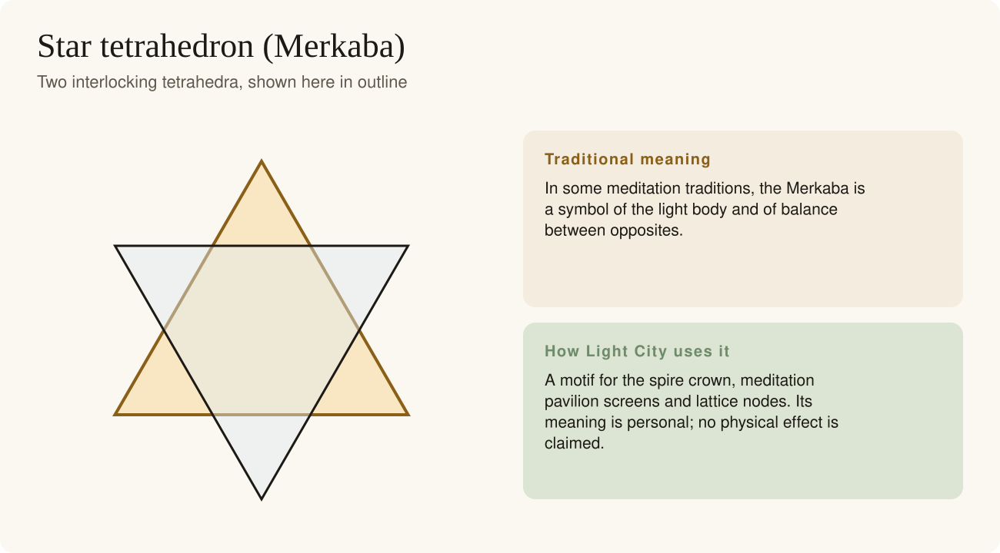

# Visual Language

*How Light City looks in photos, diagrams, type and icons: Modern Organic, a blend of nature and technology*

*Modern Organic: curved timber, glass and earth, living plants, warm light and people in natural fabrics.*

## Purpose

This guide keeps every Light City image, diagram and page consistent and readable. It covers concept photos, technical diagrams, typography, icons and how to label visionary art.

## Core principles

- **Modern Organic.** Nature and technology together: curved glulam and CLT, gridshells, glass, rammed earth and clay, living walls, solar glazing, warm integrated light. Not medieval, not rustic cabins, not science fiction.
- **Buildable first.** Images of what we plan to build show Phase 1 facts: 30–45 m domes, a 60–120 m spire, 200 residents.
- **Honest labels.** Visionary archetype art (Delphin, the original vision images) is always captioned as "Visionary archetype art, not a real place or a design."
- **Readable.** If you cannot read a label on a phone, the diagram is not finished.
- **Respectful.** Sacred symbols from living traditions are shown with their context and are not used as decoration only.

## Concept photos (Modern Organic)

Use this style note at the end of every image prompt:

> Curved glulam and CLT, timber gridshells, glass, living walls, rammed earth and clay plaster, warm integrated LED, quartz crystal accents, sculptural fire features. People in linen, cotton and raw silk in off-white, sand, sage and terracotta. Realistic documentary photo with a quiet sense of wonder. No text or logos. Avoid medieval, rustic cabins and fantasy.

- **Scale.** Domes 30–45 m across, 3–5 levels; the spire is slender, not a skyscraper.
- **People.** Diverse ages and backgrounds, doing ordinary things: cooking, working, building, resting.
- **Technology.** Visible but calm: solar glazing, batteries in a timber room, sensors that look like furniture.
- **Formats.** 16:9 for heroes, 4:3 for cards, 1:1 for tiles. Export as WebP or JPG at about 1,400–2,000 px wide.

*Earth domes and printed-earth homes: low-cost forms that belong in the image library alongside timber domes.*

## Diagrams

All diagrams in the library follow these rules:

- **Canvas.** Pearl background (`#FBF8F2`), rounded corners, width 1,100–1,300 px in SVG.
- **Type.** Title in serif at 44 px; labels and body in sans at 19–22 px minimum (at 1,300 px wide). Nothing smaller than 17 px.
- **Lines.** Ink for outlines, Gold for structure and the main flow, Terracotta for reference lines. 2–4 px strokes.
- **Labels never overlap** lines, shapes or other labels. Use leader lines with a dot at the anchor.
- **Facts.** Use the current numbers from [At a Glance](/docs/at-a-glance). Write the phase on the diagram.
- **One idea per diagram.** If a diagram needs a paragraph to explain, split it.
- **Geometry diagrams** pair the figure with two panels: "Traditional meaning" and "How Light City uses it."

*Example: numbered rings, a short legend and plain-language labels.*

## Typography

- **Display and headings:** Zodiak (serif), falling back to Iowan Old Style or Georgia.
- **Body and labels:** Switzer (sans), falling back to Inter or system sans.
- **Mono (technical):** JetBrains Mono or Fira Code.
- Line length 60–80 characters; body at 16 px or larger on the web.

## Iconography

- Stroke icons, 3 px ink lines with one gold accent, rounded joins, on a pearl disc.
- Icons describe real things: spire, dome, earth home, gridshell, microgrid, water, food, temple, learning, community, research, governance.

*The Light City icon set.*

## Geometry library

- Circle, vesica piscis, Flower of Life, golden ratio, Platonic solids, star tetrahedron (Merkaba), Metatron's Cube, Sri Yantra.
- Geometry guides proportion, plans and ornament. We do not claim physical effects from shapes.

*The golden ratio: a proportion guide for rooms, windows and ring spacing, used as one tool among many.*

*The star tetrahedron: a motif for the spire crown, pavilion screens and lattice nodes.*

## Accessibility

- Contrast at least AA (4.5:1 for body text).
- Do not use color alone to carry meaning; add labels or patterns.
- Every image has descriptive alt text.
- Keep motion and light effects subtle.

---

**Last reviewed**: November 2026  
**Related**: [Color and Light](/docs/design/color-and-light), [Architecture](/docs/design/architecture), [Beyond the Box](/docs/design/organic-forms-and-materials), [Sacred Geometry](/docs/concepts/sacred-geometry)
