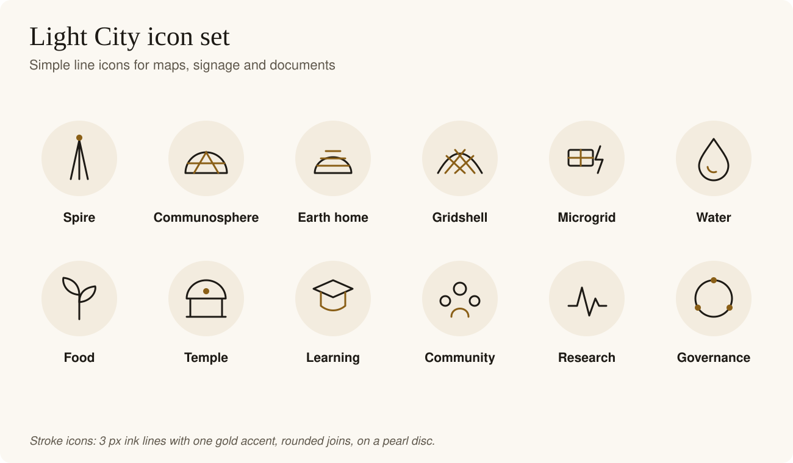

# Visual Language

*How Light City looks in photos, diagrams, type and icons: Modern Organic, a blend of nature and technology*

*Modern Organic: curved timber, glass and earth, green roofs and wild land, people of many backgrounds in varied, natural clothing.*

## Purpose

This guide keeps every Light City image, diagram and page consistent and readable. It covers concept photos, technical diagrams, typography, icons and how to label visionary art.

## Core principles

- **Modern Organic.** Nature and technology together: curved glulam and CLT, gridshells, glass, rammed earth and clay, living walls, solar glazing, warm integrated light. Not medieval, not rustic cabins, not science fiction.
- **Buildable first.** Images of what we plan to build show Phase 1 facts: 30–45 m domes, a 90 m crystal spire, 200 residents.
- **Honest labels.** Visionary archetype art (Delphin, the original vision images) is always captioned as "Visionary archetype art, not a real place or a design."
- **Readable.** If you cannot read a label on a phone, the diagram is not finished.
- **Respectful.** Sacred symbols from living traditions are shown with their context and are not used as decoration only.

## 3D reference model

Every illustration of the city as a whole starts from one shared 3D model, so the radial design never drifts. It is one model with three phases that grow from the same plan: every structure is tagged with the phase that builds it, and the phase switch turns later structures on or off ([compared in Architecture](/docs/design/architecture#phased-development--scale)). Phase 1 shows the spire on a round plaza, five rings, 12 paths that turn in a gentle spiral from the plaza, one temple and two learning pavilions, three 40 m domes on ring 3, earth homes on ring 4 and solar with meadow on ring 5, inside wild land. Phase 2 (village) and Phase 3 (town) keep all of that unchanged and add domes on reserved plots, sections on the same spire, and rings of homes and food and energy belts outward (build once, grow outward).

*The Phase 1 model, top and aerial views. Open the interactive model to orbit it and switch phases: [Phase 1](pathname:///model/index.html?phase=1), [Phase 2](pathname:///model/index.html?phase=2), [Phase 3](pathname:///model/index.html?phase=3).*

- **How to use it.** Pick the phase the image shows, then render the closest named view (aerial, top, low aerial, radial path, homes ring, plaza or solar ring) with `PHASE=1|2|3 node scripts/render-model.cjs <view>`. Give that render to the image tool as the layout reference, with the current photo as a style reference.
- **Label the phase.** Any image of the whole city says which phase it shows, and must match the model at that phase: three domes in Phase 1, eight in Phase 2, seventeen in Phase 3. The spire is a straight crystal of stacked 30 m glass sections: three in Phase 1 (90 m, short faceted point), five in Phase 2 (150 m), in Phase 3 the glass body reaches 165 m, with the vortex wind crown (165–192 m) and the full glass point to 240 m.
- **What must match.** One central eight-sided crystal spire of faceted solar glass in champagne-gold frames, almost straight-sided, with the vortex wind crown of offset glass panels and a sharp glass point of four kite-shaped facets (no flare, no open lattice, no external deck), rings and radial paths in the same places, domes only where the plan puts them, no extra towers or buildings outside the rings.
- **Changing the plan.** Update `static/model/city.js` and the plan diagram together, then re-render the views and the affected images.
- **Check the layout.** After any change to the plan, run `node scripts/audit-model.cjs` from `website/`. For each phase it reports buildings on paths or in water, overlapping buildings, path ends aimed at buildings without a planted bed (paths that arrive at a dome entrance forecourt are counted separately and are fine), straight runs over 80 m and trees on paths. All counts should be zero before a change is merged ([Planning principles](/docs/design/planning-principles#collisions-and-the-layout-audit)).

Every structure type in the model has a concept picture in the [photo guide](/docs/design/structures), and the same picture appears at the top of its info card when you click it in the model.

### What the model does not show yet

The model shows the plan, the main buildings, water, movement and the [infrastructure](/docs/design/infrastructure). These parts of the documented design are not in it yet:

| Missing from the model | Where it is described | Notes |
|---|---|---|
| Creative studios and maker spaces in detail | [Architecture: creative studios](/docs/design/architecture#5-creative-studios) | Shown as simple ring 3 buildings and work hub workshops |
| Mushrooms and food processing in detail | [Technology catalog](/docs/technical/technology-catalog#food-production) | The food hall, aquaponics tunnels and vertical farm are shown as simple buildings |
| Housing counts per dome and per terrace | [How the city grows](/docs/design/growth-plan#phase-by-phase), [At a Glance](/docs/at-a-glance) | Counts per phase are set out; terraced levels are shown, not individual homes |
| Rooms inside the domes and the spire | [How the city grows](/docs/design/growth-plan#inside-the-communospheres) | The dome commons (yoga, sound room, tool library, childcare) and the spire's lift core, base hall and gathering level are shown as volumes, not furnished rooms |
| Animals in detail, benches and stage equipment | [How the city grows: animals](/docs/design/growth-plan#animals) | The care farm, stables, dog parks, festival meadow, event hall, boathouse and Council House are in the model with simple animals and fences; furniture is not |
| Courts, ambulances and the guest house | [How the city grows](/docs/design/growth-plan#phase-by-phase) | Schools, health centres, fields, ponds, cabins, the lodge and fire stations are in the model; these smaller items are not |
| Pipes, cables and utility tunnels | [Infrastructure](/docs/design/infrastructure#utility-tunnels) | Underground, so not drawn |
| Swales and pump stations | [Infrastructure](/docs/design/infrastructure#water-supply) | Rain cisterns, the phased water yard and the reed beds are drawn; swales and pumps are not |
| Micro-hydro and geothermal | [Energy systems](/docs/concepts/energy-systems#resilience-without-diesel) | Depend on the site |
| Sound, healing and float rooms | [Technology catalog](/docs/technical/technology-catalog#consciousness--wellness-tech) | Inside the temples and domes, not modelled |
| The real landform | [Site locations](/docs/project/site-locations) | The hills, river and slopes are schematic until a site is chosen |

## Concept photos (Modern Organic)

Use this style note at the end of every image prompt:

> Curved glulam and CLT, timber gridshells, glass, living walls, rammed earth and clay plaster, warm shielded lighting, local stone, and only occasionally a single vertical quartz point on a pedestal. People of many ethnicities, ages and body types in varied, natural clothing: linen and cotton trousers, skirts and dresses, tunics, knitwear, shawls and work wear in earthy tones with warm accents, almost no denim. Mixed daylight and weather, not always sunset. Realistic documentary photo of a place that could be built today. No text or logos. Avoid medieval, rustic cabins and fantasy.

- **Scale.** Domes 30–45 m across, 3–5 levels; the spire is an eight-sided crystal of solar glass in champagne-gold frames, each panel cut by an X into tall diamond facets (blue, violet and warm amber); about 56 by 52 m at the foot and 45 by 42 m at 165 m, then the vortex wind crown to 192 m and a sharp glass point to 240 m (90 m in Phase 1, 240 m in Phase 3); it is never round and never flares at the foot like a rocket.
- **People.** Diverse ages, ethnicities, body types and personal styles, doing ordinary things: cooking, working, building, resting.
- **Clothing.** Varied and organic-looking, never a uniform look: natural fibres, many cuts (trousers, skirts, dresses, tunics, overalls, knitwear), earthy colors with some warmth. Avoid a crowd in jeans, and avoid costumes, robes or matching outfits.
- **Technology.** Visible but calm: solar glazing, batteries in a timber room, sensors that look like furniture.
- **Radial plan.** Any image that shows more than a single building must agree with the [3D reference model](#3d-reference-model).
- **Reality check.** Before an image goes in, ask: could this be photographed in a real eco-village next year? No open fire indoors, no glowing ground lights or rows of candles, no uplit domes, handrails at every drop, bird-safe patterned glass on large glazing, plants at a believable size, wild land around the buildings rather than lawns. Crystals are occasional, at most one point in a scene, and most images have none.
- **Formats.** 16:9 for heroes, 4:3 for cards, 1:1 for tiles. Export as WebP or JPG at about 1,400–2,000 px wide.

Earth domes, earthbag, printed-earth and hempcrete homes belong in the image library alongside timber domes (the model shows all four home types); examples are in [Beyond the Box](/docs/design/organic-forms-and-materials).

## Diagrams

All diagrams in the library follow these rules:

- **Canvas.** Pearl background (`#FBF8F2`), rounded corners, width 1,100–1,300 px in SVG.
- **Type.** Title in serif at 44 px; labels and body in sans at 19–22 px minimum (at 1,300 px wide). Nothing smaller than 17 px.
- **Lines.** Ink for outlines, Gold for structure and the main flow, Terracotta for reference lines. 2–4 px strokes.
- **Labels never overlap** lines, shapes or other labels. Use leader lines with a dot at the anchor.
- **Facts.** Use the current numbers from [At a Glance](/docs/at-a-glance). Write the phase on the diagram.
- **One idea per diagram.** If a diagram needs a paragraph to explain, split it.
- **Geometry diagrams** pair the figure with two panels: "Traditional meaning" and "How Light City uses it."

A good example is the city plan in [Architecture → Circular form](/docs/design/architecture#circular-form): numbered rings, a short legend and plain-language labels.

## Typography

- **Display and headings:** Zodiak (serif), falling back to Iowan Old Style or Georgia.
- **Body and labels:** Switzer (sans), falling back to Inter or system sans.
- **Mono (technical):** JetBrains Mono or Fira Code.
- Line length 60–80 characters; body at 16 px or larger on the web.

## Iconography

- Stroke icons, 3 px ink lines with one gold accent, rounded joins, on a pearl disc.
- Icons describe real things: spire, dome, earth home, gridshell, microgrid, water, food, temple, learning, community, research, governance.

*The Light City icon set.*

## Geometry library

- Circle, vesica piscis, Flower of Life, golden ratio, Platonic solids, star tetrahedron (Merkaba), Metatron's Cube, Sri Yantra.
- Geometry guides proportion, plans and ornament. We do not claim physical effects from shapes.

- The golden ratio is a proportion guide for rooms, windows and ring spacing; the star tetrahedron is a motif for the spire crown, screens and diagrid nodes. The diagrams are in [Sacred Geometry](/docs/concepts/sacred-geometry).

## Accessibility

- Contrast at least AA (4.5:1 for body text).
- Do not use color alone to carry meaning; add labels or patterns.
- Every image has descriptive alt text.
- Keep motion and light effects subtle.

---

**Last reviewed**: November 2026  
**Related**: [Color and Light](/docs/design/color-and-light), [Architecture](/docs/design/architecture), [Beyond the Box](/docs/design/organic-forms-and-materials), [Sacred Geometry](/docs/concepts/sacred-geometry)
