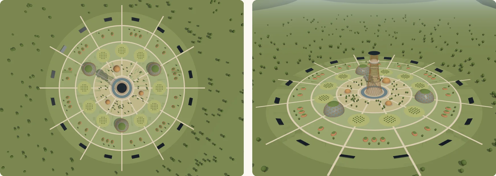

# Visual Language

*How Light City looks in photos, diagrams, type and icons: Modern Organic, a blend of nature and technology*

*Modern Organic: curved timber, glass and earth, green roofs and wild land, people of many backgrounds in varied, natural clothing.*

## Purpose

This guide keeps every Light City image, diagram and page consistent and readable. It covers concept photos, technical diagrams, typography, icons and how to label visionary art.

## Core principles

- **Modern Organic.** Nature and technology together: curved glulam and CLT, gridshells, glass, rammed earth and clay, living walls, solar glazing, warm integrated light. Not medieval, not rustic cabins, not science fiction.
- **Buildable first.** Images of what we plan to build show Phase 1 facts: 30–45 m domes, a 60–120 m spire, 200 residents.
- **Honest labels.** Visionary archetype art (Delphin, the original vision images) is always captioned as "Visionary archetype art, not a real place or a design."
- **Readable.** If you cannot read a label on a phone, the diagram is not finished.
- **Respectful.** Sacred symbols from living traditions are shown with their context and are not used as decoration only.

## 3D reference model

Every illustration of the city as a whole starts from one shared 3D model of the Phase 1 plan, so the radial design never drifts: the spire on a round plaza, five rings, 12 straight radial paths, four temple and learning pavilions, three 40 m domes on ring 3, earth homes on ring 4 and solar with meadow on ring 5, inside wild land.

*The 3D reference model, top and aerial views. [Open the interactive model](pathname:///model/index.html) to orbit it.*

- **How to use it.** Render the closest named view (aerial, top, low aerial, radial path, homes ring, plaza or solar ring) with `scripts/render-model.cjs`, then give that render to the image tool as the layout reference, with the current photo as a style reference.
- **What must match.** One central spire with a round deck and a solar ring at the top, rings and radial paths in the same places, domes only where the plan puts them, no extra towers or buildings outside the rings.
- **Changing the plan.** Update `static/model/city.js` and the plan diagram together, then re-render the views and the affected images.

## Concept photos (Modern Organic)

Use this style note at the end of every image prompt:

> Curved glulam and CLT, timber gridshells, glass, living walls, rammed earth and clay plaster, warm shielded lighting, local stone, and only occasionally a single vertical quartz point on a pedestal. People of many ethnicities, ages and body types in varied, natural clothing: linen and cotton trousers, skirts and dresses, tunics, knitwear, shawls and work wear in earthy tones with warm accents, almost no denim. Mixed daylight and weather, not always sunset. Realistic documentary photo of a place that could be built today. No text or logos. Avoid medieval, rustic cabins and fantasy.

- **Scale.** Domes 30–45 m across, 3–5 levels; the spire is slender, not a skyscraper.
- **People.** Diverse ages, ethnicities, body types and personal styles, doing ordinary things: cooking, working, building, resting.
- **Clothing.** Varied and organic-looking, never a uniform look: natural fibres, many cuts (trousers, skirts, dresses, tunics, overalls, knitwear), earthy colors with some warmth. Avoid a crowd in jeans, and avoid costumes, robes or matching outfits.
- **Technology.** Visible but calm: solar glazing, batteries in a timber room, sensors that look like furniture.
- **Radial plan.** Any image that shows more than a single building must agree with the [3D reference model](#3d-reference-model).
- **Reality check.** Before an image goes in, ask: could this be photographed in a real eco-village next year? No open fire indoors, no glowing ground lights or rows of candles, no uplit domes, handrails at every drop, bird-safe patterned glass on large glazing, plants at a believable size, wild land around the buildings rather than lawns. Crystals are occasional, at most one point in a scene, and most images have none.
- **Formats.** 16:9 for heroes, 4:3 for cards, 1:1 for tiles. Export as WebP or JPG at about 1,400–2,000 px wide.

Earth domes and printed-earth homes belong in the image library alongside timber domes; examples are in [Beyond the Box](/docs/design/organic-forms-and-materials).

## Diagrams

All diagrams in the library follow these rules:

- **Canvas.** Pearl background (`#FBF8F2`), rounded corners, width 1,100–1,300 px in SVG.
- **Type.** Title in serif at 44 px; labels and body in sans at 19–22 px minimum (at 1,300 px wide). Nothing smaller than 17 px.
- **Lines.** Ink for outlines, Gold for structure and the main flow, Terracotta for reference lines. 2–4 px strokes.
- **Labels never overlap** lines, shapes or other labels. Use leader lines with a dot at the anchor.
- **Facts.** Use the current numbers from [At a Glance](/docs/at-a-glance). Write the phase on the diagram.
- **One idea per diagram.** If a diagram needs a paragraph to explain, split it.
- **Geometry diagrams** pair the figure with two panels: "Traditional meaning" and "How Light City uses it."

A good example is the city plan in [Architecture → Circular form](/docs/design/architecture#circular-form): numbered rings, a short legend and plain-language labels.

## Typography

- **Display and headings:** Zodiak (serif), falling back to Iowan Old Style or Georgia.
- **Body and labels:** Switzer (sans), falling back to Inter or system sans.
- **Mono (technical):** JetBrains Mono or Fira Code.
- Line length 60–80 characters; body at 16 px or larger on the web.

## Iconography

- Stroke icons, 3 px ink lines with one gold accent, rounded joins, on a pearl disc.
- Icons describe real things: spire, dome, earth home, gridshell, microgrid, water, food, temple, learning, community, research, governance.

*The Light City icon set.*

## Geometry library

- Circle, vesica piscis, Flower of Life, golden ratio, Platonic solids, star tetrahedron (Merkaba), Metatron's Cube, Sri Yantra.
- Geometry guides proportion, plans and ornament. We do not claim physical effects from shapes.

- The golden ratio is a proportion guide for rooms, windows and ring spacing; the star tetrahedron is a motif for the spire crown, screens and lattice nodes. The diagrams are in [Sacred Geometry](/docs/concepts/sacred-geometry).

## Accessibility

- Contrast at least AA (4.5:1 for body text).
- Do not use color alone to carry meaning; add labels or patterns.
- Every image has descriptive alt text.
- Keep motion and light effects subtle.

---

**Last reviewed**: November 2026  
**Related**: [Color and Light](/docs/design/color-and-light), [Architecture](/docs/design/architecture), [Beyond the Box](/docs/design/organic-forms-and-materials), [Sacred Geometry](/docs/concepts/sacred-geometry)
