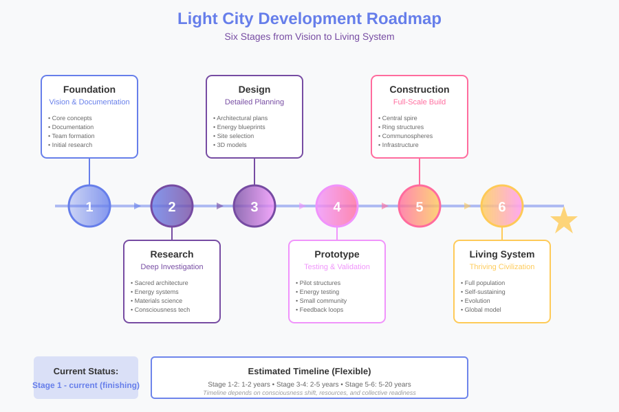
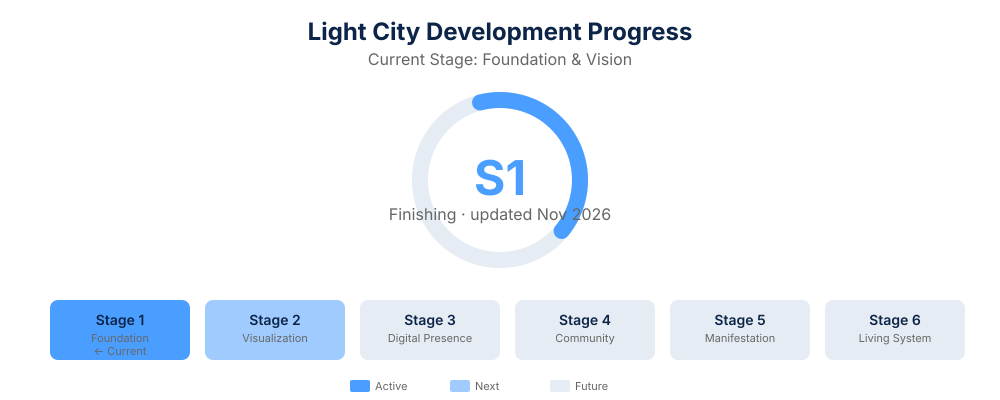

# Development Stages

The Light City project unfolds through six evolutionary stages, each building upon the previous foundation.

This roadmap runs from initial vision through design, community, construction, and steady operations. Timelines depend on funding, permits, partnerships, and collective readiness—not only on intent.

---

## Executive Summary

:::note Schedule update — November 2026
Stage 1 has run longer than the original two-to-three-month plan. Every later stage has moved back by about one year. Durations and budgets are unchanged.

As of November 16, 2026, all nine original Stage 1 deliverables are published, along with work that was not in the first plan: a household financial model, an economy and migration plan, candidate site regions and a 3D reference model. Four open items remain before the Stage 1 gate review in December 2026 (see [Stage 1](#stage-1-foundation--vision)).
:::

### Project Timeline (2025-2032+)
| Stage | Duration | Timeline | Investment | Status |
|-------|----------|----------|------------|--------|
| **S1: Foundation** | Extended | Oct 2025-Dec 2026 | $5K-$15K | Current: deliverables done, gate review Dec 2026 |
| **S2: Design** | 4-6 months | Jan-Jun 2027 | $25K-$85K | Upcoming |
| **S3: Digital** | 3-5 months | Jul-Nov 2027 | $35K-$125K | Planned |
| **S4: Community** | 6-12 months | Dec 2027-Nov 2028 | $85K-$280K | Planned |
| **S5: Physical** | 18-36 months | Dec 2028-Nov 2031 | $22M-$95M | Target |
| **S6: Operations** | Ongoing | 2032+ | $1.8M-$4.5M/yr | Long-term |

### Financial Overview
| Metric | Low Scenario | Mid Scenario | High Scenario |
|--------|--------------|--------------|---------------|
| **Total CAPEX (S1-S5)** | $22.1M | $45M | $95.5M |
| **Phase 1 Capacity** | 150 residents | 200 residents | 300 residents |
| **Annual OPEX (S6)** | $1.8M/year | $2.5M/year | $4.5M/year |
| **Annual Revenue (S6)** | $2.3M/year | $3.5M/year | $4.5M/year |
| **Break-even** | See household model | Fees ~13% above mid at 90% occupancy | See household model |
| **ROI Timeline** | 8-12 years | 6-9 years | 10-15 years |

**Target Scenario**: $45M CAPEX, 200 residents in about 110 homes, $2.5M OPEX. Revenue and break-even are being rebuilt around households; see [Household Model](#household-model-november-2026-draft).

---

## Stage Gate Checklist

> **Pass criteria for advancing to next stage:**
> 1. Key deliverables complete and published  
> 2. Community readiness confirmed (vote/consent)  
> 3. Resources secured (budget, team, partners)  
> 4. Risks reviewed with mitigations documented  
> 5. Learnings documented and linked

---

## Stage 1: Foundation & Vision

**Duration**: Planned 2-3 months; extended (Oct 2025 - Dec 2026)  
**Status**: CURRENT (deliverables published; four open items before the gate review in December 2026)  
**Total Budget**: $5K-$15K  
**Funding Sources**: Founder equity, personal investment

### Cost Breakdown (Stage 1)
| Category | Low | High | Notes |
|----------|-----|------|-------|
| **Tools & Software** | $500 | $1,500 | GitHub, design tools, domain, hosting |
| **Design Assets** | $1,000 | $3,000 | Stock images, fonts, basic concept art |
| **Consulting** | $1,000 | $5,000 | Legal (entity setup), initial advisors |
| **Documentation** | $500 | $2,000 | Writing, editing, formatting |
| **Research** | $500 | $1,500 | Books, courses, site visits |
| **Contingency (20%)** | $700 | $2,000 | Buffer for unknowns |
| **TOTAL** | **$4,200** | **$15,000** | |

**Actual Spend to Date**: ~$2,500 (tools, domain, research)

*Current status: Stage 1 - Foundation & Vision, deliverables published, gate review December 2026 (updated November 16, 2026)*

### Objectives
- Establish core philosophical and spiritual foundations
- Create comprehensive documentation structure
- Define the vision, purpose, and principles
- Document the architectural and energetic concepts
- Set up initial project infrastructure

### Key Deliverables
- [x] Core concept documentation
- [x] Project structure and organization
- [x] Vision and mission statements
- [x] Initial world-building documentation
- [x] Development roadmap
- [x] Tool selection and setup
- [x] [Technology catalog](/docs/technical/technology-catalog), with readiness (TRL), cost and supplier notes for every system
- [x] [Urban retrofit guide](/docs/technical/urban-retrofit-guide)
- [x] Visual documentation system: [visual language](/docs/design/visual-language), [color and light](/docs/design/color-and-light), [layout diagrams](/docs/design/layout-diagrams) and the [3D reference model](/docs/design/visual-language#3d-reference-model)

**Added during Stage 1** (not in the first plan)
- [x] [Household financial model](#household-model-november-2026-draft): about 110 homes for 200 residents, with operating margin by occupancy and fee level
- [x] [Governance](/docs/project/governance) and [contribution-based residency](/docs/project/contribution-based-residency) frameworks
- [x] [Economy and migration plan](/docs/project/economy-and-migration): Light hours and the four-phase dial (draft thresholds)
- [x] [Site locations](/docs/project/site-locations): five candidate regions in four countries, all above 350 ft
- [x] [Technology horizon](/docs/technical/technology-horizon), [Beyond the Box](/docs/design/organic-forms-and-materials) and [Light on the Land](/docs/design/light-on-the-land)
- [x] Public website: homepage, Explore pages (homes, city, technology, transition), pages for residents, investors, builders and researchers, an investor diligence room and a [Living here, honestly](/trust) page
- [x] Founding-circle sign-up and contact forms, collected in one sheet with email notification

**Open before the Stage 1 gate**
- [ ] Add debt service to the financial model (interest and repayment on the construction loan)
- [ ] Confirm the household fee basis and how to close the gap at 90% occupancy (about +13% above mid fees)
- [ ] Confirm the draft thresholds in the economy plan (credit limits, weekly share, dial gates)
- [ ] Engage counsel for the entity and the securities path; name the first advisors

### Activities
- Research and document spiritual/metaphysical foundations
- Sketch architectural concepts and designs
- Write foundational texts
- Create visual mood boards
- Establish documentation standards
- Set up GitHub repository and Docusaurus site

### KPIs (Stage 1)
- **Documentation velocity**: 10-15 pages/week
- **Documentation completeness**: 70%+ of outline filled
- **Visual assets**: 20+ diagrams/images created
- **Technical foundation**: GitHub + Docusaurus operational
- **Personal clarity**: Vision articulated and inspiring

### Top Risks & Mitigations
- **Scope creep**: Too much detail too early → Focus on breadth over depth; iterate
- **Perfectionism**: Never finishing → Set time boxes; ship iteratively
- **Isolation**: Working alone → Share early; invite feedback

### Gate & RACI
- **Gate (Pass/Fail)**: All key deliverables documented + GitHub/Docusaurus operational + personal clarity achieved + the four open items above closed or carried into Stage 2 with an owner and date
- **RACI**: Founder (R/A), Early advisors (C), Future community (I)

---

## Stage 2: World-Building & Design

**Duration**: 4-6 months (Jan 2027 - Jun 2027)  
**Status**: UPCOMING  
**Total Budget**: $25K-$85K  
**Funding Sources**: Arts/culture grants, patronage, crowdfunding (Kickstarter/Patreon)

### Cost Breakdown (Stage 2)
| Category | Low | High | Notes |
|----------|-----|------|-------|
| **Architectural Design** | $8,000 | $25,000 | Schematic design, concept plans, 3D models |
| **Concept Art & Visualization** | $5,000 | $20,000 | 10-20 professional renders, illustrations |
| **Sacred Geometry Mapping** | $2,000 | $8,000 | CAD/GIS work, overlays, technical drawings |
| **3D Modeling & VR** | $3,000 | $12,000 | Interactive models, virtual walkthroughs |
| **Consultants** | $3,000 | $10,000 | Engineers, sustainability experts, advisors |
| **Storytelling & Content** | $2,000 | $5,000 | Writers, editors, narrative development |
| **Contingency (20%)** | $4,600 | $16,000 | Buffer for scope changes |
| **TOTAL** | **$27,600** | **$96,000** | |

**Revenue Target**: $10K-$30K from crowdfunding, early supporters

### Objectives
- Develop detailed descriptions of Light City's architecture
- Create visual designs and concept art
- Map out the city's layout and sacred geometry
- Document the energetic systems and principles
- Define cultural and social structures

### Key Deliverables
- [ ] Complete architectural documentation (all building types)
- [ ] Professional concept art and visualizations (10-20 renders) that pass the [reality check](/docs/design/visual-language#concept-photos-modern-organic). Concept images are in place across the site; professional renders are still to be commissioned
- [ ] Baseline ecological survey of the chosen site and a biodiversity net gain plan ([Light on the Land](/docs/design/light-on-the-land))
- [ ] Materials palette for the chosen region, including local stone and embodied-carbon estimates
- [ ] City layout and sacred geometry maps (CAD/GIS)
- [ ] Cultural framework documentation
- [ ] Energy system technical specifications
- [ ] Inhabitant profiles and stories (10+ personas)
- [x] 3D model or interactive visualization: an early [3D reference model](/docs/design/visual-language#3d-reference-model) of the radial plan with Phase 1–3 layers is live; a site-specific model follows site selection

### Activities
- Create detailed architectural plans
- Commission or create professional artwork
- Design 3D models or interactive experiences
- Write stories and narratives
- Develop symbolic systems
- Engage architects and designers

### KPIs (Stage 2)
- **Design velocity**: 5-10 concept renders/month
- **Documentation completeness**: 90%+ of architecture outlined
- **Sacred geometry map**: v1.0 complete with all overlays
- **Contributor engagement**: 3-5 active contributors
- **Community feedback**: NPS ≥ 8 from early reviewers

### Top Risks & Mitigations
- **Design paralysis**: Too many options → Set design principles; use decision matrix
- **Budget overrun**: Professional services expensive → Mix paid/volunteer; phased approach
- **Vision drift**: Losing coherence → Regular alignment checks; design review board

### Gate & RACI
- **Gate (Pass/Fail)**: All architectural systems documented + 10+ professional renders + sacred geometry map v1.0 + community design review passed
- **RACI**: Founder (R), Architects (A), Design community (C), Advisors (I)

---

## Stage 3: Digital Presence

**Duration**: 3-5 months (Jul 2027 - Nov 2027)  
**Status**: FUTURE  
**Total Budget**: $35K-$125K  
**Funding Sources**: Digital products (courses, memberships), donations, sponsorships

### Cost Breakdown (Stage 3)
| Category | Low | High | Notes |
|----------|-----|------|-------|
| **Website Enhancement** | $5,000 | $20,000 | Interactive features, 3D/VR integration, UX |
| **Platform Development** | $8,000 | $30,000 | Community platform (Discord/Circle), CRM |
| **Content Creation** | $6,000 | $20,000 | Video production, courses, guides, assets |
| **Marketing & PR** | $8,000 | $25,000 | Social media ads, PR agency, influencer outreach |
| **Community Tools** | $3,000 | $10,000 | Forum, newsletter, analytics, automation |
| **Digital Products** | $3,000 | $12,000 | Course development, ebooks, templates |
| **Contingency (20%)** | $6,600 | $23,400 | Buffer for platform changes |
| **TOTAL** | **$39,600** | **$140,400** | |

**Revenue Target**: $15K-$60K from digital products, memberships, donations  
**Break-even Goal**: Month 8-12 post-launch

### Objectives
- Create a website or digital platform
- Establish online community spaces
- Share the vision publicly
- Build initial audience and community
- Create interactive experiences

### Key Deliverables
- [x] Project website (Docusaurus site operational)
- [x] 3D model in the browser (orbit, zoom, switch phases)
- [ ] VR/AR walkthroughs
- [ ] Social media presence (Twitter, Instagram, YouTube)
- [ ] Community platforms (Discord, forum, Circle)
- [x] Interactive visualizations: ring plan with phase growth, a day-in-the-life timeline, scenario and revenue charts on the homepage
- [ ] Newsletter or blog (regular cadence)
- [ ] Digital asset library (downloadable resources)
- [ ] Online courses or workshops

### Activities
- Enhance website with interactive tools
- Set up community platforms
- Create social media content strategy
- Build interactive 3D/VR experiences
- Launch public announcement campaign
- Develop digital products (courses, guides)

### KPIs (Stage 3)
- **Website traffic**: 1,000+ unique visitors/month
- **Community size**: 100-500 members
- **Engagement rate**: 10%+ active weekly
- **Content velocity**: 2-4 posts/week across platforms
- **Email list**: 200+ subscribers
- **Digital product revenue**: $1K-$5K/month

### Top Risks & Mitigations
- **Low traction**: No one cares → Targeted outreach; niche communities; compelling content
- **Platform overload**: Too many channels → Focus on 2-3 primary platforms; automate cross-posting
- **Burnout**: Content treadmill → Batch creation; guest contributors; sustainable pace

### Gate & RACI
- **Gate (Pass/Fail)**: Website live + 100+ community members + 2 digital products launched + social media active
- **RACI**: Founder (R), Marketing lead (A), Community manager (C), Tech team (I)

---

## Stage 4: Community & Collaboration

**Duration**: 6-12 months (Dec 2027 - Nov 2028)  
**Status**: FUTURE  
**Total Budget**: $85K-$280K  
**Funding Sources**: Partnerships, sponsorships, event revenue, memberships, foundation grants

### Cost Breakdown (Stage 4)
| Category | Low | High | Notes |
|----------|-----|------|-------|
| **Events & Gatherings** | $20,000 | $60,000 | Retreats, workshops, conferences (4-12 events) |
| **Contributor Stipends** | $15,000 | $60,000 | Part-time roles, project grants, fellowships |
| **Platform & Tools** | $8,000 | $25,000 | Governance tools, collaboration software, DAO |
| **Community Operations** | $12,000 | $40,000 | Community manager, moderation, support |
| **Working Group Support** | $10,000 | $35,000 | Budgets for 5-10 working groups |
| **Marketing & Outreach** | $10,000 | $30,000 | Targeted campaigns, partnerships, PR |
| **Contingency (20%)** | $15,000 | $50,000 | Buffer for rapid growth |
| **TOTAL** | **$90,000** | **$300,000** | |

**Revenue Target**: $40K-$150K from memberships, events, partnerships  
**Burn Rate**: $7K-$25K/month  
**Runway Goal**: 12-18 months secured funding

### Objectives
- Grow the community of aligned individuals
- Establish collaborative processes
- Co-create aspects of the Light City vision
- Develop governance structures
- Foster creative contributions

### Key Deliverables
- [ ] Community guidelines and governance framework
- [ ] Collaboration frameworks (working groups, decision-making)
- [ ] Contributor onboarding process (playbook + automation)
- [ ] Regular community events (weekly/monthly rhythm)
- [ ] Shared creation projects (3-5 active initiatives)
- [ ] Decision-making processes (consensus, voting, delegation)
- [ ] Contributor recognition system
- [ ] Community fund or treasury

### Activities
- Host virtual gatherings and workshops (weekly)
- Facilitate creative collaborations (design jams, hackathons)
- Establish working groups (architecture, culture, tech, outreach)
- Create contribution pathways (clear roles and projects)
- Document community wisdom (wiki, knowledge base)
- Run pilot programs (residencies, fellowships)

### KPIs (Stage 4)
- **Community size**: 500-2,000 members
- **Active contributors**: 20-50 regular participants
- **Working groups**: 5-10 active groups
- **Events**: 4-8 events/month
- **Contributor satisfaction**: NPS ≥ 9
- **Governance participation**: 30%+ vote in decisions
- **Community fund**: $10K-$50K raised

### Top Risks & Mitigations
- **Conflict**: Disagreements fracture community → Clear governance; conflict resolution process; values alignment
- **Free-rider problem**: Few do all work → Recognition systems; clear expectations; paid roles
- **Dilution**: Vision gets watered down → Strong facilitation; design authority; regular alignment

### Gate & RACI
- **Gate (Pass/Fail)**: 500+ members + governance framework operational + 5+ working groups active + 3+ co-creation projects completed
- **RACI**: Community council (R), Founder (A), Working group leads (C), All members (I)

---

## Stage 5: Physical Manifestation

**Duration**: 18-36 months (Dec 2028 - Nov 2031)  
**Status**: FUTURE  
**Total Budget**: $22M-$95M, $45M target (Phase 1 Hamlet: 200 residents target, 150-300 range)  
**Funding Sources**: Impact investors, green bonds, pre-sales, EPC finance, government grants

### Cost Breakdown (Stage 5) - Phase 1 Hamlet

#### Pre-Development ($1.5M-$5M)
| Category | Low | High | Notes |
|----------|-----|------|-------|
| **Land Acquisition** | $500K | $2M | 100-500 acres, rural/semi-rural location |
| **Due Diligence** | $50K | $200K | Environmental, geotechnical, title, surveys |
| **Master Planning** | $200K | $800K | Site plan, infrastructure design, phasing |
| **Architectural/Engineering** | $400K | $1.2M | Full construction documents (SD/DD/CD) |
| **Permitting & Legal** | $200K | $600K | Entitlements, zoning, environmental review |
| **Financing Costs** | $150K | $500K | Legal, due diligence, loan origination |
| **SUBTOTAL** | **$1.5M** | **$5.3M** | |

#### Hard Costs - Construction ($14M-$65M)
| Category | Low | High | Notes |
|----------|-----|------|-------|
| **Site Work & Infrastructure** | $3M | $12M | Roads, utilities, grading, drainage |
| **Communospheres (3-6 units)** | $4M | $18M | Geodesic domes, CLT, BIPV, interiors |
| **Residential Units (50-100)** | $5M | $25M | Tiny homes, studios, 1-3BR units. Draft plan is about 110 homes incl. 10 three-bedroom; may add ~10%, re-estimate in Stage 2 |
| **Central Spire (Prototype)** | $1M | $4M | Observation/meditation tower (50-100 ft) |
| **Energy Systems** | $800K | $3M | Solar, batteries, microgrid, backup |
| **Water Systems** | $400K | $1.5M | Wells, rainwater, treatment, storage |
| **Food Systems** | $300K | $1.2M | Greenhouses, aquaponics, gardens |
| **Wellness Facilities** | $500K | $2M | Float tanks, red light, acoustic spaces |
| **SUBTOTAL** | **$15M** | **$66.7M** | |

#### Soft Costs ($3.5M-$15M)
| Category | Low | High | Notes |
|----------|-----|------|-------|
| **Project Management** | $800K | $3.5M | Owner's rep, construction management |
| **Inspections & Testing** | $200K | $800K | QA/QC, commissioning, code compliance |
| **Insurance & Bonds** | $300K | $1.2M | Builder's risk, performance bonds |
| **Marketing & Pre-Sales** | $400K | $1.8M | Sales center, materials, campaigns |
| **Furniture & Equipment** | $600K | $2.5M | Furnishings, appliances, tools |
| **Landscaping & Art** | $400K | $1.5M | Native plants, sacred geometry installations |
| **Contingency (15-20%)** | $2.5M | $11M | Construction risk buffer |
| **SUBTOTAL** | **$5.2M** | **$22.3M** | |

#### **TOTAL PHASE 1 CAPEX**: **$21.7M - $94.3M**

**Target Budget**: $35M-$55M (mid-range scenario, 200 residents)

### Objectives
- Explore physical world implementations
- Create sacred spaces or installations
- Develop real-world community projects
- Apply Light City principles to existing spaces
- Build prototype structures or experiences
- Secure land and permits for Phase 1 hamlet

### Key Deliverables
- [ ] Physical location assessment and site selection
- [ ] Detailed architectural and engineering plans
- [ ] Prototype designs (full construction documents)
- [ ] Fundraising and capital secured ($19M-$81M Phase 1 construction; $44M target)
- [ ] Physical installations or structures (pilot projects)
- [ ] Community spaces (retreat center, co-working, events)
- [ ] Pilot projects (urban retrofits, installations)
- [ ] Land acquisition and site control
- [ ] Permitting complete (all approvals)
- [ ] Phase 1 construction initiated

### Activities
- Location scouting and assessment (site visits, due diligence)
- Architectural planning (schematic → DD → CD)
- Fundraising campaigns (grants, investors, crowdfunding)
- Building or creating physical elements (prototypes, installations)
- Hosting in-person gatherings (retreats, workshops, ceremonies)
- Establishing physical presence (office, studio, land)
- Permitting and compliance (see Permitting Rail below)

### Permitting & Build Rail
**Sequence**: Pre-application → Environmental/traffic/fire studies → Zoning/PD overlay → Building permits → Utility interconnect → Construction → Commissioning → Certificate of Occupancy

**Construction Controls**:
- Safety plan (OSHA compliance, site safety officer)
- QA/QC checklist (inspections, testing, documentation)
- Owner's rep weekly reports (schedule, budget, issues)
- Change order log (track scope changes, cost impacts)
- Commissioning & O&M handover (systems testing, training, manuals)

### KPIs (Stage 5)
- **Land secured**: Site under contract or owned
- **Permits approved**: All major permits issued
- **Capital raised**: $19M-$81M (Phase 1 construction range; $44M target)
- **Pilot projects**: 3-5 physical installations completed
- **Retreat attendance**: 100-500 people/year
- **Construction progress**: On schedule (SPI ≥ 0.9, CPI ≥ 0.9)
- **Community readiness**: 150-300 founding residents committed

### Top Risks & Mitigations
- **Permitting delays**: 12-24 month timeline → Pre-app meetings; experienced consultants; flexible schedule
- **Budget overruns**: Construction costs escalate → 20-30% contingency; value engineering; phased approach
- **Neighbor pushback**: Community opposition → Early engagement; buffer zones; benefits sharing
- **Water rights**: Insufficient water → Secure rights before purchase; backup well; rainwater systems
- **Fire/wind**: Natural disasters → Engineered for 120+ mph winds; defensible space; insurance
- **Founder conflict**: Disagreements on execution → Clear governance; decision-making process; exit mechanisms

### Gate & RACI
- **Gate (Pass/Fail)**: Land secured + permits approved + $19M+ capital raised + construction initiated + 150+ founding residents committed
- **RACI**: Founder/CEO (R), Architects/engineers (A), Community council (C), Investors/lenders (I)

---

## Stage 6: Living System & Evolution

**Duration**: Ongoing (perpetual, starting 2032+)  
**Status**: FUTURE  
**Annual Operating Budget**: $1.8M-$4.5M/year (Phase 1 steady-state, 200 residents)  
**Funding Sources**: Resident fees (60%), retreat revenue (20%), events/agritourism (10%), licensing/consulting (10%)

### Annual Operating Costs (Stage 6) - Phase 1

#### Personnel ($900K-$2.2M/year)
| Role | FTE | Salary Range | Total |
|------|-----|--------------|-------|
| **Executive Director** | 1.0 | $80K-$120K | $80K-$120K |
| **Operations Manager** | 1.0 | $60K-$90K | $60K-$90K |
| **Community Coordinator** | 1.0 | $50K-$75K | $50K-$75K |
| **Facilities Manager** | 1.0 | $55K-$80K | $55K-$80K |
| **Maintenance Staff** | 2-4 | $40K-$60K | $160K-$240K |
| **Food/Agriculture Lead** | 1.0 | $50K-$70K | $50K-$70K |
| **Wellness Coordinator** | 0.5 | $45K-$65K | $23K-$33K |
| **Admin/Finance** | 1.0 | $50K-$70K | $50K-$70K |
| **Security/Safety** | 1-2 | $40K-$55K | $40K-$110K |
| **Guest Services** | 1-2 | $35K-$50K | $35K-$100K |
| **Benefits & Taxes (35%)** | - | - | $210K-$350K |
| **SUBTOTAL** | **10-15** | - | **$813K-$1.34M** |

#### Operations ($500K-$1.2M/year)
| Category | Annual Cost | Notes |
|----------|-------------|-------|
| **Utilities** | $80K-$180K | Electric, water, internet, waste |
| **Maintenance & Repairs** | $150K-$350K | Buildings, infrastructure, equipment |
| **Food & Supplies** | $100K-$250K | Communal meals, supplies, supplements |
| **Insurance** | $80K-$200K | Property, liability, workers comp |
| **Property Taxes** | $20K-$80K | Varies by location, non-profit status |
| **Marketing & Sales** | $40K-$100K | Resident recruitment, retreat promotion |
| **Technology & Software** | $20K-$50K | Systems, licenses, IT support |
| **Professional Services** | $30K-$80K | Legal, accounting, consulting |
| **SUBTOTAL** | - | **$520K-$1.29M** |

#### Programs & Development ($200K-$500K/year)
| Category | Annual Cost | Notes |
|----------|-------------|-------|
| **Retreat Programs** | $80K-$200K | Facilitators, materials, marketing |
| **Education & Workshops** | $40K-$100K | Teachers, curriculum, equipment |
| **Research & Innovation** | $30K-$80K | Consciousness research, sustainability R&D |
| **Community Events** | $30K-$80K | Gatherings, ceremonies, celebrations |
| **Outreach & Replication** | $20K-$40K | Consulting, knowledge sharing, network |
| **SUBTOTAL** | - | **$200K-$500K** |

#### Capital Reserves ($200K-$500K/year)
| Category | Annual Reserve | Notes |
|----------|----------------|-------|
| **Replacement Reserve** | $150K-$350K | Equipment, systems, major repairs |
| **Expansion Fund** | $50K-$150K | Phase 2 planning, land acquisition |
| **SUBTOTAL** | - | **$200K-$500K** |

#### **TOTAL ANNUAL OPEX**: **$1.73M - $3.59M**

**Per Resident Cost**: $8,650-$17,950/year  
**Target Operating Budget**: $2.5M/year (200 residents @ $12,500/year avg)

### Objectives
- Maintain and evolve the Light City ecosystem
- Support ongoing growth and development
- Adapt to emerging insights and needs
- Scale successful implementations
- Serve as a living example and inspiration
- Expand to Phase 2 (village) and Phase 3 (town)

### Growth rule: build once, grow outward

Each phase must work as a finished place on its own. Expansion fills plots reserved in Phase 1 and adds new rings outside the existing ones; nothing built earlier is demolished. The spire grows by adding sections to the Phase 1 tower, whose foundation is sized for the final height. Only movable assets such as solar panels, greenhouses and nursery trees are relocated. Details: [Architecture → Phased development & scale](/docs/design/architecture#phased-development--scale).

### Key Deliverables
- [ ] Sustainable operations model (break-even or profitable)
- [ ] Continuous improvement processes (kaizen, retrospectives)
- [ ] Regular updates and evolution (quarterly reviews)
- [ ] Impact measurement and documentation (KPIs, case studies), including the annual, independently reviewed nature and footprint report
- [ ] Knowledge sharing and teaching (courses, tours, consulting)
- [ ] Replication frameworks (playbooks, licensing, support)
- [ ] Phase 2 expansion (1,500-3,000 residents)
- [ ] Network of Light Cities (10+ sites globally)

### Activities
- Regular community check-ins (weekly councils, monthly assemblies)
- Continuous documentation (wiki, blog, research papers)
- Adaptation and evolution (experiments, pilots, iterations)
- Teaching and mentoring (workshops, residencies, apprenticeships)
- Scaling successful models (Phase 2-3, new sites)
- Inspiring other Light City initiatives (open-source, consulting)
- Operating the hamlet/village/town (daily management)

### KPIs (Stage 6)
- **Occupancy rate**: 90%+ (Phase 1)
- **Resident satisfaction**: NPS ≥ 9
- **Financial sustainability**: Break-even or 10%+ margin
- **Environmental impact**: Net-positive (carbon, water, biodiversity)
- **Health outcomes**: 15%+ improvement in sleep, stress, wellness
- **Replication**: 3-10 new Light City projects inspired
- **Knowledge sharing**: 1,000+ visitors/year; 10+ publications
- **Expansion**: Phase 2 initiated within 3-5 years

### Top Risks & Mitigations
- **Operational drift**: Losing vision in daily grind → Regular retreats; values check-ins; leadership rotation
- **Financial stress**: Revenue shortfalls → Diversified income; reserves (6-12 months); cost controls
- **Community conflict**: Interpersonal tensions → Conflict resolution process; counseling; clear expectations
- **Maintenance backlog**: Deferred maintenance → Preventive maintenance schedule; capital reserves; inspections
- **Stagnation**: Losing vitality → Continuous learning; new residents; experiments; external input

### Gate & RACI
- **Gate (Pass/Fail)**: Phase 1 operational + break-even achieved + resident satisfaction ≥ 9 NPS + impact documented
- **RACI**: Community council (R), Operations team (A), All residents (C), External stakeholders (I)

---

## Navigation Between Stages

### Progression Criteria

Each stage completion is marked by:
1. **Achieving all key deliverables** (documented and published)
2. **Community readiness for next phase** (vote/consent recorded)
3. **Necessary resources secured** (budget, team, partners committed)
4. **Clear vision for next stage** (plan documented and reviewed)
5. **Documentation of learnings** (retrospective published)

### Flexibility

These stages are guideposts, not rigid requirements. The project may:
- Move through stages at different speeds (based on resources and readiness)
- Work on multiple stages simultaneously (e.g., Stage 3 + 4 overlap)
- Return to earlier stages for refinement (iterative, not linear)
- Skip or combine stages as appropriate (context-dependent)
- Create entirely new stages as needed (emergent design)

---

## Comprehensive Financial Model

### Revenue Model by Stage

#### Stage 6 Revenue Streams (Annual, Steady-State)
| Revenue Source | Annual | % of Total | Notes |
|----------------|--------|------------|-------|
| **Resident Fees** | $1.3M-$1.6M | 60% | Household model: 110 homes at 90% occupancy, home fees plus member fees (earlier figure of $1.5M-$2.7M counted every resident as a full fee) |
| **Retreat Programs** | $400K-$900K | 20% | 800-1,500 guests @ $500-$600/visit |
| **Events & Agritourism** | $200K-$450K | 10% | Workshops, tours, farm sales |
| **Licensing & Consulting** | $200K-$450K | 10% | Replication support, IP licensing |
| **TOTAL REVENUE** | **$2.3M-$4.5M** | **100%** | |

**Break-even**: under review. With per-home fees, fees about 13% above mid prices are needed at 90% occupancy and base retreat income. See [Household Model](#household-model-november-2026-draft).  
**Profitability Target**: 10-15% margin → $250K-$500K/year for expansion

### Resident Fee Structure (Monthly)
| Unit Type | Size | Monthly Fee | Annual | Notes |
|-----------|------|-------------|--------|-------|
| **Tiny Home** | 200-300 sf | $500-$700 | $6K-$8.4K | Shared facilities |
| **Studio** | 400-500 sf | $700-$950 | $8.4K-$11.4K | Private bath, kitchenette |
| **1-Bedroom** | 600-800 sf | $950-$1,300 | $11.4K-$15.6K | Full kitchen, private |
| **2-Bedroom** | 900-1,200 sf | $1,300-$1,700 | $15.6K-$20.4K | Families of 3-4, shared living |
| **3-Bedroom** (draft) | 1,300-1,600 sf | $1,700-$2,200 | $20.4K-$26.4K | Families of 4-6, three generations |

**Fee basis**: the home fee covers the home and one adult. Each additional adult pays a member fee of about $300/month and each child under 18 about $150/month, for meals, wellness and programs (draft).  
**Includes**: Utilities, communal meals (10-15/month), wellness access, events, maintenance  
**Additional**: Private meals, workshops, personal services (à la carte)

---

## Financial Model Notes & Assumptions

### Cross-Subsidy Structure

**Unit Economics**:
| Unit Type | Monthly Fee | Annual | Per-Resident Cost | Margin |
|-----------|-------------|--------|-------------------|---------|
| Tiny Home | $500-$700 | $6K-$8.4K | $8.7K-$18K | ❌ Loss leader |
| Studio | $700-$950 | $8.4K-$11.4K | $8.7K-$18K | ≈ Break-even |
| 1-Bedroom | $950-$1,300 | $11.4K-$15.6K | $8.7K-$18K | Profitable (model) |
| 2-Bedroom | $1,300-$1,700 | $15.6K-$20.4K | $8.7K-$18K | Profitable (model) |
| 3-Bedroom (draft) | $1,700-$2,200 | $20.4K-$26.4K | $8.7K-$18K | Profitable per home; more people per home |

**Cross-Subsidy Strategy**:
1. **Tiny homes** (25 of 110 homes, about 23%) operate at loss, subsidized by larger units + retreat revenue
2. **Studios** (35 homes, about 32%) approximately break-even
3. **1-BR, 2-BR and 3-BR** (50 homes, about 45%) generate profit margin
4. **Retreat revenue** ($400K-$900K/year) is **essential**, not optional

### Critical Success Factors

**Revenue Dependencies**:
- **Occupancy**: 90%+ required for break-even (80% occupancy = operating loss)
- **Retreat Revenue**: Must achieve 800-1,500 guests/year @ $500-$600/guest
- **Unit Mix**: Cannot exceed 25% tiny homes without increasing fees
- **Pricing Power**: Must maintain fees within $500-$2,200 per home range (market competitive)

### Sensitivity Analysis

**10% Revenue Drop Scenarios**:
| Scenario | Impact | Mitigation |
|----------|--------|------------|
| Occupancy drops to 80% | -$185K-$252K/year | Increase marketing, improve retention |
| Retreat bookings -10% | -$40K-$90K/year | Diversify retreat offerings, partnerships |
| Fee resistance (5% discount) | -$93K-$126K/year | Value-add services, improve experience |
| **Combined worst case** | -$318K-$468K/year | Draw from reserves, cut discretionary costs |

**Risk Mitigation**:
1. **Build 12-18 month operating reserve** ($1.8M-$4.5M) before opening
2. **Guarantee minimum retreat bookings** (pre-sell 50% of Year 1 capacity)
3. **Dynamic pricing** (adjust fees based on demand, +/- 10%)
4. **Limit tiny homes** to 25% of total units (currently appropriate)
5. **Diversify revenue** (events, agritourism, licensing)

### Household Model (November 2026 draft)

Fees are charged per home, not per person, so revenue depends on how many homes there are and who lives in them. The earlier break-even analysis below counted 180 residents each paying the $925 average home fee, which overstates resident income for a 200-person community living in about 110 homes.

**Draft home mix for 200 residents**

| Home | Homes | People per home | Residents | Home fee / month (mid) |
|------|-------|-----------------|-----------|------------------------|
| Tiny home | 25 | 1 | 25 | $600 |
| Studio | 35 | 1-2 (avg 1.2) | 42 | $825 |
| 1-Bedroom | 25 | 1-2 (avg 1.7) | 43 | $1,125 |
| 2-Bedroom | 15 | 2-4 (avg 3) | 45 | $1,500 |
| 3-Bedroom (draft) | 10 | 4-6 (avg 4.5) | 45 | $1,950 |
| **Total** | **110** | **1.8 avg** | **200** | |

**Member fees**: about 50 additional adults at $300/month and 40 children at $150/month = about $250K/year.

**Resident income at full occupancy**: home fees $1.37M (mid prices) + member fees $0.25M = **$1.62M/year**. At 90% occupancy: $1.46M. (Earlier method: $2.0M.)

**Annual operating margin** (operating cost $2.5M, other income $850K base / $600K low retreats):

| Occupancy | Mid prices, $850K | Mid prices, $600K | Top of range, $850K | Top of range, $600K |
|-----------|-------------------|-------------------|---------------------|---------------------|
| 80% (88 homes) | -$355K | -$605K | -$195K | -$445K |
| 90% (99 homes) | -$194K | -$444K | -$13K | -$263K |
| 100% (110 homes) | -$32K | -$282K | +$169K | -$81K |

**What this means**
- At mid prices the operating budget does not break even, even at full occupancy.
- Break-even at 90% occupancy needs fees about 13% above mid (close to the top of each range) with base other income, or about 30% above mid with low retreat income.
- Not yet included: contribution-based residency discounts (20-30% of homes), founding-member discounts and debt service. All three widen the gap.
- Levers to test in Stage 2: more homes on the same infrastructure, a larger share of 1-3 bedroom homes, higher member fees, lower operating cost per home and pre-sold retreat income.

### Break-Even Analysis (earlier per-resident method, superseded)

The cases below count each resident as paying a full home fee. They are kept for reference until the Stage 2 model replaces them.

**Base Case** (Mid Scenario):
- **Residents**: 180 @ average $925/month = $2.0M/year
- **Retreats**: 1,000 guests @ $550 = $550K/year
- **Other**: Events, agritourism, licensing = $300K/year
- **Total Revenue**: $2.85M/year
- **Total OPEX**: $2.5M/year
- **Margin**: $350K/year (12% margin)

**Conservative Case** (Low Scenario):
- **Residents**: 160 @ average $800/month = $1.54M/year
- **Retreats**: 800 guests @ $500 = $400K/year
- **Other**: $200K/year
- **Total Revenue**: $2.14M/year
- **Total OPEX**: $1.8M/year
- **Margin**: $340K/year (16% margin)

**Optimistic Case** (High Scenario):
- **Residents**: 220 @ average $1,100/month = $2.9M/year
- **Retreats**: 1,500 guests @ $600 = $900K/year
- **Other**: $450K/year
- **Total Revenue**: $4.25M/year
- **Total OPEX**: $3.6M/year
- **Margin**: $650K/year (15% margin)

---

### Funding Stack by Stage

| Stage | Budget Range | Timeline | Primary Sources | Secondary Sources |
|-------|-------------|----------|-----------------|-------------------|
| **S1: Foundation** | $5K-$15K | 2-3 mo | Founder equity, personal investment | Friends/family |
| **S2: Design** | $25K-$85K | 4-6 mo | Arts/culture grants, patronage | Crowdfunding (Kickstarter), pre-sales |
| **S3: Digital** | $35K-$125K | 3-5 mo | Digital products, memberships, donations | Sponsorships, affiliate revenue |
| **S4: Community** | $85K-$280K | 6-12 mo | Partnerships, event revenue, memberships | Foundation grants, corporate sponsors |
| **S5: Physical** | $22M-$95M | 18-36 mo | Impact investors (40%), pre-sales (30%), EPC finance (20%) | Green bonds, government grants (10%) |
| **S6: Operations** | $1.8M-$4.5M/yr | Ongoing | Resident fees (60%), retreat revenue (20%) | Events (10%), licensing (10%) |

**Cumulative Investment (S1-S5)**: **$22.1M - $95.5M**  
**Target Capital Raise (S5)**: **$35M-$55M** (mid-range scenario, 200 residents)

### Investment Returns & Exit Strategies

#### For Impact Investors (Stage 5)
| Return Mechanism | Timeline | Expected Return | Notes |
|------------------|----------|-----------------|-------|
| **Preferred Return** | Years 1-3 | 4-6% annual | Priority distribution before equity |
| **Equity Appreciation** | Years 5-10 | 8-12% IRR | Property value + business value growth |
| **Refinancing Exit** | Year 5-7 | Full return | Refinance with permanent debt, cash out investors |
| **Sale/Transfer** | Year 10+ | 1.5-2.5x | Sell to community trust, co-op, or new investors |
| **Dividend Stream** | Year 4+ | 3-8% yield | Ongoing distributions from operating profit |

**Investor Profile**: Impact-first, patient capital, 7-12 year horizon, aligned values

#### For Pre-Sale Residents (Stage 5)
| Benefit | Value | Notes |
|---------|-------|-------|
| **Founding Member Discount** | 15-25% off | Early commitment discount on monthly fees |
| **Equity Participation** | 5-10% | Optional: invest $25K-$100K for equity stake |
| **Governance Rights** | Voting | Founding members get enhanced voting rights |
| **Priority Selection** | First choice | Unit selection, communosphere placement |
| **Lifetime Lock** | Fixed rate | Monthly fees locked at founding rate (inflation-adjusted) |

**Pre-Sale Target**: 50-100 founding residents @ $5K-$25K deposits = $250K-$2.5M

---

## Current Focus: Stage 1 Activities

### Immediate Next Steps
1. Complete core concept documentation
2. Set up project management tools (GitHub, Docusaurus)
3. Create initial visual concepts (30+ diagrams)
4. Define project values and principles
5. Establish documentation standards
6. Select technical tools and platforms
7. [ ] Complete Technology Catalog
8. [ ] Complete Urban Retrofit Guide
9. [ ] Finalize Stage 1 and transition to Stage 2

### Success Metrics for Stage 1
- Clear, comprehensive documentation of vision (70%+ complete)
- Well-organized project structure (GitHub + Docusaurus operational)
- Foundational documents that invite serious review (early reader feedback)
- Technical foundation for future stages (live website, version control)
- Clear direction for contributors (vision and next steps documented)

---

**Last Updated**: November 16, 2026  
**Last Reviewed**: November 16, 2026  
**Version**: 2.0 (Comprehensive Financial Model)  
**Author**: Stan Zemskoff (Founder)  
**Related**: [Architecture](/docs/design/architecture), [Technology Catalog](/docs/technical/technology-catalog), [Energy Systems](/docs/concepts/energy-systems)

---

**[Edit this page on GitHub](https://github.com/szemkoff/light-city-project/edit/main/website/docs/project/development-stages.md)** | **[Project updates](/blog)**
