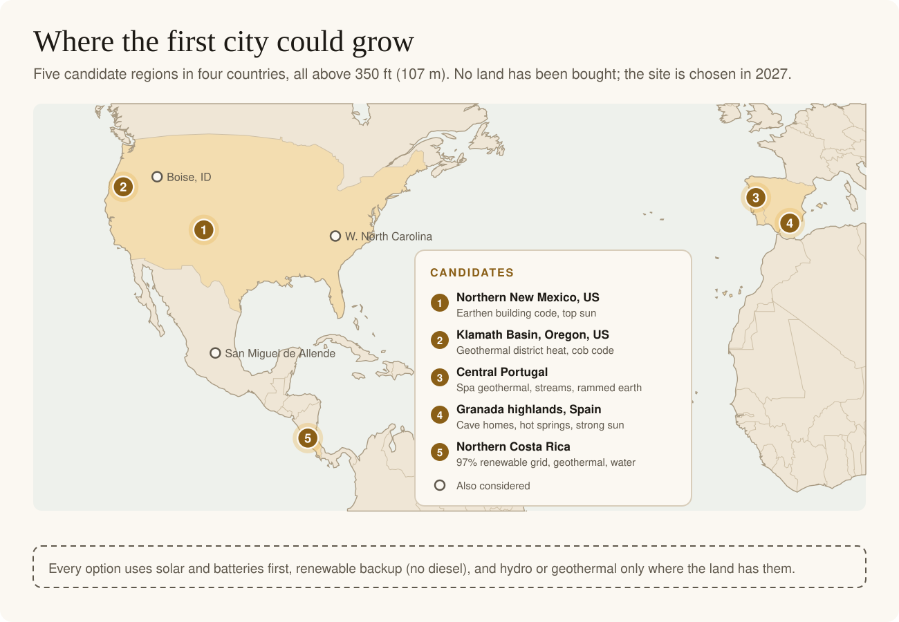

# Site Locations

No land has been bought. This page is a **desk study**: it narrows the search to four regions worth visiting in Stage 2 (Design, 2027), when the final site is chosen. Each region is scored against the [siting criteria](/docs/design/architecture#site-selection-future) and the energy plan: solar first, batteries, then renewable backup (biogas or bio-ethanol, never diesel), with micro-hydro and geothermal heat as site-dependent bonuses. See [Resilience without diesel](/docs/concepts/energy-systems#resilience-without-diesel).

## What we are looking for

- **100–500 acres**, rural or semi-rural, for a 20–30 acre Phase 1 core plus farmland, buffers and room for Phase 2 ([At a glance](/docs/at-a-glance)).
- **Strong sun** for a 2–5 MWp solar microgrid.
- **Secure water**: rainfall, springs or wells, and the legal right to use them.
- **A bonus energy resource**: hot water underground for direct geothermal heat, or a year-round stream for micro-hydro.
- **Codes that allow earth and timber**: rammed earth, adobe, cob, compressed earth block and mass timber.
- **Affordable land**, low climate risk, a welcoming community and reasonable access to a hospital and an airport.

## Scorecard

Scores run from 1 (weak) to 5 (strong). For land cost and climate risk, 5 means cheap or low-risk. These are first-pass judgments from public data, to be replaced by site visits and test wells.

| Criterion | Northern New Mexico | San Luis Valley, CO | Klamath Basin, OR | Western North Carolina |
|---|:-:|:-:|:-:|:-:|
| Sun (annual average) | 5 · 5.29 kWh/m²/day | 5 · 5.28 | 4 · 4.72 | 3 · 4.39 |
| Water (rainfall, rights) | 2 · ~17 in/yr | 2 · ~15 in/yr | 3 · ~23 in/yr | 5 · ~53 in/yr |
| Geothermal heat | 3 | 4 | 5 | 1 |
| Micro-hydro | 1 | 2 | 3 | 5 |
| Earth-building code | 5 | 3 | 4 | 2 |
| Land cost | 4 | 5 | 4 | 3 |
| Climate risk | 3 | 3 | 2 | 2 |
| Community fit | 4 | 5 | 3 | 5 |
| Access (hospital, airport) | 3 | 2 | 3 | 4 |
| **Total (of 45)** | **30** | **31** | **31** | **30** |

Sun, rainfall and temperature figures are 30-year climatology from [NASA POWER](https://power.larc.nasa.gov/) at a representative point in each region. Every region clears the 4.5 kWh/m²/day solar threshold except Western North Carolina, which is close. The two Southwest options fall well short of the 30 inches of rain the criteria prefer, so they depend on wells and water rights.

The totals are close on purpose: no region wins outright. Each one is strongest at something different, and the choice depends on what the founding circle values most.

## Option 1 · Northern New Mexico (Taos to Ojo Caliente)

**Best for:** building with earth, legally, from day one.

- **Earth-building code.** New Mexico is one of the few US states with its own [Earthen Building Materials Code](https://www.srca.nm.gov/parts/title14/14.007.0004.html), covering adobe, rammed earth, compressed earth block and terrón, for buildings up to two stories ([NM 14.7.4.12](https://regulations.justia.com/states/new-mexico/title-14/chapter-7/part-4/section-14-7-4-12/)). This fits the [Beyond the box](/docs/design/organic-forms-and-materials) homes directly.
- **Sun.** About 5.3 kWh/m²/day, among the best in the country ([NASA POWER](https://power.larc.nasa.gov/)).
- **Geothermal.** The Rio Grande rift drives the state's geothermal potential ([NM Bureau of Geology](https://www.nmlegis.gov/handouts/WNR%20083126%20Item%208%20NMT%20Geothermal%20Program.pdf)). Ojo Caliente already uses its hot water for space heating ([NM Bureau of Geology](https://geoinfo.nmt.edu/publications/periodicals/litegeology/28/lg_v28.pdf)), and geothermal greenhouses make up nearly half of the state's greenhouse acreage ([Earth Matters](https://geoinfo.nmt.edu/publications/periodicals/earthmatters/6/n2/em_v6_n2.pdf)). Northern wells are warm (about 115–132°F), good for heat, not power ([City of Albuquerque appendix](https://www.cabq.gov/airquality/documents/pdf/appendixoo.pdf)).
- **Precedent.** The Greater World Earthship community near Taos covers about 630 acres and shows the county will permit off-grid earth homes ([Alta](https://www.altaonline.com/culture/architecture/a69500861/your-next-home-could-be-an-earthship/)).

**Watch-outs.**
- Water is scarce. Rights run through acequias and the State Engineer, and well permits can be contested ([US Land Life](https://www.uslandlife.com/new-mexico/taos-county/homesteading)).
- Earthship history shows that county rules can tighten. Plan as a proper subdivision with roads, wells and wastewater approvals from the start ([SAH Archipedia](https://sah-archipedia.org/buildings/NM-01-055-0185)).
- Taos Pueblo and Hispano land-grant communities have deep ties to this land. Any project here begins with listening, not buying.
- Taos County residential height is capped at 27 feet without a special permit ([Taos County](https://www.taoscounty.org/DocumentCenter/View/1754/Residential-Zoning-Clearance-Permit-Application)). A 60–120 m spire would need a special use permit and may not fit here at all.

## Option 2 · San Luis Valley, Colorado (Crestone and Saguache County)

**Best for:** sun, cheap land and an existing contemplative community.

- **Sun.** Known as the "Land of Cool Sunshine", with more than 85 MW of utility solar already built ([Colorado State University](https://foodsystems.colostate.edu/wp-content/uploads/2017/01/CO-BP-Region-8-summary-profile-rw.pdf)). About 5.3 kWh/m²/day ([NASA POWER](https://power.larc.nasa.gov/)).
- **Geothermal.** NREL named the valley one of Colorado's two most promising geothermal areas, with water around 200°F at about 5,000 feet: best suited to direct heat and heat pumps ([Pueblo Chieftain](https://www.chieftain.com/story/news/2010/02/28/san-luis-valley-looking-to/9118454007/)).
- **Community.** Crestone and the Baca Grande host more than two dozen spiritual centers across many traditions ([Town of Crestone](https://townofcrestone.gov/pages/local-spiritual-centers), [GoColorado](https://gocolorado.com/towns/crestone/)). This is the closest existing match to Light City's culture.
- **Land.** Among the cheapest rural land in Colorado, with a long history of solar pioneers ([High Country News](https://www.hcn.org/wotr/energy-exporters-stay-out-of-the-san-luis-valley/)).

**Watch-outs.**
- Very cold winters (January lows below −25°C in the climatology) and strong wind. Domes and earth walls need careful insulation.
- Water is tied to the Rio Grande Compact and a stressed aquifer. New uses need augmentation plans.
- Remote: several hours to Denver or Colorado Springs. No state earthen-building code; approval depends on the county building official.

## Option 3 · Klamath Basin, Southern Oregon (Klamath Falls)

**Best for:** proven geothermal heat and a code friendly to cob and mass timber.

- **Geothermal.** Klamath Falls has run a city geothermal district heating system since 1981, with 200–220°F wells serving 23 buildings and melting snow from sidewalks ([City of Klamath Falls](https://www.klamathfalls.city/232/Geothermal), [US DOE](https://www.energy.gov/hgeo/geothermal/networked-geothermal)). Hundreds of homes and Oregon Tech also heat with geothermal water ([OSTI](https://www.osti.gov/etdeweb/servlets/purl/894596)). This is the strongest geothermal story of the four.
- **Codes.** Oregon's residential code includes an appendix for cob construction ([Oregon BCD](https://www.oregon.gov/bcd/codes-stand/Documents/23orsc-ch1.pdf)), and Oregon was the first state to allow tall mass-timber buildings ([Oregon BCD](https://www.oregon.gov/bcd/50years/Documents/5820-BCD-50th-anniversary.pdf)). That suits glulam domes and earth walls.
- **Hydro.** Oregon has the largest small-hydro potential of the four states, mostly in the Cascades ([Kosnik, Energy Policy](https://www.umsl.edu/~kosnikl/Saved%20Emissions.pdf)).
- **Sun.** Still good at about 4.7 kWh/m²/day ([NASA POWER](https://power.larc.nasa.gov/)).

**Watch-outs.**
- Long-running conflict over Klamath water between farms, tribes and fish. A newcomer must not add pressure.
- Wildfire and drought are real risks. Design for defensible space and on-site water storage.

## Option 4 · Western North Carolina (Asheville region)

**Best for:** water, micro-hydro, a mild green climate and an established wellness culture.

- **Water.** About 53 inches of rain a year ([NASA POWER](https://power.larc.nasa.gov/)), the only option that clearly meets the 30-inch criterion.
- **Micro-hydro.** An Oak Ridge National Laboratory study found 366 stream sites on Cherokee land able to power at least a home each, and some over 100 kW, with no dams ([AZoCleantech](https://www.azocleantech.com/news.aspx?newsID=36843)). An older survey counted about 1,593 feasible small-hydro sites across the mountain counties ([UNT Digital Library](https://digital.library.unt.edu/ark:/67531/metadc1099376/m2/1/high_res_d/5753801.pdf)).
- **Community and access.** Asheville is a well-known center for wellness, arts and craft, with a regional airport and hospitals.

**Watch-outs.**
- Hurricane Helene in 2024 dropped about 14 inches of rain on Asheville in three days, beyond a 1-in-1,000-year event, and set off around 2,000 landslides ([NOAA Climate.gov](https://www.climate.gov/news-features/event-tracker/hurricane-helenes-extreme-rainfall-and-catastrophic-inland-flooding)). Any site must sit high, off floodplains and away from steep slopes.
- The lowest sun of the four (about 4.4 kWh/m²/day), so a larger array or more storage.
- No deep geothermal (heat pumps only). Earth building is harder in a wet climate and has no dedicated state code.

## Also considered

- **Southern Idaho (Boise).** Boise runs the largest municipal geothermal heating utility in the US, warming more than 6 million square feet of buildings with 177°F water ([US DOE](https://www.energy.gov/hgeo/geothermal/networked-geothermal)). A strong reserve candidate.
- **Big Island, Hawaii (Puna).** Real geothermal power and year-round growing, but high land and shipping costs and lava risk.
- **South Florida (Homestead).** The founder's home base, with good sun, but hurricanes, flat land, no geothermal and no hydro. Better suited to an [urban retrofit](/docs/technical/urban-retrofit-guide) pilot than the first city.

## Next steps

1. **Founding circle input (2026).** Rank the criteria: is earth-building freedom, geothermal heat, water or community the top priority?
2. **Shortlist two regions (early 2027).** Talk to county planners, the state engineer or water office, and tribal and local community leaders before any land search.
3. **Site visits (2027).** Walk 3–5 parcels per region. Check solar access, slope, soils, wells, streams and road access.
4. **Test before buying.** Commission a water-rights review, a geotechnical survey and, where geothermal is promising, a temperature-gradient well.
5. **Visionary layer, tested fairly.** If the community wants to include how a place feels, use a blinded comparison of shortlisted sites so the impressions can be recorded honestly (see [Open Questions](/docs/research/open-questions)).
6. **Decision gate.** The site is chosen at the end of Stage 2 (Design), as set out in [Development Stages](/docs/project/development-stages).
