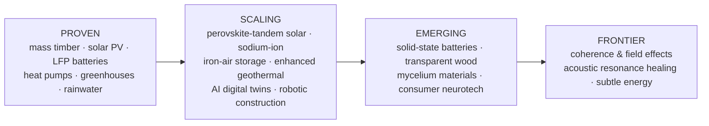

# Technology Horizon

**What exists, what is arriving, and what is still a question, as of November 2026.**

Light City should feel like the future without betting the community on hype. Every technology we mention sits on one of four horizons. Documents across the library use these same four tags.

| Horizon | Meaning | Light City rule | Typical TRL |
|---|---|---|---|
| **Proven** | Commercially mature with long track records | Build with it from day one | 8–9 |
| **Scaling** | In commercial production now, costs falling fast | Design for it and procure when Stage 5 starts (2028–2031) | 6–8 |
| **Emerging** | Pilot lines or early products, not yet bankable | Leave space and interfaces for it, adopt in Phase 2 | 4–6 |
| **Frontier** | Research and hypotheses | Study it openly, never depend on it | 1–3 |

The detailed specs, costs and suppliers for each system are in the [Technology Catalog](/docs/technical/technology-catalog).

---

## Proven — build with it now

| Technology | Role in Light City | Status |
|---|---|---|
| **Mass timber (CLT, glulam)** | Dome frames, spire hybrid structure, housing | Ascent in Milwaukee is 86.6 m (284 ft), the tallest timber building in the world ([Thornton Tomasetti](https://www.thorntontomasetti.com/project/ascent)). A 114 m successor is planned in the same city ([CTBUH](https://www.ctbuh.org/news/the-next-milwaukee-mass-timber-tall-building-breaks-ground)). A 60–120 m timber-steel spire therefore sits within the demonstrated range. |
| **Silicon solar PV + LFP batteries** | 2–5 MWp and 8–20 MWh Phase 1 microgrid | Mature and bankable. This is the baseline for the [energy system](/docs/concepts/energy-systems). |
| **Heat pumps and heat recovery** | Heating, cooling and hot water | Mature. Paired with timber's thermal mass and passive design. |
| **Solar greenhouses and agroforestry** | Year-round food | Mature, low energy. Chosen over vertical farms (see the realism notes below). |
| **Rainwater, living machines, composting** | Closed-loop water and waste | Mature. Details are in the catalog. |
| **Circadian lighting and environmental sensors** | Healthy interiors | Mature. |

## Scaling — design for it, buy it in Stage 5

### Perovskite-silicon tandem solar
Tandem cells stack a perovskite layer on silicon to capture more of the spectrum. In 2026 they moved from the lab into factories. LONGi set a 35.5% cell efficiency record, and Tandem PV launched commercial manufacturing in California ([pv magazine USA](https://pv-magazine-usa.com/2026/11/13/us-firm-claims-96000-wafer-per-hour-deposition-line-for-tandem-cells/)). Heliene and Caelux began commercial production of modules above 27% efficiency in Minnesota, with deliveries in 2027 ([pv magazine](https://www.pv-magazine.com/2026/11/13/heliene-announces-commercial-production-of-perovskite-tandem-modules-using-caelux-glass/)). GCL won China's first commercial tandem module order ([pv magazine](https://www.pv-magazine.com/2026/03/24/gcl-optoelectronics-wins-chinas-first-commercial-perovskite-silicon-tandem-pv-module-order/)).
**For Light City:** a strong candidate for the spire canopy and dome glazing, where every square meter counts. Field durability data from 2027–2028 will decide between tandem and silicon.

### Sodium-ion batteries
Sodium-ion uses abundant materials, stays safe and works well in the cold. CATL's Naxtra reaches 175 Wh/kg, keeps over 90% of its capacity at −40°C and enters mass production by the end of 2026 ([CATL](https://www.catl.com/en/news/6720.html)). Wood Mackenzie expects cell costs to reach parity with LFP by the end of 2026 ([The Driven](https://thedriven.io/2026/11/13/sodium-ion-batteries-gain-ground-with-more-than-70-gwh-in-supply-deals/)).
**For Light City:** the preferred stationary storage chemistry for Phase 1 if pricing holds.

### Iron-air multi-day storage
Form Energy's iron-air batteries store about 100 hours of energy using iron, water and air. After the first commercial deployment with Great River Energy, the company is building a 300 MW / 30 GWh system with Xcel Energy and Google ([Form Energy](https://formenergy.com/about/)).
**For Light City:** the path to riding through cloudy weeks without fossil backup. Most relevant in Phase 2, when loads justify utility-scale units.

### Enhanced geothermal
Fervo Energy's Cape Station in Utah delivered first power in September 2026 and began commercial operation at 33 MW, with roughly 100 MW expected by early 2027 ([Fervo Energy](https://fervoenergy.com/fervo-energy-achieves-first-power-at-cape-station-a-landmark-moment-for-the-future-of-enhanced-geothermal-systems/); [SEC filing](https://www.sec.gov/Archives/edgar/data/1853868/000162828026064103/exhibit991pressrelease10126.htm)).
**For Light City:** site-dependent. If the chosen land has good heat resources, geothermal could provide firm, always-on power and heat from Phase 2. Shallow ground-source heat pumps are proven everywhere.

### AI building digital twins
Reviews of AI and reinforcement-learning building controls report 25–40% HVAC energy savings ([MDPI Buildings](https://www.mdpi.com/2075-5309/16/9/1715)), with typical operational savings of 15–22% in US studies ([Taylor & Francis review](https://www.tandfonline.com/doi/full/10.1080/27525783.2026.2654843)).
**For Light City:** the Stage 3 digital model becomes the operating twin of the real city. It tunes comfort, energy and maintenance, and gives residents a visible view of the city's metabolism.

### Robotic and 3D-printed construction
ICON and Lennar completed a 100-home 3D-printed neighborhood at Wolf Ranch, Texas ([New Atlas](https://newatlas.com/architecture/wolf-ranch-icon-texas-nears-completion/)). ICON's newer printer targets multistory walls at much lower cost ([SFGate](https://www.sfgate.com/realestate/article/a-robot-built-their-homes-texas-homebuyers-19571201.php)).
**For Light City:** printed foundations, garden walls and studio buildings. Factory-prefabricated CLT panels remain the main method for the domes.

### Agrivoltaics
Placing solar panels over crops can work, but it depends on the climate. A 2026 PNAS analysis found yield losses in humid regions (maize −24%) and gains in semi-arid regions (soy +6%) ([PMC](https://pmc.ncbi.nlm.nih.gov/articles/PMC12974514/)). Shade-tolerant vegetables have done well under panels ([Michigan State University](https://www.canr.msu.edu/news/the-future-of-farming-may-be-shaded)).
**For Light City:** use it for vegetables and grazing in suitable climates, and match it to the site.

## Emerging — leave room for it, adopt in Phase 2

| Technology | Status in 2026 | Light City approach |
|---|---|---|
| **Solid-state batteries** | Still pilot-scale. QuantumScape opened its Eagle pilot line in 2026, and volume lines are targeted for about 2028. Toyota's target is 2027–28 after earlier slips ([Battery Design](https://www.batterydesign.net/solid-state-production-timelines/); [Electrek](https://electrek.co/2026/11/11/quantumscape-osprey-all-solid-state-sulfide-battery/)). | Vehicles and mobility first. Not planned for Phase 1 stationary storage. |
| **Transparent wood** | Lab and early pilots | Possible daylighting panels in Phase 2 |
| **Mycelium and bio-based materials** | Small commercial products (insulation, acoustic panels) | Interior finishes and pilots in studios |
| **Self-healing concrete** | Early commercial | Foundations, if cost-competitive |
| **Consumer neurotech (EEG + fNIRS headbands)** | Products such as the Muse S Athena combine EEG with fNIRS. Evidence is still emerging ([ONDA review](https://onda-life.com/reviews/compare/best-eeg-headsets-2026)). | Optional tools for practice and research, never required |
| **Psychedelic-assisted therapy** | Compass Pathways submitted its psilocybin application to the FDA in November 2026 ([Compass Pathways](https://ir.compasspathways.com/News--Events-/news/news-details/2026/Compass-Pathways-Completes-COMP360-Psilocybin-New-Drug-Application-to-U-S--FDA-for-Treatment-Resistant-Depression/default.aspx)). Approval is not yet granted. | Light City **does not** provide or promote psychedelics. We follow the science and the law, and would only partner with licensed clinical providers if regulations allow. |

## Frontier — study openly, never depend on

These ideas come from the visionary and channeled sources of the project. We take them seriously as **research questions**:

- **Group coherence and field effects.** Can shared practice measurably synchronize physiology or affect wellbeing beyond the individual? (TRL 1–3)
- **Acoustic and resonance spaces.** Do specific frequencies or room geometries improve rest, focus or emotion? (TRL 2–4)
- **Sacred geometry and wellbeing.** Do proportion systems such as the golden ratio change how spaces feel and function? (TRL 2–4)
- **Subtle-energy concepts** described in the archetype, such as the crystal spire and knowledge transfer. (TRL 1)

Our standard: preregistered studies, independent partners, published results (including null results) and no health claims without evidence. The full list is in [Open Questions](/docs/research/open-questions).

---

## Realism notes — lessons we have already learned

- **Vertical farming is not the default.** Several well-funded vertical farms failed. 80 Acres Farms wound down in 2026, after Bowery and Plenty ([Vertical Farm Daily](https://www.verticalfarmdaily.com/article/9882055/can-vertical-farming-find-a-more-focused-future/)). Fully indoor farms can use several times the energy of greenhouses ([Agritecture](https://www.agritecture.com/blog/odyssey-teachings-about-vertical-farming)). Light City grows food in solar greenhouses, food forests and fields, and keeps indoor growing for niche crops such as herbs, microgreens and mushrooms.
- **Timelines slip.** Solid-state batteries are years behind early promises. We plan with what ships today and treat new technology as an upgrade path.
- **The spire is the boldest structure.** At TRL 4–5 it is a novel assembly of proven parts, so it gets the most engineering review in Stage 2.

## Adoption timeline

| When | Proven | Scaling | Emerging |
|---|---|---|---|
| **Stage 2–3 (2027)** | Specified in design | Track pilots, collect field data | Watch |
| **Stage 5 (2028–2031)** | Built | Procure if bankable (tandem PV, sodium-ion, AI controls, robotic prefab) | Interfaces reserved |
| **Stage 6 / Phase 2 (2032+)** | Operated | Expand (iron-air, geothermal) | Pilot adoption |
| **Phase 3 (2040s)** | — | Standard | Adopt what has proven itself |

Related: [At a Glance](/docs/at-a-glance) · [Technology Catalog](/docs/technical/technology-catalog) · [Energy Systems](/docs/concepts/energy-systems) · [The Transition](/docs/concepts/the-transition)

*Last reviewed: November 2026. Status changes quickly, and this page is refreshed each stage.*
